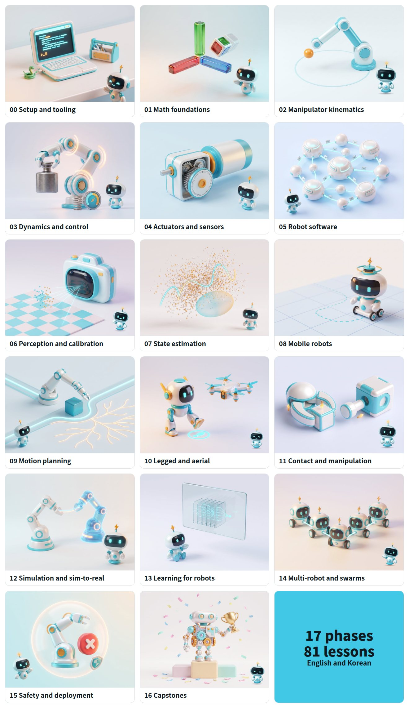
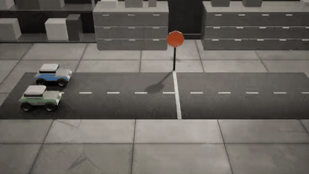
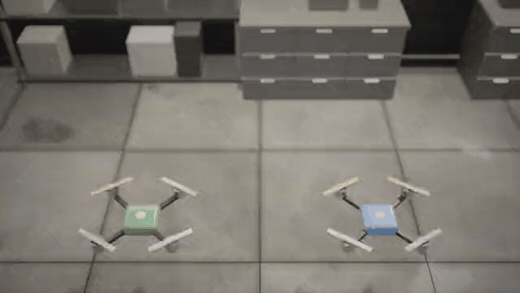
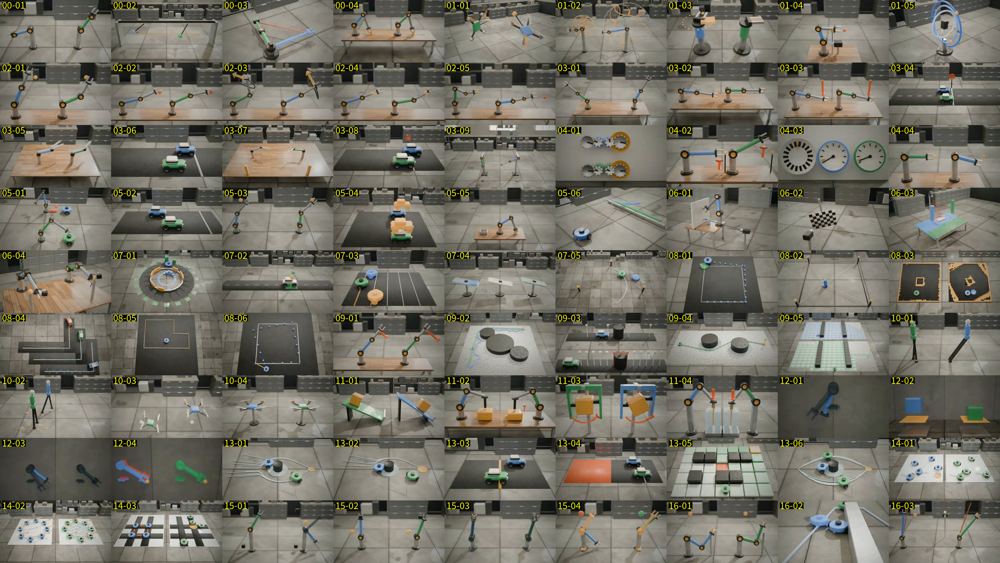

# Robotics Engineering from Scratch

Learn how robots work by building the math and control yourself, in plain numpy, with tests. Then see what the production library does.

**[Read it online](https://robotics-from-scratch.robotics-site.workers.dev)**: every lesson, clip and quiz in the browser, in English or Korean, with progress saved on your device. No install. Or run it locally with the `robo` CLI below.


*Six of the 81 lesson clips. Every motion is computed by that lesson's own code.*

81 lessons, 17 phases, English and Korean. Arms, wheeled and legged robots, drones, perception, planning, learning, fleets and safety. About 15 minutes each. The full list is in [ROADMAP.md](ROADMAP.md).


<details>
<summary>See all 17 phases</summary>



</details>

## What a lesson gives you

- A short "In Plain Words" opening in everyday terms, before any math
- A short rendered clip of a real object (a toy car, a bench arm, a rover, a drone) that acts out the lesson, computed by the lesson's own code
- Diagrams and data figures
- Code that runs, with tests
- A six-question quiz and a one-page checklist you can reuse

Every lesson is simulation only. Nothing sends a command to real hardware.

## Clips

Each lesson opens with a short clip rendered in Blender. The motion comes from the lesson's `code/main.py`, so what you see is the lesson's result, not an illustration of it. Blue is the plain or failing case, green the fixed one. Many lessons have a second clip next to their worked example.

<table>
<tr>
<td width="50%"></td>
<td width="50%"></td>
</tr>
<tr>
<td><em>Lesson 03-04: integral windup, and the clamp that fixes it.</em></td>
<td><em>Lesson 10-03: a drone must tilt before it can move sideways.</em></td>
</tr>
</table>



*All 81 lesson clips, one frame each, labelled by lesson number.*

## In the terminal


*`robo` in the terminal: lessons, quizzes, clip posters and your progress.*

## Start

The quickest start is the [website](https://robotics-from-scratch.robotics-site.workers.dev). To work with the code:

```bash
cd robotics-engineering-from-scratch
pip install -r requirements.txt
python3 scripts/robo.py            # read in the terminal (needs rich)
```

In the terminal, `robo read 03-02` opens a lesson, `robo quiz 03-02` runs a quiz and `robo daily` is a five-question review. Add `--lang ko` for Korean.

## Check the code

```bash
python3 -m pytest phases scripts/tests_robo -q
python3 scripts/check_lessons.py
```

The lesson format is in [LESSON_SPEC.md](LESSON_SPEC.md).

## Limits

- The Korean text was drafted and checked with tooling. No native editor has reviewed it, so corrections are welcome.
- Two `robo` quiz processes at the same moment can undercount XP.

## Contribute

Forks and pull requests are welcome, from a typo to a whole new lesson. Run the two checks above and see [CONTRIBUTING.md](CONTRIBUTING.md).

## License and credits

MIT, see [LICENSE](LICENSE). The lesson shape follows [rohitg00/ai-engineering-from-scratch](https://github.com/rohitg00/ai-engineering-from-scratch) (MIT). The text, code and figures here are original. The Bolt mascot picture below, the 17 phase covers, the social card background and the Bolt animation are AI-generated (Higgsfield), from the Bolt mascot. Models and prompts are in [docs/img/AI-ART.md](docs/img/AI-ART.md). The lesson figures are drawn in code, not generated.

To regenerate the pictures above, run `python3 scripts/readme_roadmap.py`, `node scripts/render_excalidraw.cjs docs/img/roadmap.excalidraw` and `node scripts/readme_shots.cjs cli`.


If the course helps you, a star helps other learners find it.
