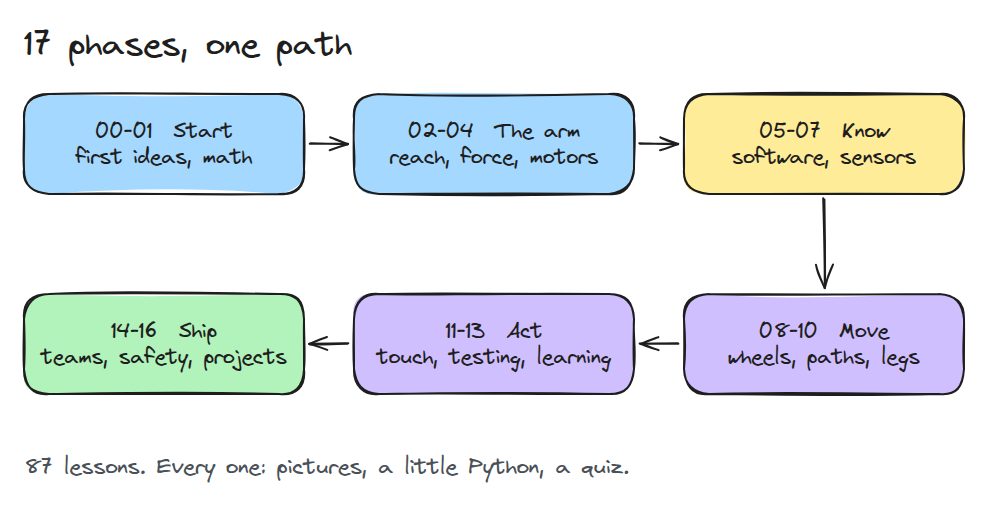
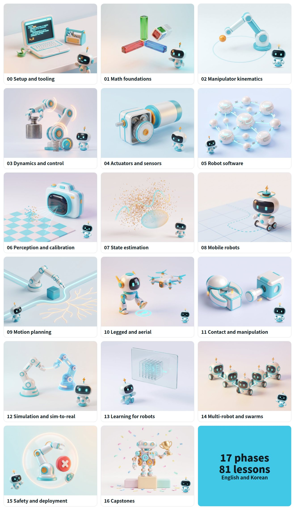
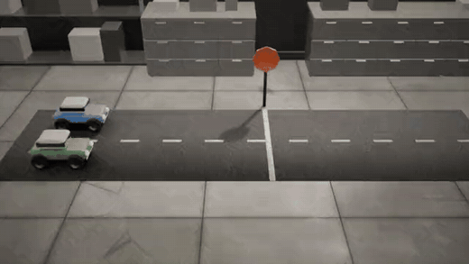
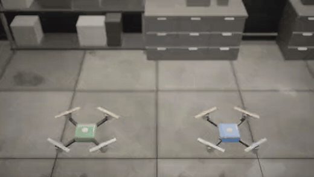
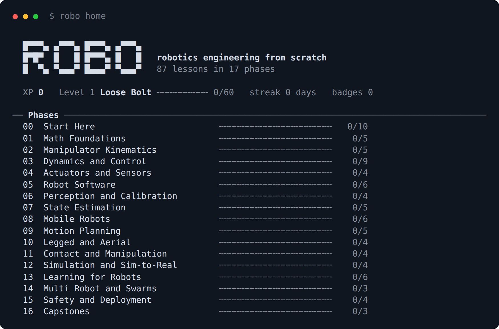
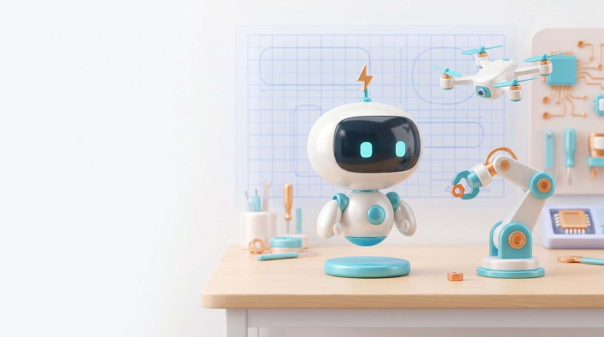

# Robotics Engineering from Scratch

A free, beginner-first course on how robots work. No robotics background needed: you build each idea yourself in small Python programs, watch it move, then see how real tools do it.

**[Start reading online](https://robotics-from-scratch.robotics-site.workers.dev)**, no install. Progress is saved in your browser.


*Every motion here is computed by a lesson's own code.*

87 short lessons (about 15 minutes each) in 17 phases: robot arms, wheeled and walking robots, drones, cameras and sensors, path planning, robot learning, robot teams and safety. Full list: [ROADMAP.md](ROADMAP.md).

## Who this is for

You have never studied robotics. You can write a little Python (variables, loops, functions). You remember high-school math. That is enough. Every new word is explained the first time it appears, and each lesson starts with a short story in everyday words before any math.

## How a robot works, in one picture

Every robot repeats three steps, many times a second:

1. **Sense**: read cameras and other sensors to learn what is happening.
2. **Think**: work out where it is and what to do next.
3. **Act**: send commands to motors so something moves.

The phases follow that loop. Phase 00 starts from zero: what a robot is, points, angles, joints and time steps, one small idea per lesson. Then you learn to describe where things are (phases 01 and 02), then how to make motors move a body (03 to 05), how to sense and estimate (06 and 07), how to drive, plan, walk and fly (08 to 11), and finally how to test, learn, work in teams and stay safe (12 to 16).



<details>
<summary>See all 17 phases</summary>



</details>

## Start in three steps

1. Open the [website](https://robotics-from-scratch.robotics-site.workers.dev) and read [lesson 00-01, What Is a Robot](phases/00-start-here/01-what-is-a-robot/docs/en.md). Nothing to install.
2. When you want to run the code, install Python 3.10 or newer, then:
   ```bash
   git clone https://github.com/joey114132/robotics-engineering-from-scratch
   cd robotics-engineering-from-scratch
   pip install -r requirements.txt
   python3 phases/00-start-here/01-what-is-a-robot/code/main.py
   ```
3. Go in order. Each lesson takes about 15 minutes and names the lessons it builds on. Stuck on a word? Check the [glossary](GLOSSARY.md).

## What a lesson gives you

| Part | What it is |
|---|---|
| In Plain Words | the idea as an everyday story, no math |
| Key Terms | the new words of the lesson, one plain line each |
| Clip | a short 3D animation computed by the lesson's code |
| The Problem, The Concept | what goes wrong, and pictures that show why |
| Build It | the code, small enough to read, with tests |
| Use It | the same thing done with a real library |
| Quiz | six questions to check yourself |

Every lesson runs in simulation only. Nothing here moves real hardware.

## Clips

The clips are computed, not drawn: the motion comes from each lesson's own code. Blue is the failing case, green the fix.

<table>
<tr>
<td width="50%"></td>
<td width="50%"></td>
</tr>
<tr>
<td><em>Lesson 03-04: a car that rolls past its stop line, and the small fix.</em></td>
<td><em>Lesson 10-03: a drone must tilt before it can move sideways.</em></td>
</tr>
</table>

## Read in the terminal



`python3 scripts/robo.py` opens the course in your terminal. `robo read 03-02` opens a lesson, `robo quiz 03-02` runs its quiz, `robo daily` gives five review questions. Add `--lang ko` for Korean.

## Check the code

```bash
python3 -m pytest phases scripts/tests_robo -q
python3 scripts/check_lessons.py
```

## Limits

- The Korean text was drafted and checked with tooling. No native editor has reviewed it, so corrections are welcome.
- Two `robo` quiz processes at the same moment can undercount XP.

## Contribute

Forks and pull requests are welcome, from a typo to a whole new lesson. Run the two checks above and see [CONTRIBUTING.md](CONTRIBUTING.md).

## License and credits

MIT, see [LICENSE](LICENSE). The lesson shape follows [rohitg00/ai-engineering-from-scratch](https://github.com/rohitg00/ai-engineering-from-scratch) (MIT). The text, code and figures here are original. The Bolt mascot picture below, the 17 phase covers, the social card background and the Bolt animation are AI-generated (Higgsfield), from the Bolt mascot. Models and prompts are in [docs/img/AI-ART.md](docs/img/AI-ART.md). The lesson figures are drawn in code, not generated.

To regenerate the pictures above, run `python3 scripts/readme_roadmap.py`, `node scripts/render_excalidraw.cjs docs/img/roadmap.excalidraw` and `node scripts/readme_shots.cjs cli`.



If the course helps you, a star helps other learners find it.
