# Robotics Engineering from Scratch

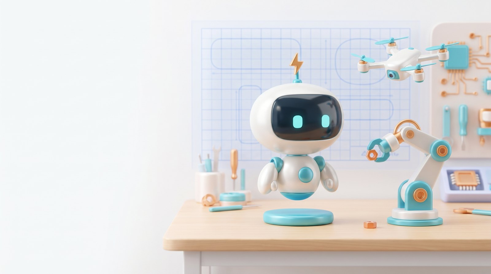

Learn how robots work by building the math and control yourself, in plain numpy, with tests. Then see what the production library does.

81 lessons, 17 phases, English and Korean. Arms, wheeled and legged robots, drones, perception, planning, learning, fleets and safety. About 15 minutes each. The full list is in [ROADMAP.md](ROADMAP.md).

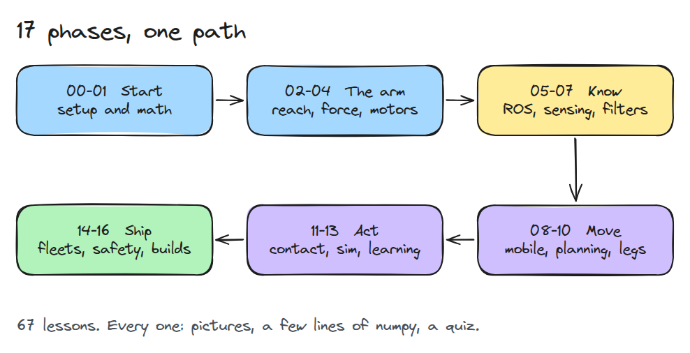

## What a lesson gives you

- A short "In Plain Words" opening in everyday terms, before any math
- An animation and a 3D scene you can orbit, and for some lessons a toy you can drag
- Diagrams and data figures
- Code that runs, with tests
- A six-question quiz and a one-page checklist you can reuse

Every lesson is simulation only. Nothing sends a command to real hardware.

## 3D scenes

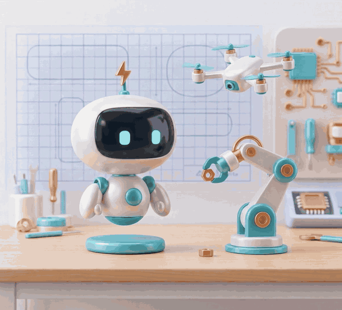

Every lesson has a 3D scene of something real: an arm holding itself up, a quadrotor, a robot finding its way back to the start. Drag to orbit it, move a slider, and watch the lesson's law happen.

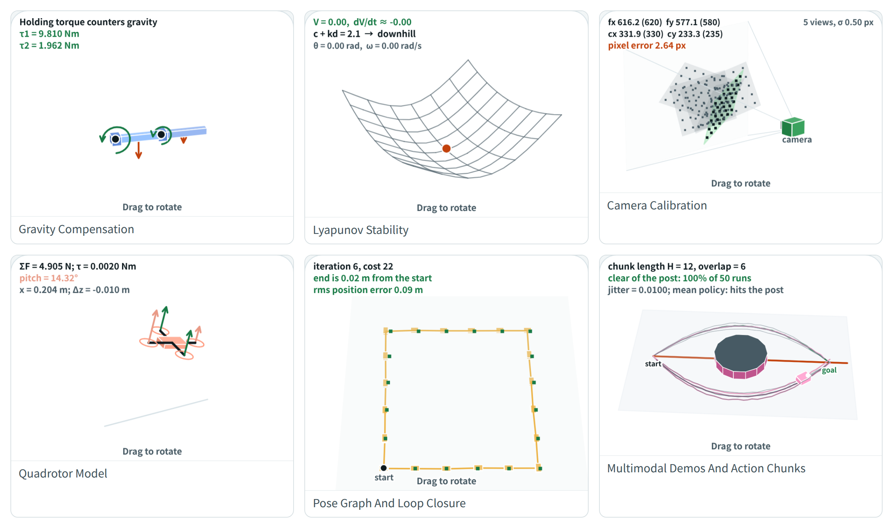

<table>
<tr>
<td width="50%">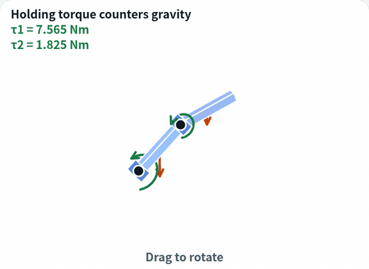</td>
<td width="50%">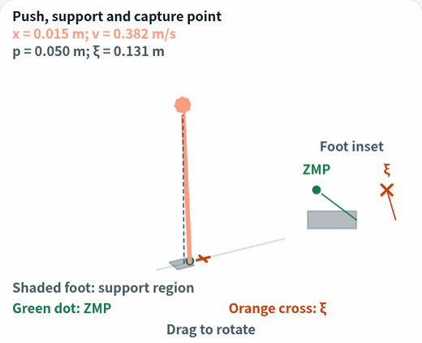</td>
</tr>
<tr>
<td><em>Lesson 03-02: the torque needed to hold the arm still.</em></td>
<td><em>Lesson 10-01: push, support point and capture point.</em></td>
</tr>
</table>

Each lesson also has a 2D animation, and some have a toy you can drag.

<table>
<tr>
<td width="50%">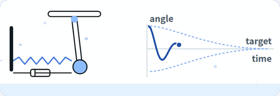</td>
<td width="50%">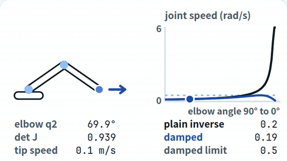</td>
</tr>
<tr>
<td><em>Phase 3 opener: a damped swing settles.</em></td>
<td><em>Lesson 02-04: near full stretch the plain inverse blows up, damped least squares stays bounded.</em></td>
</tr>
</table>

## On a phone and in the terminal

<table>
<tr>
<td width="33%">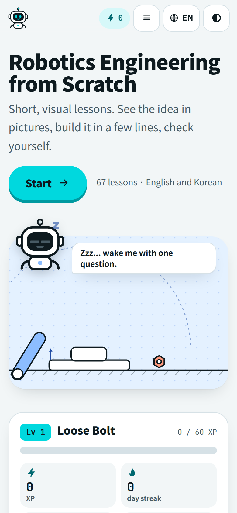</td>
<td width="33%">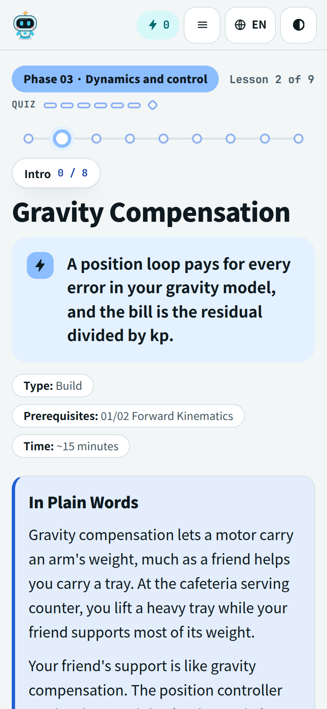</td>
<td width="33%">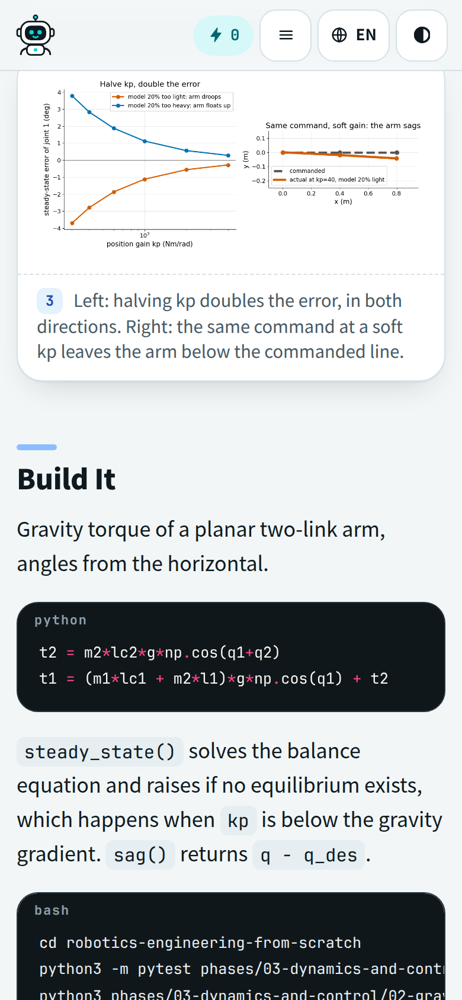</td>
</tr>
<tr>
<td><em>Home, with Bolt.</em></td>
<td><em>Every lesson starts in plain words.</em></td>
<td><em>Figures first, then a few lines of code.</em></td>
</tr>
</table>

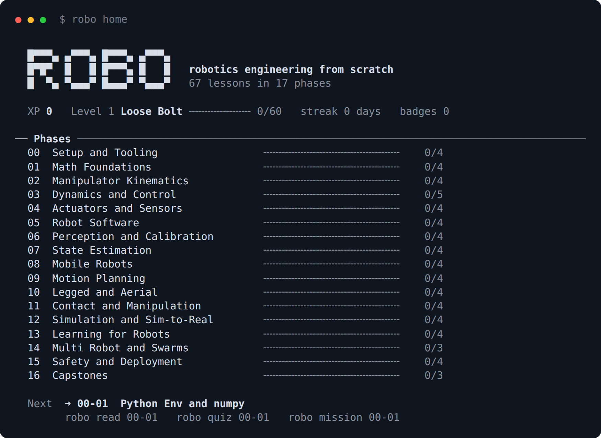

*`robo` in the terminal: same lessons and progress.*

## Start

```bash
cd robotics-engineering-from-scratch
python3 scripts/build_site.py      # build the website
xdg-open site/index.html           # read it (English/Korean, dark mode, quizzes)
python3 scripts/robo.py            # or read in the terminal (needs rich)
```

In the terminal, `robo read 03-02` opens a lesson, `robo quiz 03-02` runs a quiz and `robo daily` is a five-question review. Add `--lang ko` for Korean. Progress carries between the terminal and the website with a progress code on the home page.

## Check the code

```bash
python3 -m pytest phases scripts/tests_robo -q
python3 scripts/check_lessons.py
```

`python3 scripts/build_single.py` bundles everything into one file, `site-single/robotics-from-scratch.html`, for a phone or for sharing. The lesson format is in [LESSON_SPEC.md](LESSON_SPEC.md).

## Limits

- The Korean text was drafted and checked with tooling. No native editor has reviewed it, so corrections are welcome.
- The site caches pages for offline use through a service worker. The one-file bundle cannot, so it relies on the browser cache.
- Two `robo` quiz processes at the same moment can undercount XP.

## Contribute

Forks and pull requests are welcome, from a typo to a whole new lesson. Run the two checks above and see [CONTRIBUTING.md](CONTRIBUTING.md).

## License and credits

MIT, see [LICENSE](LICENSE). The lesson shape follows [rohitg00/ai-engineering-from-scratch](https://github.com/rohitg00/ai-engineering-from-scratch) (MIT). The text, code and figures here are original. The banner picture and the Bolt animation are AI-generated (Higgsfield) from the Bolt mascot, and the lesson figures are not. The animations use GSAP 3.15.0, which keeps its own terms in `scripts/vendor/GSAP-LICENSE.txt`.

To regenerate the pictures above, run `python3 scripts/readme_roadmap.py`, `node scripts/render_excalidraw.cjs docs/img/roadmap.excalidraw` and `node scripts/readme_shots.cjs site|cli|gif|gif3d|gallery3d` after building the site.
