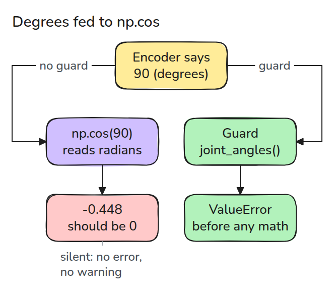
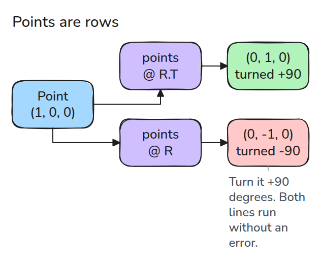
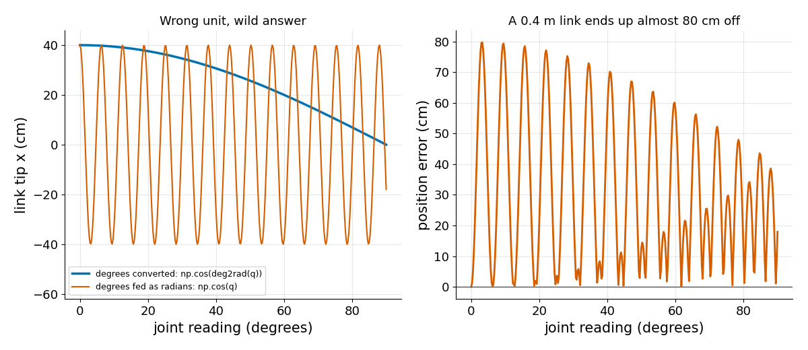

# Python Env and numpy

> numpy never checks units or shapes for you, so a robot program has to check them itself.

**Type:** Build   **Prerequisites:** none   **Time:** ~15 minutes

## In Plain Words

A small arm on a bench has an encoder, a sensor in its joint, that reports the elbow angle as ninety. In degrees a full turn is three hundred sixty, so ninety is a quarter turn and the arm stands up. In radians a full turn is about six point three, so ninety is over fourteen turns.

numpy always assumes radians and never asks. A wrong array shape (its rows and columns) fails the same way: the math still runs. Only a check at the data's entry catches it.

## The Problem

Your arm code finds how far the link tip reaches with `length * np.cos(q)`, where `q` is the joint angle. The encoder driver reports `90` and you pass it straight in. The tip lands 0.45 of a link length from where it should be, with no error. Neither a wrong unit nor a transposed array (rows and columns swapped) stops numpy.

## The Concept

Follow the red box. `np.cos(90)` reads radians: 90 minus fourteen full turns leaves 2.04 radians, about 117 degrees, whose cosine is -0.448 instead of 0. Nothing complains.



*The sensor says 90 degrees but `np.cos` reads 90 radians. A guard, a check where data enters your code, turns the silent error into a loud one.*

Robot data has two things numpy cannot see: a unit and a meaning for each axis. We store N points as rows, shape `(N, 3)`, meaning N rows of x, y, z. A rotation matrix `R` turns one point `p` as `R @ p`. Points stored as rows need `points @ R.T`, where `.T` swaps rows and columns of `R`, because that gives the same numbers.



*Forgetting `.T` does not crash. It rotates the points the other way.*

Turn `(1, 0, 0)`, a point on the x axis, by +90 degrees about z. Seen from above, x lands on y, so expect `(0, 1, 0)`. `rotate_z`, which uses `.T`, gives that. `points @ R` gives `(0, -1, 0)`. Both run, and numpy raises nothing.


*Two arms turn a hand 90° about z toward the amber post. Green uses `rotate_z` and reaches it. Blue leaves out `.T` and swings away.*



*Left: tip position against the reading in degrees. Blue reads degrees correctly, orange reads them as radians. Right: the orange error swings the tip of a 0.4 m link by almost 0.8 m.*

## Build It

`check_shape` stops with a message naming the argument. `looks_like_degrees` is true when any value is above `2 * pi`, about 6.28, one full turn in radians.

```python
def check_shape(x, shape, name="array"):
    a = np.asarray(x, dtype=float)
    if a.ndim != len(shape) or any(s is not None and s != n for s, n in zip(shape, a.shape)):
        raise ValueError(f"{name}: expected shape {shape}, got {a.shape}")
    return a

def looks_like_degrees(q, limit=2 * np.pi):
    return bool(np.max(np.abs(q)) > limit)
```

`joint_angles(q)` calls both and refuses degree-looking values. `rotate_z(points, theta)` checks `(N, 3)` first. A continuous joint, one that can spin past a full turn, needs a larger `limit`.

```bash
cd robotics-engineering-from-scratch
python3 -m pytest phases/00-setup-and-tooling/01-python-env-and-numpy -q
python3 phases/00-setup-and-tooling/01-python-env-and-numpy/code/main.py
```

## Use It

`python3 -m venv .venv` creates a venv, a private folder of packages for one project. Our own advice: one environment per project, versions recorded with `pip freeze`, `np.testing.assert_allclose` in tests, and units in variable names (`q_rad`, `p_m`).

Sources: https://docs.python.org/3/library/venv.html (only `python3 -m venv .venv` and the `.venv` convention), https://numpy.org/doc/stable/user/basics.broadcasting.html (only broadcasting).

## Ship It

`outputs/skill-numpy-robot-guards.md` reviews a robot script for missing shape and unit guards.

## Exercises

1. Add a `check_finite` guard that rejects NaN and infinity in a trajectory.
2. Make `looks_like_degrees` take a per-joint limit vector.
3. Show that `points @ R` rotates by `-theta`, using a test.
