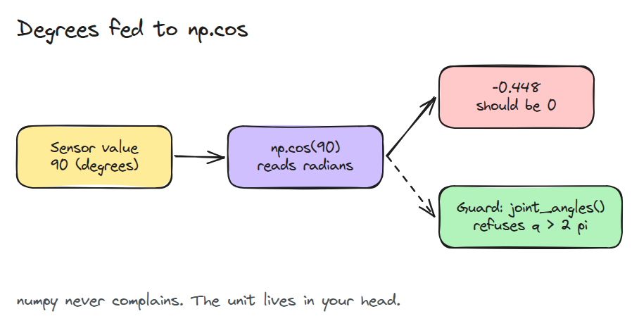
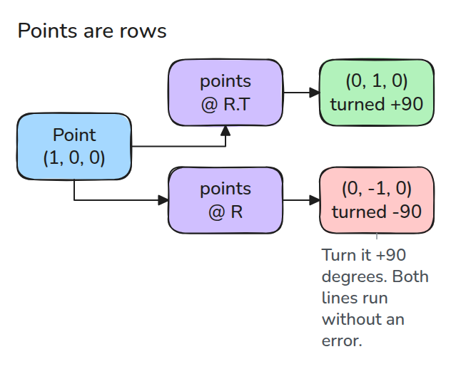
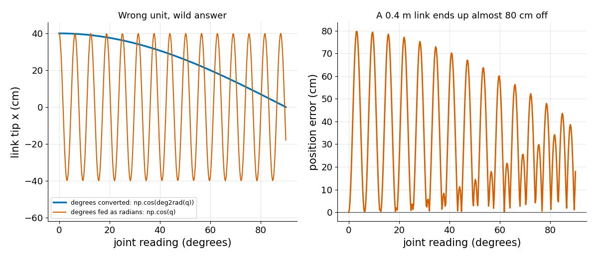

# Python Env and numpy

> See how a wrong unit or array shape quietly gives a wrong answer, and how to catch it.

**Type:** Build   **Prerequisites:** none   **Time:** ~15 minutes

## In Plain Words

A small arm has an encoder, a sensor in its joint, that reports the elbow angle as ninety. In degrees that is a quarter turn. In radians it is over fourteen turns.

numpy always assumes radians and never asks. A wrong array shape fails the same way: the math still runs. Only a check where data enters your code catches it.

## Key Terms

- **Radian**: a unit of angle where one full turn is about 6.28. Degrees use 360 for a full turn.
- **Array shape**: how many rows and columns an array has, such as 5 rows by 3 columns.
- **Rotation matrix**: a small grid of numbers that turns a point around an axis.
- **Transpose (`.T`)**: swaps the rows and columns of a matrix.
- **Guard**: a check where data enters your code that stops bad data with a clear error.
- **venv**: a private folder of packages for one project.

## The Problem

A robot arm's sensor says the elbow is at `90` degrees, and you pass that to `length * np.cos(q)` (`q` is the joint angle). The tip lands 0.45 of a link length off, with no error.

## The Concept

A robot acts on any number it gets, so a wrong unit moves a real arm wrongly.

Follow the red box. `np.cos(90)` reads radians: 90 minus fourteen full turns leaves 2.04 radians (about 117 degrees), whose cosine is -0.448, not 0.



*The sensor says 90 degrees but `np.cos` reads 90 radians.*

numpy cannot see a unit or the meaning of an axis. We store N points as rows, shape `(N, 3)`. A rotation matrix `R` turns one point as `R @ p`. Points stored as rows need `points @ R.T`.



*Without `.T` it turns the other way.*

Turn `(1, 0, 0)` by +90 degrees about z. Seen from above, x lands on y, so expect `(0, 1, 0)`. `rotate_z` gives that. `points @ R` gives `(0, -1, 0)`.


*Green uses `rotate_z` and reaches the amber post. Blue leaves out `.T` and swings away.*



*Left: tip position against the reading; orange reads degrees as radians. Right: that error swings a 0.4 m link tip by almost 0.8 m.*

## Build It

`check_shape` stops with a message naming the argument. `looks_like_degrees` is true when a value exceeds `2 * pi`.

```python
def check_shape(x, shape, name="array"):
    a = np.asarray(x, dtype=float)
    if a.ndim != len(shape) or any(s is not None and s != n for s, n in zip(shape, a.shape)):
        raise ValueError(f"{name}: expected shape {shape}, got {a.shape}")
    return a

def looks_like_degrees(q, limit=2 * np.pi):
    return bool(np.max(np.abs(q)) > limit)
```

`joint_angles(q)` calls both. `rotate_z(points, theta)` checks `(N, 3)` first. A joint that can spin past a full turn needs a larger `limit`.

```bash
cd robotics-engineering-from-scratch
python3 -m pytest phases/00-setup-and-tooling/01-python-env-and-numpy -q
python3 phases/00-setup-and-tooling/01-python-env-and-numpy/code/main.py
```

## Use It

`python3 -m venv .venv` creates a venv. Our advice: one venv per project, `np.testing.assert_allclose` in tests, units in names (`q_rad`).

Sources: https://docs.python.org/3/library/venv.html (venv only), https://numpy.org/doc/stable/user/basics.broadcasting.html (broadcasting only).

## Ship It

`outputs/skill-numpy-robot-guards.md` reviews a robot script for missing shape and unit guards.

## Exercises

1. Add a `check_finite` guard that rejects NaN and infinity in a trajectory.
2. Make `looks_like_degrees` take a per-joint limit vector.
3. Test that `points @ R` rotates by `-theta`.
