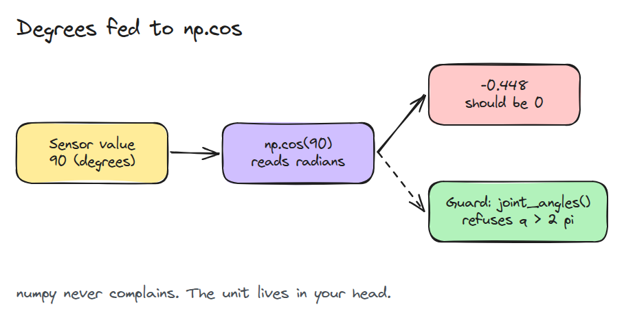
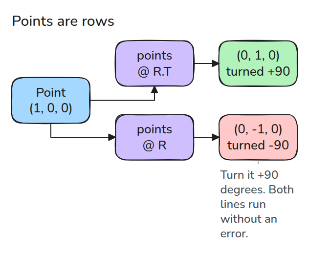
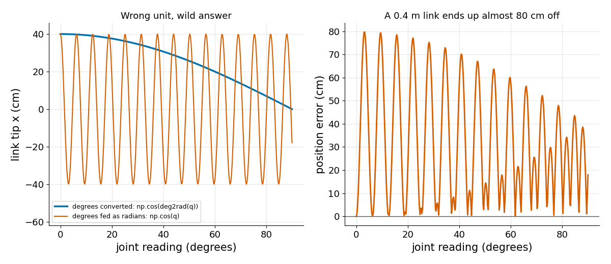

# Python 환경과 numpy

> numpy는 단위도 shape도 검사해 주지 않으므로 로봇 프로그램이 직접 검사해야 합니다.

**유형:** 만들기   **선수 지식:** 없음   **시간:** 약 15분

## 쉽게 말하면

요리법에 적힌 소금 양을 숟가락 대신 컵으로 재면 국이 너무 짜져요. 적힌 양은 같아도 단위를 다르게 읽어서 넣는 양이 달라진 거예요.

로봇의 각도도 degrees를 radians로 읽으면 다른 방향을 가리켜요. 배열은 shape이 맞아야 각 값이 제자리에 쓰여요. 계산 자체는 끝까지 될 수 있어서 입력에서 단위와 shape을
확인해야 해요.

## 문제

encoder driver가 관절 값으로 `90`을 보고합니다. 이 값을 `np.cos`에 넣으면 링크 끝이 링크 길이의 0.45배만큼 어긋나는데도 오류나 경고가 없습니다.

numpy는 모든 숫자를 라디안으로 읽고 모든 배열을 숫자 덩어리로 봅니다. 그래서 단위 실수나 전치된 배열도 정상 실행과 똑같아 보입니다.

## 개념



*센서는 90도라고 하는데 `np.cos`는 90 라디안으로 읽습니다. 경계에 가드를 두면 조용한 오류가 눈에 띄는 오류가 됩니다.*

로봇 데이터에는 numpy가 보지 못하는 것이 둘 있습니다. 단위(라디안, 미터)와 각 축의 의미입니다. 이 과정에서는 점을 행으로 저장해 shape을 `(N, 3)`으로 두고 회전은 `points @ R.T`로 적용합니다.



*`.T`를 빼먹어도 프로그램은 멈추지 않습니다. 점이 반대 방향으로 돌 뿐입니다.*



*같은 값을 두 가지로 해석한 결과입니다. 틀린 해석은 0.4 m 링크의 끝을 0.8 m 가까이 흔듭니다.*

## 만들기

작은 가드 세 개입니다. 모두 인자 이름을 넣은 메시지로 실패합니다.

```python
def check_shape(x, shape, name="array"):
    a = np.asarray(x, dtype=float)
    if a.ndim != len(shape) or any(s is not None and s != n for s, n in zip(shape, a.shape)):
        raise ValueError(f"{name}: expected shape {shape}, got {a.shape}")
    return a

def looks_like_degrees(q, limit=2 * np.pi):
    return bool(np.max(np.abs(q)) > limit)
```

`joint_angles(q)`는 두 가드를 모두 부르고 도처럼 보이는 벡터를 거부합니다. `rotate_z(points, theta)`는 먼저 `(N, 3)`을 확인합니다. continuous 관절은 `2 * pi`를 넘을 수 있으므로 그런 관절에는 `limit`을 키웁니다.

```bash
cd robotics-engineering-from-scratch
python3 -m pytest phases/00-setup-and-tooling/01-python-env-and-numpy -q
python3 phases/00-setup-and-tooling/01-python-env-and-numpy/code/main.py
```

## 실제 도구로 보기

`python3 -m venv .venv`로 가상환경을 만듭니다. 이 명령과 `.venv` 디렉터리 이름은 Python venv 문서에 나옵니다. 나머지는 이 레슨의 조언입니다.

프로젝트마다 가상환경을 하나씩 만들고 `pip freeze`로 버전을 기록합니다. 테스트에는 `np.testing.assert_allclose`를 쓰고 변수 이름에 단위(`q_rad`, `p_m`)를 붙입니다.

출처: https://docs.python.org/3/library/venv.html (`python3 -m venv .venv`와 `.venv` 관례만), https://numpy.org/doc/stable/user/basics.broadcasting.html (broadcasting만).

## 결과물

`outputs/skill-numpy-robot-guards.md`는 로봇 스크립트에서 빠진 shape 가드와 단위 가드를 찾아 줍니다.

## 연습 문제

1. trajectory의 NaN과 무한대를 거부하는 `check_finite` 가드를 추가하세요.
2. `looks_like_degrees`가 관절별 limit 벡터를 받게 바꾸세요.
3. `points @ R`이 `-theta`만큼 회전시킨다는 것을 테스트로 보이세요.
