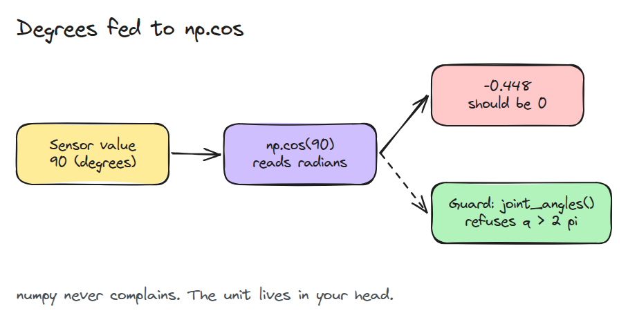
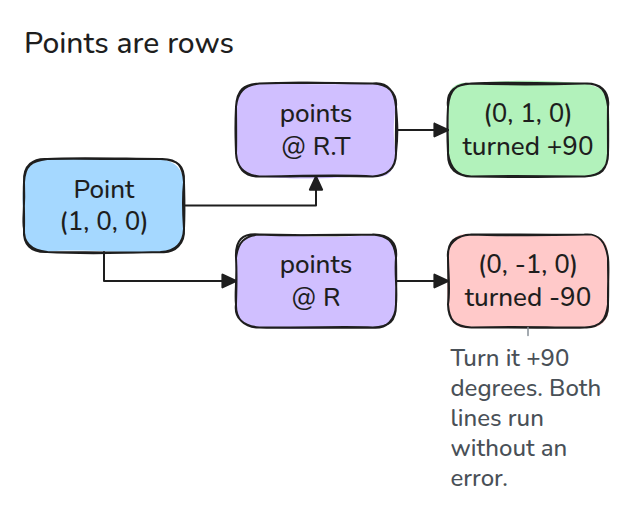
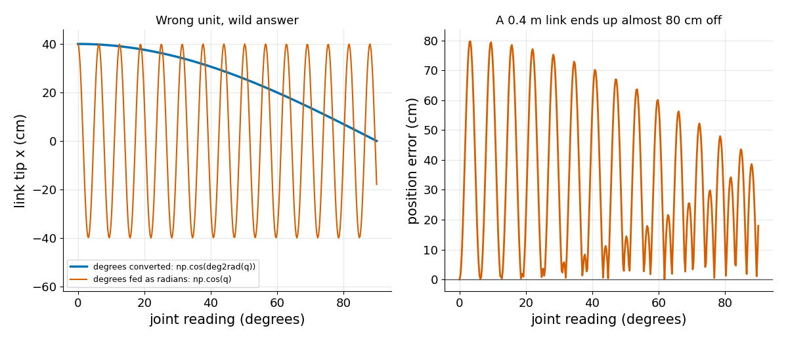

# Python 환경과 numpy

> 단위나 배열 모양이 틀리면 왜 조용히 틀린 답이 나오는지, 그리고 어떻게 잡는지 알게 됩니다.

**유형:** 만들기   **선수 지식:** 없음   **시간:** 약 15분

## 쉽게 말하면

작은 로봇 팔의 관절 안에는 encoder라는 센서가 있어서 팔꿈치 각도를 구십이라고 알려 줘요. degrees에서는 사분의 일 바퀴예요. radians에서는 열네 바퀴가 넘어요.

numpy는 언제나 radians라고 가정하고 단위를 묻지 않아요. 배열의 shape이 틀려도 계산은 그대로 돌아가요. 데이터가 코드로 들어오는 자리에서 검사해야만 잡을 수 있어요.

## 핵심 용어

- **Radian**: 각도의 단위로 한 바퀴가 약 6.28입니다. degrees는 한 바퀴를 360으로 셉니다.
- **Array shape**: 배열의 행과 열이 몇 개인지입니다. 예를 들어 5행 3열입니다.
- **Rotation matrix**: 점을 어떤 축 둘레로 돌리는 작은 숫자 표입니다.
- **Transpose (`.T`)**: 행렬의 행과 열을 맞바꿉니다.
- **Guard**: 데이터가 코드로 들어오는 자리에서 나쁜 데이터를 분명한 오류로 멈추게 하는 검사입니다.
- **venv**: 프로젝트 하나를 위한 패키지 전용 폴더입니다.

## 문제

로봇 팔의 센서가 팔꿈치가 90도에 있다고 알려 줍니다. 이 값을 `length * np.cos(q)`에 그대로 넣었습니다(`q`는 관절 각도입니다).

링크 끝이 링크 길이의 0.45배만큼 어긋나는데도 오류가 없습니다. 단위가 틀려도, 행과 열이 바뀐 배열이어도 numpy는 멈추지 않습니다.

## 개념

로봇은 받은 숫자를 그대로 따라 움직이므로 단위가 틀리면 실제 팔이 엉뚱한 곳으로 갑니다.

빨간 상자를 따라가 보세요. `np.cos(90)`은 90을 radians로 읽습니다. 90에서 온전한 열네 바퀴를 빼면 2.04 radians, 약 117 degrees가 남고 그 cosine은 0이 아니라 -0.448입니다. 아무 경고도 없습니다.



*센서는 90 degrees라고 하는데 `np.cos`는 90 radians로 읽습니다. guard는 조용한 오류를 눈에 띄는 오류로 바꿉니다.*

로봇 데이터에는 numpy가 보지 못하는 것이 둘 있습니다. 단위와 각 축의 의미입니다. 점 N개를 행으로 저장해 shape을 `(N, 3)`으로 두면 점마다 x, y, z 한 행이 생깁니다.

rotation matrix `R`은 점 `p` 하나를 `R @ p`로 돌립니다. 점을 행으로 저장했다면 같은 숫자가 나오도록 `points @ R.T`를 써야 합니다.



*`.T`를 빼먹어도 프로그램은 멈추지 않습니다. 점이 반대 방향으로 돌 뿐입니다.*

x축 위의 점 `(1, 0, 0)`을 z축 둘레로 +90 degrees 돌려 봅니다. 위에서 보면 x가 y 위로 가므로 `(0, 1, 0)`이 나와야 합니다. `.T`를 쓴 `rotate_z`가 그 값을 줍니다.

`points @ R`은 `(0, -1, 0)`을 줍니다. 두 줄 모두 실행되고 numpy는 아무것도 알리지 않습니다.


*팔 두 대가 손을 z축 둘레로 90 degrees 돌려 주황색 기둥으로 보냅니다. 초록은 `rotate_z`를 써서 닿고 파랑은 `.T`를 빼서 반대로 돕니다.*



*왼쪽은 degrees로 잰 센서 값에 따른 링크 끝 위치입니다. 파랑은 degrees로 바르게 읽은 것이고 주황은 같은 값을 radians로 읽은 것입니다. 오른쪽에서는 주황의 오차가 0.4 m 링크 끝을 0.8 m 가까이 흔듭니다.*

## 만들기

`check_shape`는 인자 이름을 넣은 메시지와 함께 멈춥니다. `looks_like_degrees`는 값이 `2 * pi`(radians로 한 바퀴)를 넘으면 참입니다.

```python
def check_shape(x, shape, name="array"):
    a = np.asarray(x, dtype=float)
    if a.ndim != len(shape) or any(s is not None and s != n for s, n in zip(shape, a.shape)):
        raise ValueError(f"{name}: expected shape {shape}, got {a.shape}")
    return a

def looks_like_degrees(q, limit=2 * np.pi):
    return bool(np.max(np.abs(q)) > limit)
```

`joint_angles(q)`는 두 guard를 부르고 degrees처럼 보이는 값을 거부합니다. `rotate_z(points, theta)`는 먼저 `(N, 3)`을 확인합니다. 한 바퀴를 넘게 도는 continuous 관절에는 `limit`을 더 크게 잡습니다.

```bash
cd robotics-engineering-from-scratch
python3 -m pytest phases/00-setup-and-tooling/01-python-env-and-numpy -q
python3 phases/00-setup-and-tooling/01-python-env-and-numpy/code/main.py
```

## 실제 도구로 보기

`python3 -m venv .venv`는 venv를 만듭니다. 이 명령과 `.venv` 이름은 Python venv 문서에 나옵니다.

나머지는 이 레슨의 조언입니다. 프로젝트마다 가상환경을 하나씩 만들고 `pip freeze`로 버전을 기록합니다. 테스트에는 `np.testing.assert_allclose`를 쓰고 변수 이름에 단위(`q_rad`, `p_m`)를 붙입니다.

출처: https://docs.python.org/3/library/venv.html (`python3 -m venv .venv`와 `.venv` 관례만), https://numpy.org/doc/stable/user/basics.broadcasting.html (broadcasting만).

## 결과물

`outputs/skill-numpy-robot-guards.md`는 로봇 스크립트에서 빠진 shape guard와 단위 guard를 찾아 줍니다.

## 연습 문제

1. trajectory의 NaN과 무한대를 거부하는 `check_finite` guard를 추가하세요.
2. `looks_like_degrees`가 관절별 limit 벡터를 받게 바꾸세요.
3. `points @ R`이 `-theta`만큼 회전시킨다는 것을 테스트로 보이세요.
