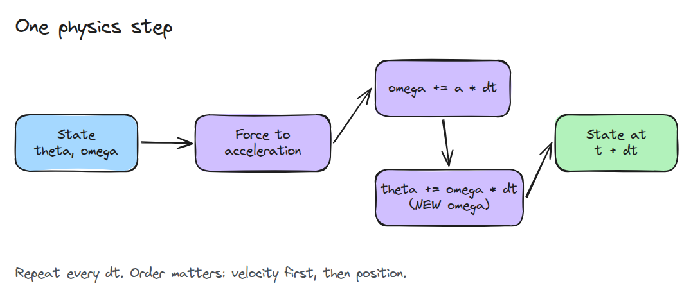
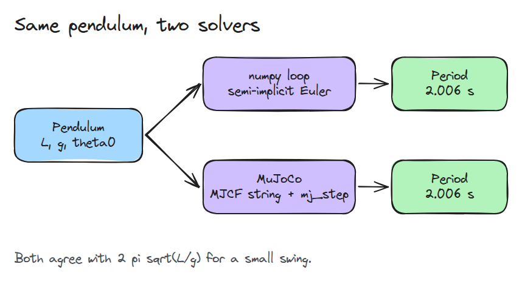
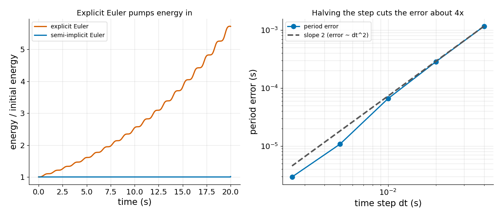

# MuJoCo Hello World

> Learn how a simulator moves things in tiny time steps, why a wrong step adds energy out of nowhere, and the one-line fix.

**Type:** Build   **Prerequisites:** 00/01 Python Env and numpy   **Time:** ~15 minutes

## In Plain Words

Hang a ball on a rod like a swing and let go. Without friction it never rises above where you let go.

A computer moves the ball in tiny time steps. Each step first changes the speed, then moves the ball. If it moves the ball with the old speed, every step adds a little energy and the swing grows. Using the new speed fixes it.

## Key Terms

- **Simulation**: a program that predicts how something moves by repeating one small time step many times.
- **Time step (`dt`)**: how far the simulation jumps forward in time on each step, here a few hundredths of a second.
- **Pendulum**: a weight on a rod that swings under gravity; the simplest test for a simulator.
- **Period**: the time for one full swing out and back.
- **Explicit / semi-implicit Euler**: two ways to take a step. Explicit moves with the old speed; semi-implicit moves with the new one.
- **MuJoCo**: a free physics engine, a ready-made simulator we compare our loop against.

## The Problem

You copy a physics loop and run a pendulum. It swings higher each time until it spins over the top. Only two lines are in the wrong order.

## The Concept

Robots are tested in simulation first, so a simulator that invents energy misleads you. An engine repeats these boxes every time step.



*Acceleration changes the speed, and the new speed moves the position. Moving with the old speed is explicit Euler.*

`theta` is the swing angle in radians, `omega` the angular speed, `L` the rod length and `g` gravity (9.81). Gravity changes the speed by `-(g/L) sin(theta)` per second.

Each explicit step multiplies the swing's energy by about `1 + (g/L) dt^2`, just above one. Release at 0.5 rad and run 10 s: semi-implicit stays at 0.50 rad, explicit climbs to 2.46 rad.


*1.8 times real speed. Amber line: release height. Blue (explicit, `dt` 0.04 s) climbs far above it, small dark blue (explicit, `dt` 0.01 s) climbs slowly, green (semi-implicit) stays on it.*



*Our loop and MuJoCo give the same period.*



*Left: explicit Euler's energy climbs. Right: halving `dt` cuts the period error to about a quarter.*

## Build It

The only difference between the two schemes is which `omega` moves the angle.

```python
def step(theta, omega, dt, L=1.0, scheme="semi"):
    omega_new = omega - dt * (G / L) * np.sin(theta)
    return theta + dt * (omega_new if scheme == "semi" else omega), omega_new

def simulate(theta0, dt, seconds, L=1.0, scheme="semi"):
    theta, omega, out = theta0, 0.0, [theta0]
    for _ in range(int(round(seconds / dt))):
        theta, omega = step(theta, omega, dt, L, scheme)
        out.append(theta)
    return np.array(out)
```

```bash
cd robotics-engineering-from-scratch
python3 -m pytest phases/00-setup-and-tooling/02-mujoco-hello-world -q
python3 phases/00-setup-and-tooling/02-mujoco-hello-world/code/main.py
```

## Use It

`mujoco_period()` builds the same pendulum in MJCF (MuJoCo's XML model format) and steps it with `mujoco.mj_step`. The two periods agree within 0.5% (tested). MuJoCo's default `Euler` integrator is semi-implicit.

Sources: https://mujoco.readthedocs.io/en/stable/XMLreference.html

## Ship It

`outputs/skill-sim-sanity-check.md` is a checklist for trusting a new simulation: period, energy and step size.

## Exercises

1. Add damping (a slowing force) to `step` and check that the energy now falls.
2. Find the largest `dt` that keeps the period error under 1%.
3. Change `L` in the MJCF string and confirm the period scales with `sqrt(L)`.
