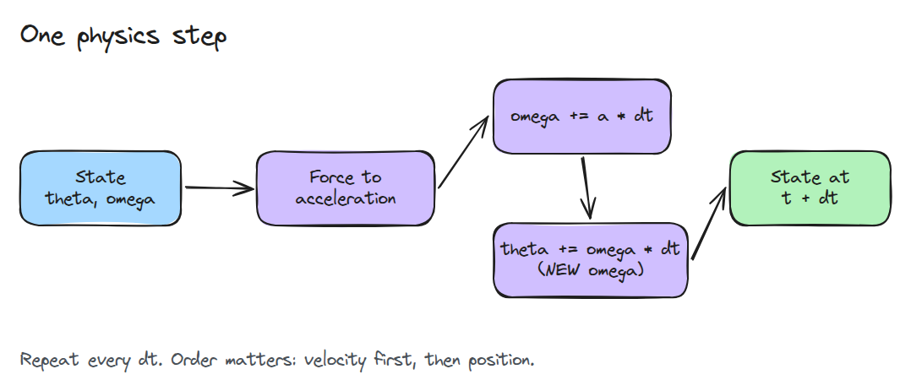
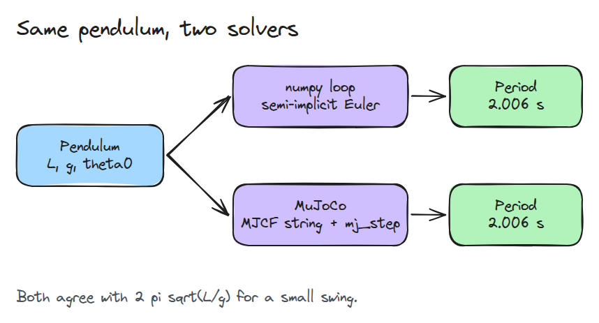
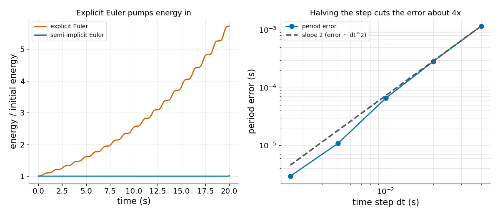

# MuJoCo Hello World

> A simulator is a loop that turns forces into a new state every `dt`, so write one before you trust one.

**Type:** Build   **Prerequisites:** 00/01 Python Env and numpy   **Time:** ~15 minutes

## In Plain Words

A playground swing trades height for speed as it falls, then speed for height as it rises. Without friction or
another push, it should not climb higher on every trip.

A simulation can invent that extra energy if it moves the swing using an old speed while updating speed
separately. Updating speed first and using that new speed to move changes the result. The order of those
updates changes how the simulated energy behaves over repeated swings.

## The Problem

You copy a physics loop from a forum, run a pendulum, and watch it swing a little higher every cycle until it spins. Nothing crashed and the equations look right. The only thing wrong is the order of two lines in the time step.

## The Concept



*Acceleration changes velocity, and the new velocity moves the position. Using the old velocity instead is explicit Euler.*

A physics engine repeats that step. The pendulum is the smallest case: `omega' = -(g/L) sin(theta)`, and for a small swing the period is `2 pi sqrt(L/g)`.



*We solve one pendulum twice, once with our loop and once with MuJoCo, and compare the periods.*



*Left: explicit Euler adds energy every swing. Right: halving `dt` cuts the period error about four times.*

## Build It

One step, then a loop. The only difference between the two schemes is which `omega` moves the angle.

```python
def step(theta, omega, dt, L=1.0, scheme="semi"):
    omega_new = omega - dt * (G / L) * np.sin(theta)
    return theta + dt * (omega_new if scheme == "semi" else omega), omega_new

def simulate(theta0, dt, seconds, L=1.0, scheme="semi"):
    theta, omega, out = theta0, 0.0, [theta0]
    for _ in range(int(round(seconds / dt))):
        theta, omega = step(theta, omega, dt, L, scheme)
        out.append(theta)
    return np.array(out)
```

`measure_period` finds upward zero crossings and interpolates inside the step.

```bash
cd robotics-engineering-from-scratch
python3 -m pytest phases/00-setup-and-tooling/02-mujoco-hello-world -q
python3 phases/00-setup-and-tooling/02-mujoco-hello-world/code/main.py
```

## Use It

`mujoco_period()` builds the same pendulum from an inline MJCF string and calls `mujoco.mj_step`. Its period agrees with ours to within 0.5% (tested, skipped if MuJoCo is missing). The MuJoCo XML reference lists `integrator` with default `Euler`, described as semi-implicit Euler; the docs also recommend `implicitfast`.

Sources: https://mujoco.readthedocs.io/en/stable/XMLreference.html

## Ship It

`outputs/skill-sim-sanity-check.md` is a checklist for trusting a new simulation: period, energy and step size.

## Exercises

1. Add damping to `step` and check that the energy now falls.
2. Find the largest `dt` at which the period error stays under 1%.
3. Change `L` in the MJCF string and confirm the period scales with `sqrt(L)`.
