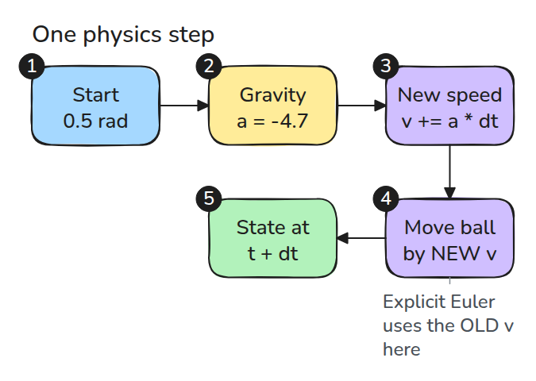
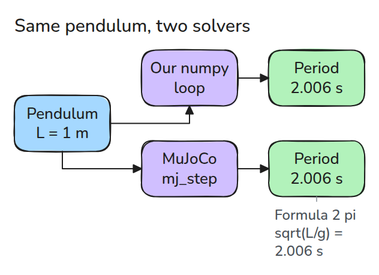
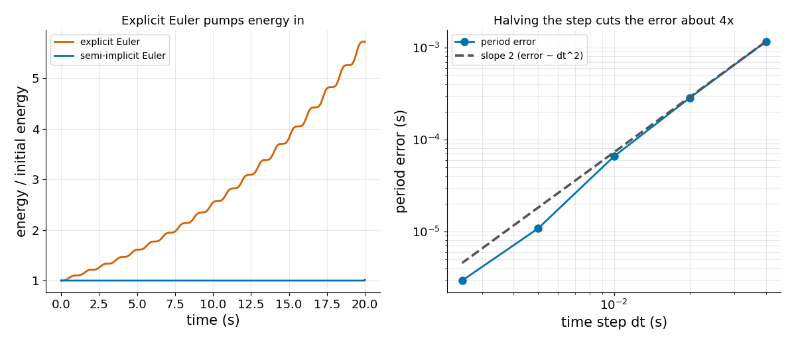

# MuJoCo Hello World

> simulator는 `dt`마다 힘을 새 상태로 바꾸는 반복문입니다. 믿기 전에 하나를 직접 써 보세요.

**유형:** 만들기   **선수 지식:** 00/01 Python 환경과 numpy   **시간:** 약 15분

## 쉽게 말하면

공을 막대에 매달아 놀이터 그네처럼 만들고 옆에서 놓아 보세요. 마찰이 없으면 놓은 곳보다 높이 올라가지는 않아요.

simulation은 공을 `dt`초짜리 작은 시간 스텝으로 나눠 움직여요. 한 스텝마다 속도를 바꾸고 나서 공을 옮겨요.
속도를 바꾸기 전 값으로 옮기면 공이 힘보다 한 스텝 늦어져서 스텝마다 에너지가 조금씩 더해져요. 바뀐 새 속도로 옮기면 그 늦음이 없어져요.

## 문제

forum에서 물리 반복문을 가져와 진자를 돌렸습니다. 진자는 막대 끝에 달려 흔들리는 추입니다. 한 번 흔들릴 때마다 조금씩 높이 올라가다가 결국 한 바퀴를 돕니다. 프로그램은 멈추지 않았고 식도 맞아 보입니다. 틀린 것은 시간 스텝 안에서 두 줄의 순서뿐입니다.

## 개념

상자를 순서대로 읽어 보세요. 엔진은 이 단계를 시간 스텝 `dt`마다 되풀이합니다.



*가속도가 속도를 바꾸고 새 속도가 위치를 움직입니다. 옛 속도로 위치를 움직이면 explicit Euler입니다.*

semi-implicit Euler는 도해의 반복문 그대로입니다. 새 속도를 먼저 구하고 그 속도로 움직입니다. explicit Euler는 옛 속도로 움직입니다.

진자가 가장 작은 시험대입니다. `theta`는 곧게 매달린 상태에서 잰 각도(radians)이고 `omega`는 각속도, `L`은 막대 길이, `g`는 중력(9.81)입니다.
중력 때문에 `omega' = -(g/L) sin(theta)`가 되고 `omega`가 바뀌는 비율은 옆으로 당기는 힘 `sin(theta)`를 따릅니다. 작게 흔들 때 주기, 곧 한 번 왕복하는 시간은 `2 pi sqrt(L/g)`입니다.

explicit 스텝 하나는 작게 흔드는 진자의 에너지에 약 `1 + (g/L) dt^2`를 곱합니다. 1보다 조금 큰 값이고 `L` = 1 m, `dt` = 0.04초이면 1.016입니다.
이 곱셈이 스텝마다 쌓여서 흔들릴 때마다 조금씩 높이 올라갑니다. 공을 0.5 rad에서 놓고 10초를 돌립니다.

semi-implicit Euler는 0.50 rad에 머뭅니다. explicit Euler는 2.46 rad까지 올라가 거의 다섯 배 높아집니다. `dt` = 0.01초에서도 0.78 rad에 닿습니다.


*진자 세 개를 1.8배 빠르게 재생합니다. 주황색 선은 놓은 높이입니다. 파랑(explicit Euler, `dt` 0.04초)은 선보다 훨씬 높이 올라가고 연한 파랑(explicit Euler, `dt` 0.01초)은 천천히 오릅니다. 초록(semi-implicit Euler)은 선에 머뭅니다.*

같은 진자 하나를 두 solver, 곧 우리 반복문과 물리 엔진 MuJoCo로 풉니다.



*우리 반복문과 MuJoCo는 같은 주기를 줍니다.*



*왼쪽에서는 explicit Euler의 에너지가 올라가는 모습을 보세요. 오른쪽은 `dt`를 절반으로 줄이면 정확한 주기와 비교한 주기 오차가 약 4분의 1이 되는 모습입니다.*

## 만들기

스텝 하나와 반복문입니다. 두 방식의 차이는 어느 `omega`가 각도를 움직이느냐뿐입니다.

```python
def step(theta, omega, dt, L=1.0, scheme="semi"):
    omega_new = omega - dt * (G / L) * np.sin(theta)
    return theta + dt * (omega_new if scheme == "semi" else omega), omega_new

def simulate(theta0, dt, seconds, L=1.0, scheme="semi"):
    theta, omega, out = theta0, 0.0, [theta0]
    for _ in range(int(round(seconds / dt))):
        theta, omega = step(theta, omega, dt, L, scheme)
        out.append(theta)
    return np.array(out)
```

`measure_period`는 각도가 위로 0을 지나는 순간을 찾고 스텝 안에서 보간합니다. 두 순간 사이의 시간이 주기 하나입니다.

```bash
cd robotics-engineering-from-scratch
python3 -m pytest phases/00-setup-and-tooling/02-mujoco-hello-world -q
python3 phases/00-setup-and-tooling/02-mujoco-hello-world/code/main.py
```

## 실제 도구로 보기

`mujoco_period()`는 inline MJCF 문자열(MuJoCo의 XML 모델 형식)로 같은 진자를 만들고 `mujoco.mj_step`을 부릅니다.

주기는 우리 값과 0.5% 안에서 일치합니다(테스트가 확인하고 MuJoCo가 없으면 건너뜁니다). MuJoCo XML 레퍼런스에서 `integrator`의 기본값은 `Euler`이고 semi-implicit Euler라고 설명합니다. 문서는 `implicitfast`도 권합니다.

출처: https://mujoco.readthedocs.io/en/stable/XMLreference.html

## 결과물

`outputs/skill-sim-sanity-check.md`는 새 simulation을 믿기 전에 주기, 에너지, 스텝 크기를 확인하는 체크리스트입니다.

## 연습 문제

1. `step`에 damping을 넣고 에너지가 줄어드는지 확인하세요.
2. 주기 오차가 1% 아래로 유지되는 가장 큰 `dt`를 찾으세요.
3. MJCF 문자열의 `L`을 바꾸고 주기가 `sqrt(L)`에 비례하는지 확인하세요.
