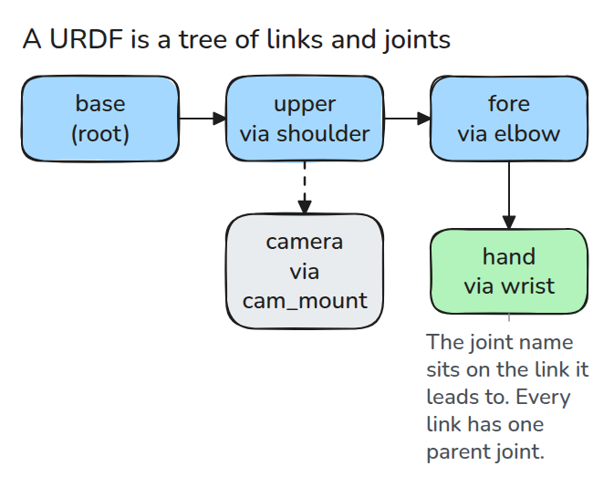
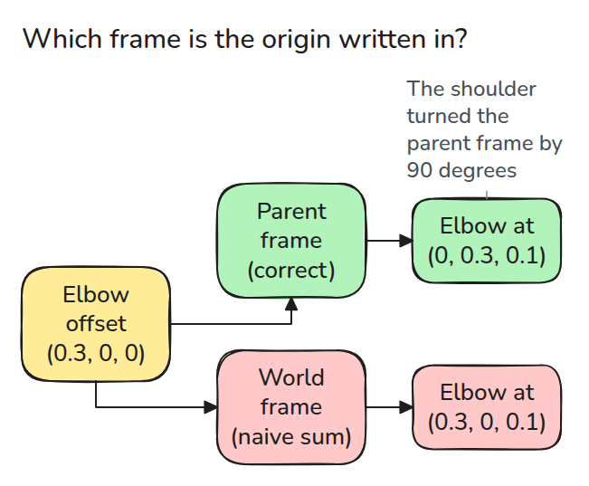
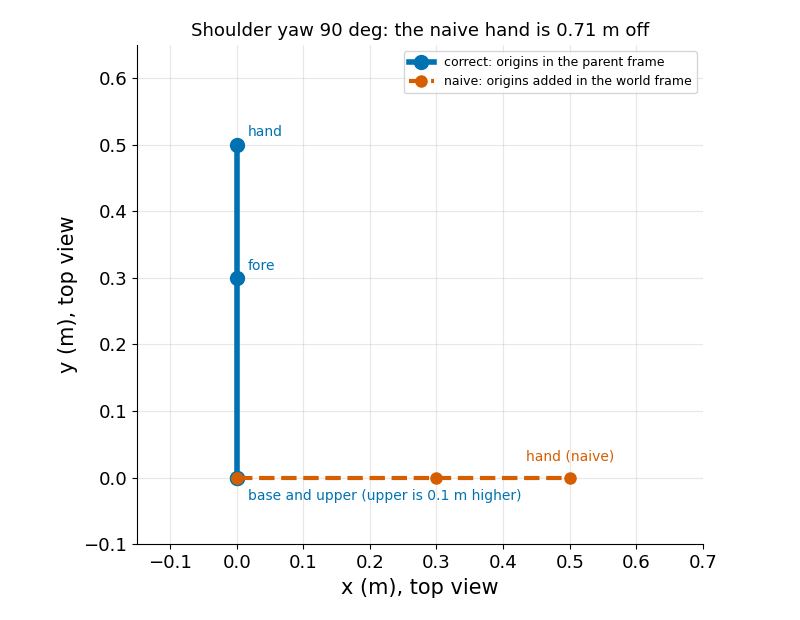

# Reading a URDF

> A URDF is a tree of links joined by joints, and every joint origin is written in its parent link's frame.

**Type:** Build   **Prerequisites:** 00/01 Python Env and numpy   **Time:** ~15 minutes

## In Plain Words

The file of a small bench arm says the elbow sits a fixed distance ahead of the shoulder. Ahead means along the link, not along the room, so a turned shoulder makes ahead point sideways.

A URDF, the robot's description file, lists links (rigid parts) joined by joints. It writes each joint offset in the frame of the link before it, meaning that link's own x, y and z axes. Turn each offset by every turn before it, then add. Raw offsets treat ahead as one room direction.

## The Problem

You add up the joint offsets to find the hand, and the answer is far from what the viewer shows. The offsets were right. You read each along the world's axes, the room's fixed x, y, z, but the file writes it along the axes of the link before it.

## The Concept

Follow the arrows from base to hand.



*Each box is a link, each arrow a joint (graph nodes and edges). A link can have several children but one parent joint.*

Each joint has a parent, a child, an `<origin>` (a position `xyz` and a rotation `rpy`), and for a moving joint an axis and limits. The ROS wiki defines the origin as the transform from the parent link to the child link, and `rpy` as roll about x, then pitch about y, then yaw about z, around fixed axes.

Compare two readings of one `xyz`.



*Read in the parent frame, the elbow offset follows the turned link. Read in the world frame it ignores the turn.*

Here every joint angle is 0 and the turn lives in the file: the shoulder `<origin>` lifts the frame 0.1 m along z and turns it 90 degrees about z, carrying x onto y. The elbow offset is `0.3 0 0`, the wrist offset `0.2 0 0`, each along its own link's x. Added as world directions they give `(0.5, 0, 0.1)`. Turned correctly, both point along world y: the hand sits at `(0, 0.5, 0.1)`, 0.71 m from the wrong answer.


*At twice the URDF size. The dark axes turn 90 degrees and the green arrows follow. The pale blue arrows stay on world x. The red line is the gap between the two hands.*



*Top view. The shoulder origin turns the arm by 90 degrees, so the elbow offset points along y. A plain sum puts the hand 0.71 m from the right answer.*

## Build It

Parse with the standard library, then walk root to tip, multiplying one 4x4 transform (a table holding a turn and a shift) per joint.

```python
root = ET.fromstring(xml)
for e in root.findall("joint"):
    o = e.find("origin")
    joints[e.get("name")] = dict(parent=e.find("parent").get("link"),
                                 child=e.find("child").get("link"),
                                 xyz=_vec(o, "xyz"), rpy=_vec(o, "rpy"))
# T = T @ T_origin @ R_axis(q), for each joint on the chain
```

`chain()` follows parent links from the tip back to the root. `link_positions()` applies the origin first and the joint rotation second, and rejects a value outside the limits.

```bash
cd robotics-engineering-from-scratch
python3 -m pytest phases/00-setup-and-tooling/03-reading-a-urdf -q
```

## Use It

`robot_state_publisher` in ROS 2 turns the URDF and the `joint_states` topic (a named stream of joint values) into poses for tf2, ROS's store of frames. Compare them with `link_positions()` at the same joint values.

Sources: https://wiki.ros.org/urdf/XML/joint, https://github.com/ros/robot_state_publisher

## Ship It

`outputs/skill-urdf-reading-check.md` lists what to check when a URDF position looks wrong.

## Exercises

1. Add a prismatic joint and move a link along its axis.
2. Print every link that has more than one child.
3. Make the parser reject a tree with two roots.
