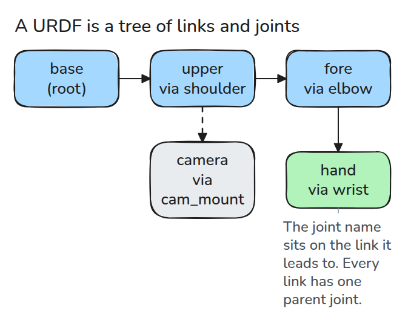
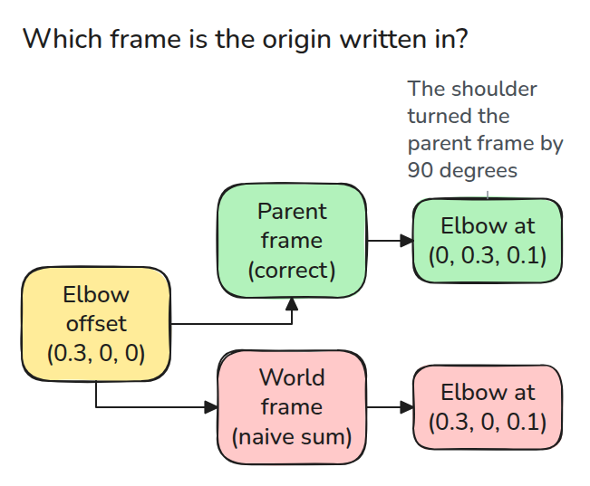
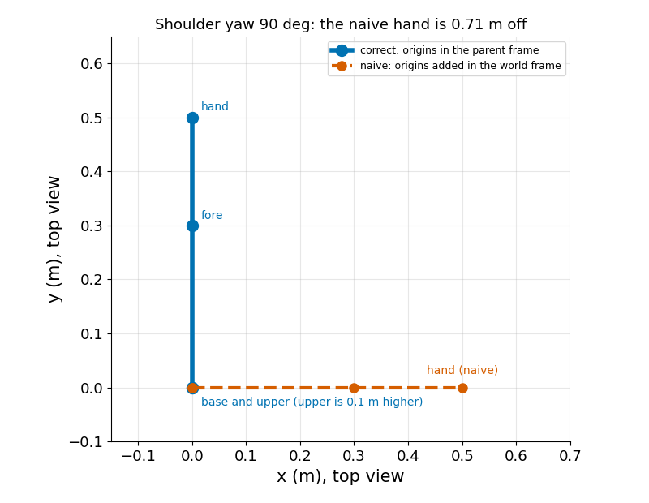

# Reading a URDF

> Learn to read a robot's description file, and why each joint's offset is measured from the part before it.

**Type:** Build   **Prerequisites:** 00/01 Python Env and numpy   **Time:** ~15 minutes

## In Plain Words

A small arm's file says the elbow sits a fixed distance ahead of the shoulder. Ahead means along the link, not along the room, so a turned shoulder makes ahead point sideways.

A URDF, the robot's description file, lists links (rigid parts) joined by joints. Each joint offset follows the previous link's axes, so turn each offset by every turn before it, then add.

## Key Terms

- **URDF**: a text file that describes a robot as links joined by joints.
- **Link**: one rigid part of the robot, such as an upper arm.
- **Joint**: the connection that lets a child link move relative to its parent link.
- **Frame**: a set of x, y, z axes attached to something, such as a link or the room.
- **`<origin>`**: a joint's position (`xyz`) and rotation (`rpy`) relative to its parent link.
- **Transform**: a 4x4 table of numbers holding one turn and one shift.

## The Problem

A robot file lists each part's offset from the part before it. You add the offsets to find the hand and get an answer far from the viewer's, because the file measures along each previous link's axes, not the room's.

## The Concept

Simulators and robot programs all start from this file, so misreading it breaks everything built on it.

Follow the arrows from base to hand.



*Each box is a link, each arrow a joint.*

The ROS wiki defines a joint's `<origin>` as the parent-to-child transform, with `rpy` as roll about x, pitch about y, yaw about z.



*In the parent frame the offset follows the turned link. In the world frame it ignores the turn.*

Every joint angle is 0. The shoulder `<origin>` lifts the frame 0.1 m along z and turns it 90 degrees about z. Offsets `0.3 0 0` (elbow) and `0.2 0 0` (wrist) each lie along their own link's x. Added in world directions they give `(0.5, 0, 0.1)`. Turned correctly, the hand is at `(0, 0.5, 0.1)`, 0.71 m away.


*Dark axes turn and green arrows follow. Blue arrows stay on world x. Red: the gap.*



*Top view: the elbow offset points along y.*

## Build It

Parse with the standard library, then walk root to tip, multiplying one 4x4 transform per joint.

```python
root = ET.fromstring(xml)
for e in root.findall("joint"):
    o = e.find("origin")
    joints[e.get("name")] = dict(parent=e.find("parent").get("link"),
                                 child=e.find("child").get("link"),
                                 xyz=_vec(o, "xyz"), rpy=_vec(o, "rpy"))
# T = T @ T_origin @ R_axis(q), for each joint on the chain
```

`chain()` walks from tip to root. `link_positions()` applies the origin first, then the joint rotation, and rejects values outside the limits.

```bash
cd robotics-engineering-from-scratch
python3 -m pytest phases/00-setup-and-tooling/03-reading-a-urdf -q
```

## Use It

`robot_state_publisher` in ROS 2 turns the URDF and `joint_states` into poses for tf2, ROS's store of frames. Compare them with `link_positions()`.

Sources: https://wiki.ros.org/urdf/XML/joint, https://github.com/ros/robot_state_publisher

## Ship It

`outputs/skill-urdf-reading-check.md` lists what to check when a URDF position looks wrong.

## Exercises

1. Add a prismatic joint and move a link along its axis.
2. Print every link that has more than one child.
3. Make the parser reject a tree with two roots.
