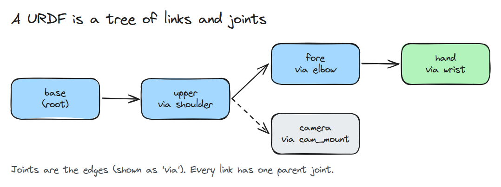
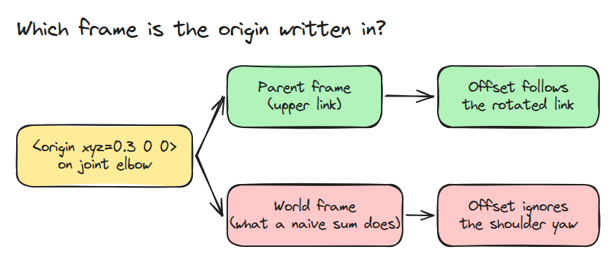
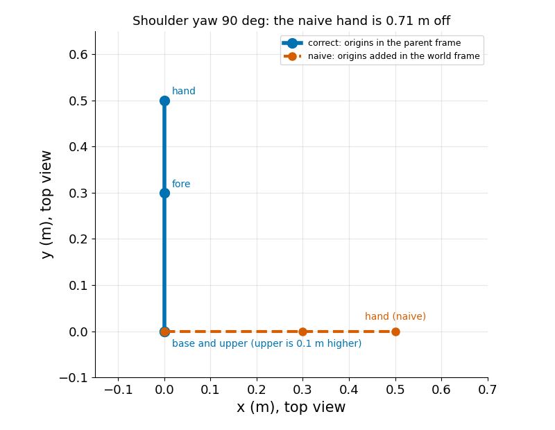

# URDF 읽기

> URDF는 joint로 이어진 link의 tree이고 모든 joint origin은 부모 link의 frame에서 쓰여 있습니다.

**유형:** 만들기   **선수 지식:** 00/01 Python 환경과 numpy   **시간:** 약 15분

## 문제

로봇 설명 파일을 읽고 joint offset을 모두 더해서 손의 위치를 구했는데 viewer가 보여 주는 위치와 많이 다릅니다. offset 값은 맞았습니다. 파일은 각 값을 바로 앞 link의 frame에서 쓰는데 이 값을 world frame에서 읽은 것이 문제입니다.

## 개념



*link가 node이고 joint가 edge입니다. link는 자식을 여럿 가질 수 있지만 부모 joint는 하나뿐입니다.*

joint마다 부모, 자식, `<origin>`(위치 `xyz`와 회전 `rpy`)이 있고 움직이는 joint에는 axis와 limit도 있습니다.

ROS wiki는 origin을 부모 link에서 자식 link로 가는 transform으로 정의하고 `rpy`를 고정축 기준 roll, pitch, yaw 순서로 정의합니다.



*같은 `xyz`도 어느 frame에서 읽느냐에 따라 전혀 다른 위치가 됩니다.*



*위에서 본 모습입니다. 어깨 origin이 팔을 90도 돌리므로 elbow offset은 y 방향을 향합니다. offset을 그냥 더하면 손이 0.71 m 벗어납니다.*

## 만들기

표준 라이브러리로 파싱한 다음, root에서 tip까지 걸으며 joint마다 4x4 transform을 하나씩 곱합니다.

```python
root = ET.fromstring(xml)
for e in root.findall("joint"):
    o = e.find("origin")
    joints[e.get("name")] = dict(parent=e.find("parent").get("link"),
                                 child=e.find("child").get("link"),
                                 xyz=_vec(o, "xyz"), rpy=_vec(o, "rpy"))
# T = T @ T_origin @ R_axis(q), for each joint on the chain
```

`chain()`은 tip에서 root까지 부모 link를 따라갑니다. `link_positions()`는 origin을 먼저 적용하고 joint 회전을 그다음에 적용하며 limit 밖의 값은 거부합니다.

```bash
cd robotics-engineering-from-scratch
python3 -m pytest phases/00-setup-and-tooling/03-reading-a-urdf -q
```

## 실제 도구로 보기

ROS 2에서는 `robot_state_publisher`가 URDF의 kinematic tree와 `joint_states` topic을 받아, 계산한 pose를 tf2로 publish합니다.

같은 joint 값에서 그 transform을 `link_positions()`의 결과와 비교해 보세요.

출처: https://wiki.ros.org/urdf/XML/joint, https://github.com/ros/robot_state_publisher

## 결과물

`outputs/skill-urdf-reading-check.md`는 URDF 위치가 이상할 때 확인할 항목을 정리한 것입니다.

## 연습 문제

1. prismatic joint를 추가하고 link를 axis 방향으로 움직이세요.
2. 자식이 둘 이상인 link를 모두 출력하세요.
3. root가 둘인 tree를 파서가 거부하게 만드세요.
