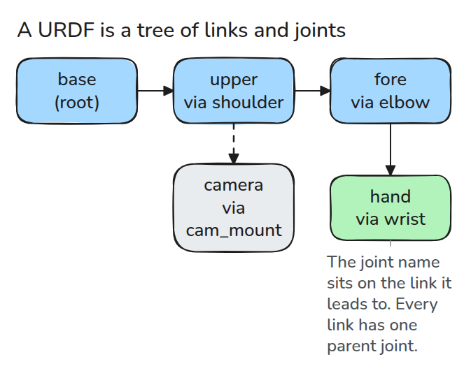
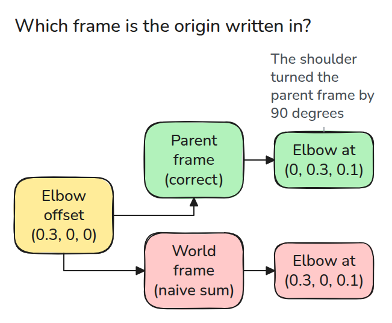
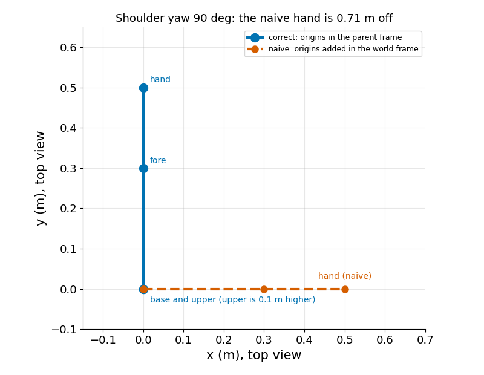

# URDF 읽기

> 로봇의 설명 파일을 읽는 법과, 각 joint의 offset을 왜 바로 앞 부품에서 재는지 알게 됩니다.

**유형:** 만들기   **선수 지식:** 00/01 Python 환경과 numpy   **시간:** 약 15분

## 쉽게 말하면

작은 bench arm의 파일에는 팔꿈치가 어깨에서 일정한 거리만큼 앞에 있다고 적혀 있어요. 여기서 앞은 방이 아니라 link를 따라가는 방향이라서 어깨를 돌리면 앞이 옆을 가리켜요.

URDF는 로봇의 설명 파일이고 joint로 이어진 link(단단한 부품)를 나열해요. 각 joint의 offset은 바로 앞 link의 축을 기준으로 적혀 있어요. offset마다 그 앞의 회전을 모두 반영한 다음 더해야 해요.

## 핵심 용어

- **URDF**: 로봇을 joint로 이어진 link로 설명하는 텍스트 파일입니다.
- **Link**: 로봇의 단단한 부품 하나입니다. 예를 들어 윗팔입니다.
- **Joint**: 자식 link가 부모 link에 대해 움직이게 해 주는 연결입니다.
- **Frame**: 링크나 방 같은 어떤 대상에 붙은 x, y, z축의 묶음입니다.
- **`<origin>`**: joint의 위치(`xyz`)와 회전(`rpy`)을 부모 link 기준으로 적은 값입니다.
- **Transform**: 회전 하나와 이동 하나를 담은 4x4 숫자 표입니다.

## 문제

로봇 파일에는 부품마다 바로 앞 부품에서 얼마나 떨어져 있는지가 적혀 있습니다. offset을 모두 더해 손의 위치를 구했더니 viewer가 보여 주는 위치와 많이 다릅니다.

파일은 offset을 방이 아니라 바로 앞 link의 축을 기준으로 쓰는데 각 값을 방에 고정된 축으로 읽었기 때문입니다.

## 개념

simulator와 로봇 프로그램은 모두 이 파일에서 출발하므로 잘못 읽으면 그 위에 쌓은 것이 전부 틀어집니다.

base에서 손까지 화살표를 따라가 보세요.



*상자는 link이고 화살표는 joint입니다. link는 부모 joint가 하나뿐이지만 자식은 여럿 가질 수 있습니다.*

joint마다 부모, 자식, `<origin>`이 있고 움직이는 joint에는 axis와 limit도 있습니다. ROS wiki는 origin을 부모 link에서 자식 link로 가는 transform으로 정의합니다.

`rpy`는 고정축 기준으로 x축 roll, y축 pitch, z축 yaw 순서의 회전입니다. 같은 `xyz`를 두 가지로 읽은 결과를 비교해 보세요.



*부모 frame에서 읽으면 elbow offset은 돌아간 link를 따라갑니다. world frame에서 읽으면 회전을 무시합니다.*

모든 joint 각도는 0입니다. 어깨 `<origin>`이 frame을 z축 방향으로 0.1 m 올리고 z축 둘레로 90도 돌려 x를 y 위로 보냅니다.

elbow offset `0.3 0 0`과 wrist offset `0.2 0 0`은 각각 자기 link의 x축 방향입니다. world 방향으로 더하면 `(0.5, 0, 0.1)`이 나옵니다.

제대로 돌리면 둘 다 world y 방향이어서 손은 `(0, 0.5, 0.1)`에 있고 틀린 답과 0.71 m 떨어져 있습니다.


*어두운 축이 90도 돌고 초록 화살표가 따라갑니다. 파란 화살표는 world x축에 머뭅니다. 빨간 선은 두 손 사이의 거리입니다.*



*위에서 본 모습입니다. 어깨 origin이 팔을 돌리므로 elbow offset은 y 방향을 향합니다.*

## 만들기

표준 라이브러리로 파싱한 다음 root에서 tip까지 걸어가며 joint마다 4x4 transform 하나씩 곱합니다.

```python
root = ET.fromstring(xml)
for e in root.findall("joint"):
    o = e.find("origin")
    joints[e.get("name")] = dict(parent=e.find("parent").get("link"),
                                 child=e.find("child").get("link"),
                                 xyz=_vec(o, "xyz"), rpy=_vec(o, "rpy"))
# T = T @ T_origin @ R_axis(q), for each joint on the chain
```

`chain()`은 tip에서 root까지 부모 link를 따라갑니다. `link_positions()`는 origin을 먼저 적용하고 joint 회전을 그다음에 적용하며 limit 밖의 값은 거부합니다.

```bash
cd robotics-engineering-from-scratch
python3 -m pytest phases/00-setup-and-tooling/03-reading-a-urdf -q
```

## 실제 도구로 보기

ROS 2에서는 `robot_state_publisher`가 URDF와 `joint_states` topic을 받아 pose를 ROS의 frame 저장소인 tf2로 publish합니다.

같은 joint 값에서 그 transform을 `link_positions()`의 결과와 비교해 보세요.

출처: https://wiki.ros.org/urdf/XML/joint, https://github.com/ros/robot_state_publisher

## 결과물

`outputs/skill-urdf-reading-check.md`는 URDF 위치가 이상할 때 확인할 항목을 정리한 것입니다.

## 연습 문제

1. prismatic joint를 추가하고 link를 axis 방향으로 움직이세요.
2. 자식이 둘 이상인 link를 모두 출력하세요.
3. root가 둘인 tree를 파서가 거부하게 만드세요.
