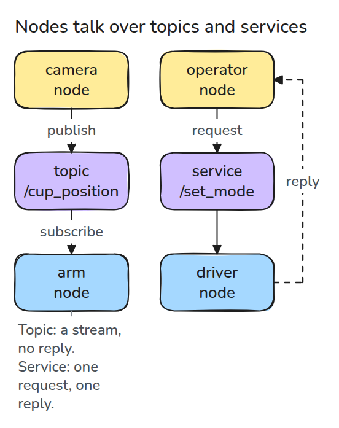
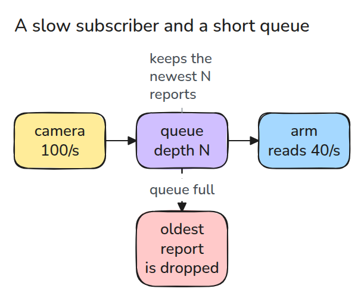
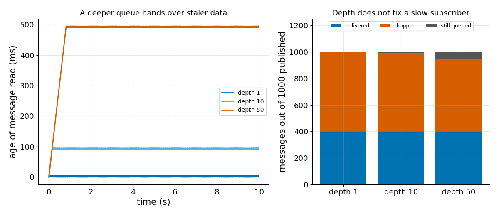

# ROS 2 in One Page

> Nodes exchange data over topics and services, and a queue depth decides what a slow subscriber loses.

**Type:** Learn   **Prerequisites:** 00/01 Python Env and numpy   **Time:** ~15 minutes

## In Plain Words

A cup slides along a rail. A sensor reports its position faster than the arm's controller can read. Unread reports wait in a queue, and the controller always takes the oldest one.

When the queue is full, each new report pushes the oldest out. A long queue means the oldest waiting report can be half a second old, so the arm aims where the cup was. A queue that holds one report means the arm reads the newest.

## The Problem

Your controller (the program commanding the arm) reads joint states (joint angles) at 40 Hz, times per second. The driver, the motor program, publishes them at 100 Hz. You raise the queue depth to 50 to stop losing messages. A message arrives every 10 ms, so 50 queued messages reach back 0.5 s, and the arm reacts half a second late.

## The Concept

Look at the two lanes: a stream on top, a question and one answer below.



*A node is a program. A topic carries a stream from publishers (senders) to subscribers (receivers). A service answers one request with one reply.*

A subscriber owns a queue, a waiting line of messages. With the "keep last" history setting, the queue holds the newest `depth` messages and a new one pushes out the oldest when it is full.



*The publisher is faster, so the queue stays full and the oldest message is dropped on every publish.*

Run 10 s with a 100 Hz publisher and a 40 Hz reader. The publisher sends 1000 messages and the reader takes 400 at every depth. The last message read is 5 ms old at depth 1, and each extra queued message adds 10 ms, one publish period: 95 ms at depth 10, 495 ms at depth 50.


*Three arms, one per depth. Each pale cup is where that arm believes the cup is. Green (depth 1) stays on the cup, pale blue (depth 10) trails a little, blue (depth 50) chases old positions.*



*Left: watch message age grow with depth, about `(depth - 1)` publish periods. Right: of 1000 published, 400 are delivered at every depth. Depth only moves the other 600 between "dropped" and "still queued".*

## Build It

A `Bus` with named topics and one queue per subscription.

```python
def publish(self, topic, msg):
    for s in self.subs.get(topic, []):
        if len(s.q) == s.depth:
            s.q.popleft()
            s.dropped += 1
        s.q.append(msg)
```

`run(pub_hz, sub_hz, depth, seconds)` stamps each message with its send time and takes one per subscriber tick (one read), so it reports drops and the age of what was read. `burst_drops()` shows where depth does help: a burst, many messages at once, shorter than the queue.

```bash
cd robotics-engineering-from-scratch
python3 -m pytest phases/00-setup-and-tooling/04-ros2-in-one-page -q
python3 phases/00-setup-and-tooling/04-ros2-in-one-page/code/main.py
```

## Use It

In ROS 2 the same setting is the QoS (quality of service) history policy `keep last` with a queue depth; the QoS page supports only that. Our own advice: keep a small depth for control signals where only the newest value matters, and size a larger one for bursts. Match the subscriber rate to the publisher before raising depth.

Sources: https://docs.ros.org/en/jazzy/Concepts/Intermediate/About-Quality-of-Service-Settings.html

## Ship It

`outputs/skill-qos-depth-check.md` reviews a topic's rates and depth and says whether data will be dropped or stale.

## Exercises

1. Add a "keep all" subscription and show how its queue grows.
2. Plot the age of messages when the subscriber is faster than the publisher.
3. Add a second subscriber with a different depth on the same topic.
