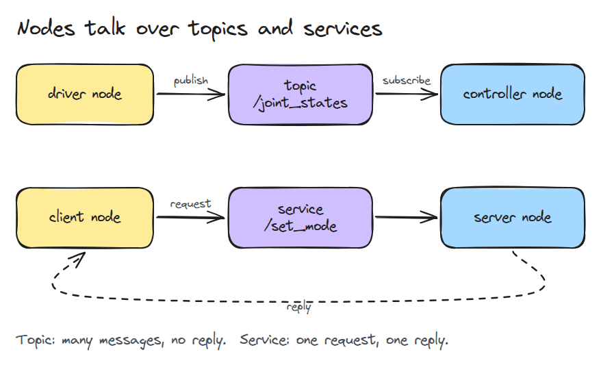
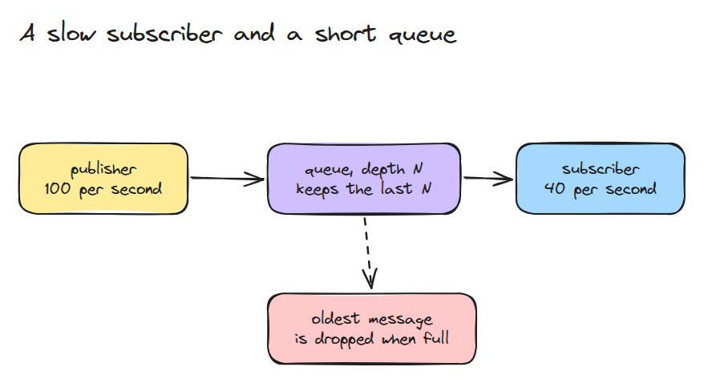
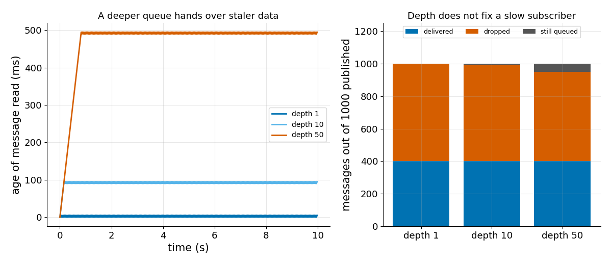

# ROS 2 in One Page

> Learn how robot programs pass data to each other, and why a longer waiting line can make a robot react late.

**Type:** Learn   **Prerequisites:** 00/01 Python Env and numpy   **Time:** ~15 minutes

## In Plain Words

A sensor reports a sliding cup's position faster than the arm's controller can read. Unread reports wait in a queue, and the controller takes the oldest first.

When the queue is full, each new report pushes the oldest out. A long queue means the oldest report can be half a second old. A queue of one means the arm reads the newest.

## Key Terms

- **Node**: one running program in a ROS 2 system.
- **Topic**: a named stream that publishers send to and subscribers read from.
- **Service**: a request with one reply, unlike a topic's endless stream.
- **Queue depth**: how many messages a subscriber keeps while it waits to read them.
- **Hz**: times per second.
- **QoS**: quality of service, the settings that decide how messages are kept and delivered.

## The Problem

A robot's controller reads joint angles at 40 Hz, but the motor driver publishes them at 100 Hz. You raise the queue depth to 50 to stop losing messages. Messages arrive every 10 ms, so 50 queued ones reach back 0.5 s and the arm reacts late.

## The Concept

A robot is many small programs, and how they pass data decides how fresh it is on arrival.



*A topic streams data; a service answers one request.*

A subscriber owns a queue. With "keep last", it holds the newest `depth` messages and a new one pushes out the oldest.



*The publisher is faster, so the queue stays full.*

Run 10 s with a 100 Hz publisher and a 40 Hz reader: 1000 messages sent, 400 read at every depth. The last message read is 5 ms old at depth 1, and each extra queued message adds 10 ms: 95 ms at depth 10, 495 ms at depth 50.


*Pale cups: where each arm believes the cup is. Green (depth 1) stays on it, pale blue (depth 10) trails, blue (depth 50) chases old positions.*



*Left: message age grows with depth. Right: 400 of 1000 arrive at every depth; depth only moves the rest between dropped and queued.*

## Build It

`run(pub_hz, sub_hz, depth, seconds)` stamps each message with its send time and reports drops and age. `burst_drops()` shows where depth helps: a burst shorter than the queue.

```python
def publish(self, topic, msg):
    for s in self.subs.get(topic, []):
        if len(s.q) == s.depth:
            s.q.popleft()
            s.dropped += 1
        s.q.append(msg)
```

```bash
cd robotics-engineering-from-scratch
python3 -m pytest phases/00-setup-and-tooling/04-ros2-in-one-page -q
python3 phases/00-setup-and-tooling/04-ros2-in-one-page/code/main.py
```

## Use It

In ROS 2 this is the QoS history policy `keep last`. Keep depth small for control signals, larger only for bursts.

Sources: https://docs.ros.org/en/jazzy/Concepts/Intermediate/About-Quality-of-Service-Settings.html

## Ship It

`outputs/skill-qos-depth-check.md` checks a topic's rates and depth for drops and stale data.

## Exercises

1. Add a "keep all" subscription and show its queue growing.
2. Plot message age when the subscriber is faster than the publisher.
3. Add a second subscriber with a different depth.
