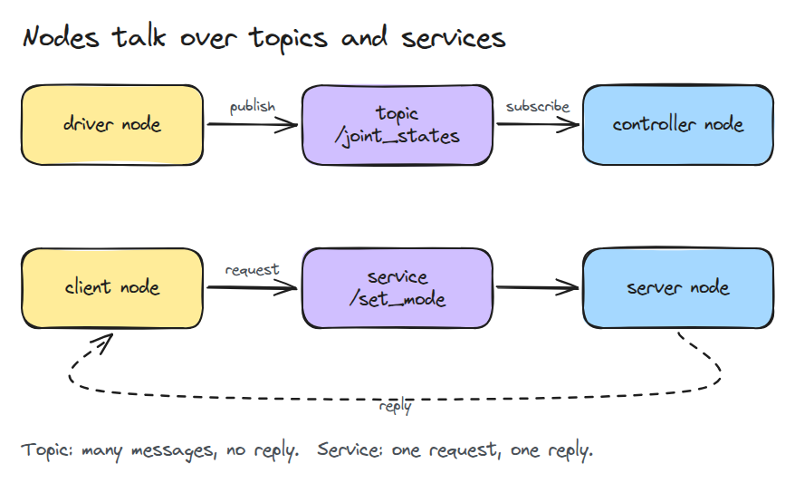
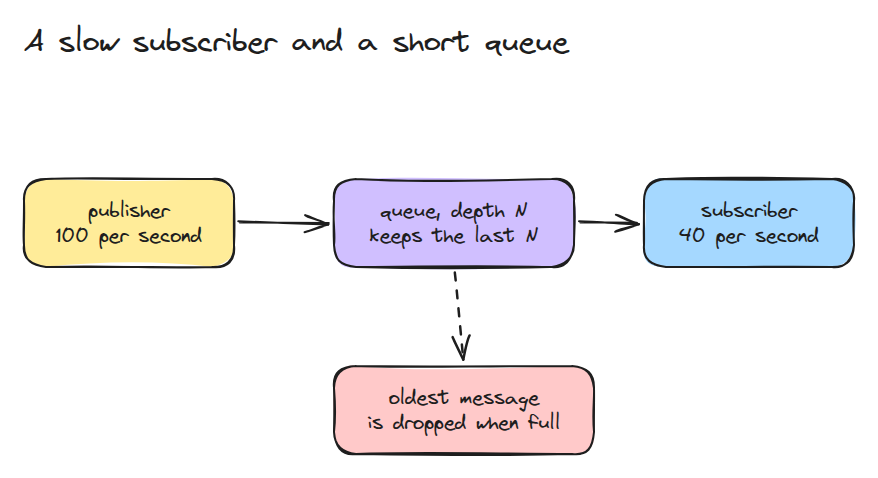
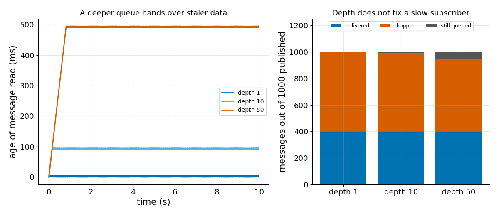

# ROS 2 한 장 요약

> node는 topic과 service로 데이터를 주고받고 queue depth가 느린 subscriber의 손실을 정합니다.

**유형:** 배우기   **선수 지식:** 00/01 Python 환경과 numpy   **시간:** 약 15분

## 쉽게 말하면

학급 채팅방에 글이 읽는 속도보다 빨리 올라와요. 안 읽은 글을 오래된 순서로 읽는다면 보관함을 키울수록 더 지난 소식을 읽게 돼요.

subscriber의 queue도 비슷해요. keep last에서는 가득 찬 queue에 새 메시지가 오면 가장 오래된 메시지를 버려요. depth를 키우면 대기 중인 메시지는 더 남지만 읽는
속도는 그대로예요. 계속 밀리면 읽는 데이터가 더 오래돼요.

## 문제

controller는 joint state를 40 Hz로 읽는데 driver는 100 Hz로 publish합니다. 메시지를 잃지 않으려고 queue depth를 50으로 올렸더니 팔이 반 초씩 늦게 반응합니다. 안전 여유처럼 보였던 설정이 오래된 데이터를 읽게 만든 것입니다.

## 개념



*node는 프로그램 하나입니다. topic은 publisher에서 subscriber로 가는 스트림을 나릅니다. service는 요청 하나에 응답 하나를 돌려줍니다.*

subscriber는 자기 queue를 가집니다. history 정책이 "keep last"이면 queue에는 최대 `depth`개가 들어가고 가득 찬 상태에서 새 메시지가 오면 가장 오래된 메시지가 밀려납니다.



*publisher가 subscriber보다 빠르므로 queue는 항상 가득 차 있고 publish할 때마다 가장 오래된 메시지가 버려집니다.*



*왼쪽은 subscriber가 발행 주기 `(depth - 1)`개만큼 오래된 메시지를 읽는 모습입니다. 오른쪽은 depth와 상관없이 같은 400개가 전달되는 모습입니다. depth는 메시지를 "버려짐"과 "아직 queue에 있음" 사이에서 옮길 뿐입니다.*

## 만들기

이름 있는 topic과 구독마다 queue 하나를 가진 `Bus`입니다. ROS를 설치할 필요가 없습니다.

```python
def publish(self, topic, msg):
    for s in self.subs.get(topic, []):
        if len(s.q) == s.depth:
            s.q.popleft()
            s.dropped += 1
        s.q.append(msg)
```

`run(pub_hz, sub_hz, depth, seconds)`는 메시지마다 보낸 시각을 찍고 subscriber tick마다 하나씩 꺼냅니다.

그래서 폐기 개수와 읽은 메시지의 나이를 보고할 수 있습니다. `burst_drops()`는 depth가 도움이 되는 경우, 곧 queue보다 짧은 burst를 보여 줍니다.

```bash
cd robotics-engineering-from-scratch
python3 -m pytest phases/00-setup-and-tooling/04-ros2-in-one-page -q
python3 phases/00-setup-and-tooling/04-ros2-in-one-page/code/main.py
```

## 실제 도구로 보기

ROS 2에서는 같은 설정이 QoS history 정책 `keep last`와 queue depth입니다. QoS 문서가 뒷받침하는 것은 여기까지입니다. 이어지는 조언은 이 레슨의 것입니다.

최신 값만 중요한 제어 신호에는 작은 depth를 두고 burst에 대비할 때만 더 크게 잡습니다. depth를 올리기 전에 subscriber 속도를 publisher에 맞춥니다.

출처: https://docs.ros.org/en/jazzy/Concepts/Intermediate/About-Quality-of-Service-Settings.html

## 결과물

`outputs/skill-qos-depth-check.md`는 topic의 속도와 depth를 보고 데이터가 버려지는지 낡는지 알려 줍니다.

## 연습 문제

1. "keep all" 구독을 추가하고 queue가 어떻게 자라는지 보이세요.
2. subscriber가 publisher보다 빠를 때 메시지 나이를 그래프로 그리세요.
3. 같은 topic에 depth가 다른 두 번째 subscriber를 추가하세요.
