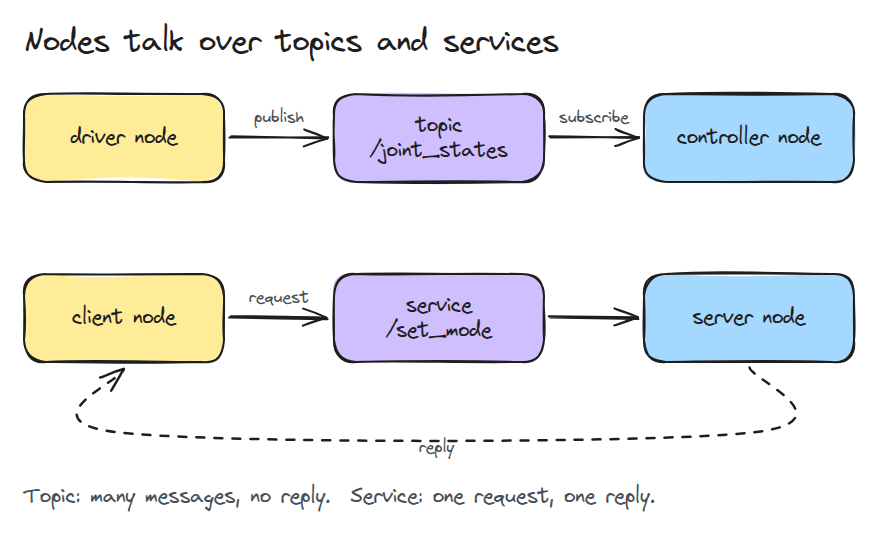
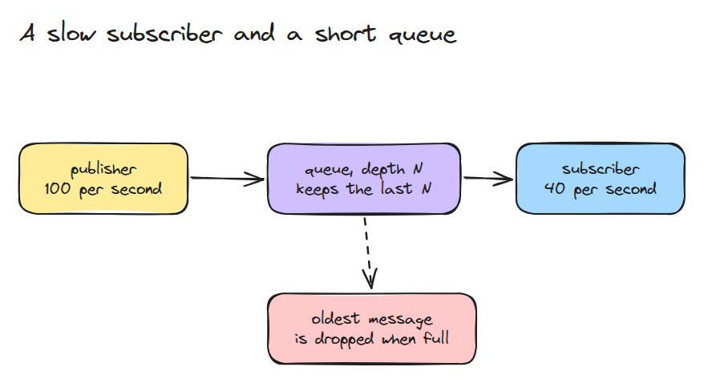
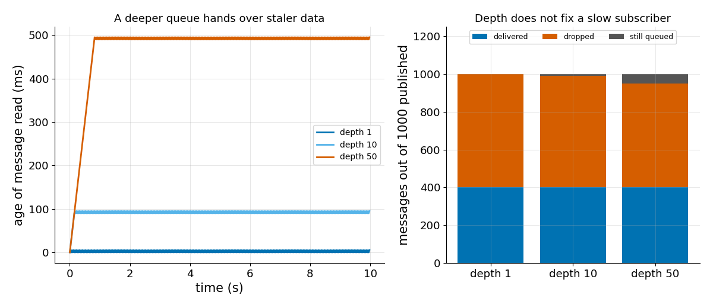

# ROS 2 한 장 요약

> 로봇 프로그램들이 서로 데이터를 주고받는 방법과, 대기열을 길게 하면 왜 로봇이 늦게 반응하는지 알게 됩니다.

**유형:** 배우기   **선수 지식:** 00/01 Python 환경과 numpy   **시간:** 약 15분

## 쉽게 말하면

센서는 미끄러지는 컵의 위치를 팔의 controller가 읽는 것보다 빠르게 알려 줘요. 읽지 못한 보고는 queue에서 기다리고 controller는 가장 오래된 보고부터 가져가요.

queue가 가득 차면 새 보고가 올 때마다 가장 오래된 보고가 밀려나요. queue가 길면 가장 오래된 보고가 반 초 전 것일 수도 있어서 팔은 컵이 있던 자리를 향해요. 보고를 하나만 담는 queue라면 팔은 가장 새 보고를 읽어요.

## 핵심 용어

- **Node**: ROS 2 시스템에서 돌아가는 프로그램 하나입니다.
- **Topic**: publisher가 보내고 subscriber가 읽는 이름 붙은 스트림입니다.
- **Service**: 요청 하나에 응답 하나를 돌려주는 방식입니다. 끝없이 흐르는 topic과 다릅니다.
- **Queue depth**: subscriber가 읽기 전까지 보관하는 메시지의 개수입니다.
- **Hz**: 1초에 몇 번인지를 나타내는 단위입니다.
- **QoS**: quality of service의 약자로 메시지를 어떻게 보관하고 전달할지 정하는 설정입니다.

## 문제

로봇의 controller는 joint 각도를 40 Hz로 읽는데 모터 driver는 100 Hz로 publish합니다. 메시지를 잃지 않으려고 queue depth를 50으로 올렸습니다.

메시지는 10 ms마다 오므로 queue 50개는 0.5초 전까지 거슬러 올라가고 팔은 늦게 반응합니다.

## 개념

로봇은 작은 프로그램 여러 개로 이루어져 있고 이들이 데이터를 건네는 방식이 데이터가 도착할 때 얼마나 신선한지를 정합니다.



*topic은 publisher에서 subscriber로 가는 스트림을 나릅니다. service는 요청 하나에 응답 하나를 돌려줍니다.*

subscriber는 메시지가 기다리는 줄인 queue를 가집니다. history 설정이 "keep last"이면 queue는 가장 최근 `depth`개를 담고 가득 찬 상태에서 새 메시지가 오면 가장 오래된 메시지가 밀려납니다.



*publisher가 더 빠르므로 queue는 가득 찬 채로 있고 publish할 때마다 가장 오래된 메시지가 버려집니다.*

publisher 100 Hz와 reader 40 Hz로 10초를 돌려 봅니다. publisher는 메시지 1000개를 보내고 reader는 depth와 상관없이 400개를 읽습니다.

마지막으로 읽은 메시지는 depth 1에서 5 ms 전 것이고 queue에 메시지가 하나 더 쌓일 때마다 10 ms가 더해집니다. depth 10은 95 ms, depth 50은 495 ms입니다.


*연한 컵은 그 팔이 컵이 있다고 믿는 자리입니다. 초록(depth 1)은 컵 위에 머물고 연한 파랑(depth 10)은 조금 뒤처지며 파랑(depth 50)은 예전 위치를 쫓아갑니다.*



*왼쪽은 depth가 클수록 메시지 나이가 커지는 모습입니다. 오른쪽은 1000개 중 400개가 depth와 상관없이 전달된다는 것입니다. depth는 나머지 600개를 "버려짐"과 "아직 queue에 있음" 사이에서 옮길 뿐입니다.*

## 만들기

`run(pub_hz, sub_hz, depth, seconds)`는 메시지마다 보낸 시각을 찍고 폐기 개수와 읽은 메시지의 나이를 보고합니다. `burst_drops()`는 depth가 도움이 되는 경우, 곧 queue보다 짧은 burst를 보여 줍니다.

```python
def publish(self, topic, msg):
    for s in self.subs.get(topic, []):
        if len(s.q) == s.depth:
            s.q.popleft()
            s.dropped += 1
        s.q.append(msg)
```

```bash
cd robotics-engineering-from-scratch
python3 -m pytest phases/00-setup-and-tooling/04-ros2-in-one-page -q
python3 phases/00-setup-and-tooling/04-ros2-in-one-page/code/main.py
```

## 실제 도구로 보기

ROS 2에서는 같은 설정이 QoS history 정책 `keep last`와 queue depth입니다. QoS 문서가 뒷받침하는 것은 여기까지입니다.

이어지는 조언은 이 레슨의 것입니다. 제어 신호에는 depth를 작게 두고 burst에 대비할 때만 더 크게 잡습니다. depth를 올리기 전에 subscriber 속도를 publisher에 맞춥니다.

출처: https://docs.ros.org/en/jazzy/Concepts/Intermediate/About-Quality-of-Service-Settings.html

## 결과물

`outputs/skill-qos-depth-check.md`는 topic의 속도와 depth를 보고 데이터가 버려지는지 낡는지 알려 줍니다.

## 연습 문제

1. "keep all" 구독을 추가하고 queue가 자라는 것을 보이세요.
2. subscriber가 publisher보다 빠를 때 메시지 나이를 그래프로 그리세요.
3. depth가 다른 두 번째 subscriber를 추가하세요.
