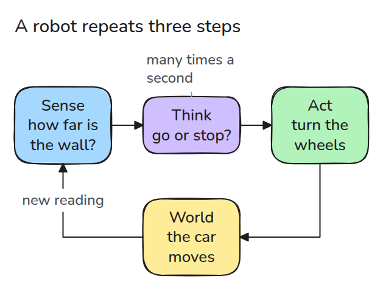
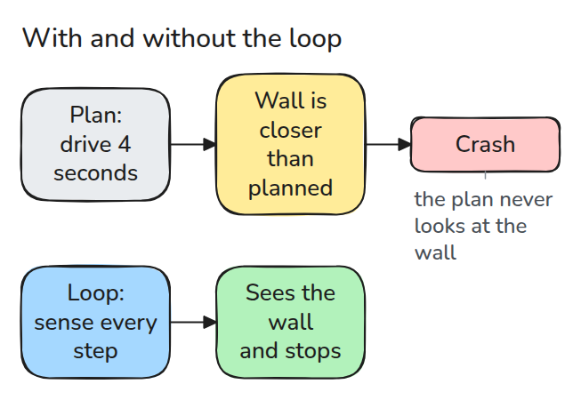
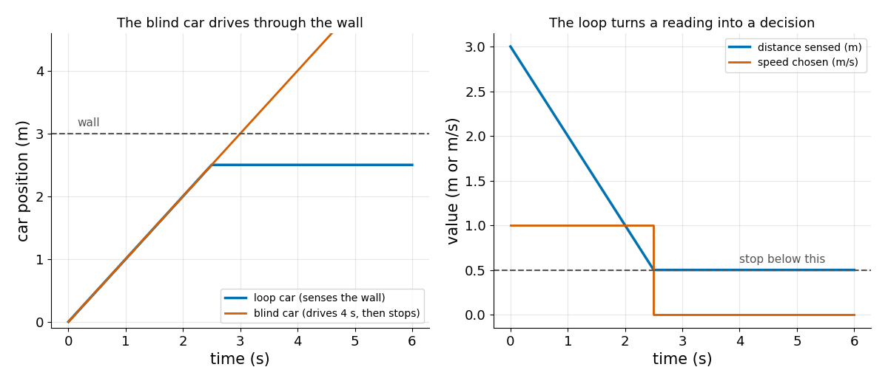

# What Is a Robot

> Learn that a robot is a machine that keeps repeating three steps: sense, think, act.

**Type:** Learn   **Prerequisites:** none   **Time:** ~15 minutes

## In Plain Words

Picture riding a bike toward a wall. You look at how close it is, decide to brake, and squeeze the brakes. Then you look again, because the wall is nearer now.

A robot works the same way. It never makes one big plan and hopes. It checks, decides and moves, over and over, many times each second.

## Key Terms

- **Robot**: a machine that senses its surroundings, decides what to do, and moves, again and again.
- **Sensor**: a part that measures something, such as the distance to a wall.
- **Actuator**: a part that makes motion, such as a motor that turns a wheel.
- **Loop**: steps that repeat over and over.
- **Time step**: the short pause between two passes of the loop. Here it is a tenth of a second.

## The Problem

A toy car must stop before a wall. You could tell it "drive for four seconds". But if the wall is closer than you thought, the car crashes, and the plan never notices.

## The Concept

Every robot, from a vacuum cleaner to an arm, is built on this loop.



*Sense, think, act. The world changes after every move, so the next reading is new.*

A car with a fixed plan cannot react. A car that senses on every pass can.



*The plan never looks at the wall. The loop looks every time.*

<details><summary>The math (optional)</summary>

On each pass: `distance = wall - position`. If `distance` is more than 0.5 m the speed is 1.0 m/s, otherwise 0. Then `position = position + speed * dt` with `dt` = 0.1 s. The wall is at 3.0 m, so the loop car stops at 2.5 m, 0.5 m from the wall. The blind car drives 4 s at 1.0 m/s and ends at 4.0 m, 1.0 m past the wall.

</details>


*The green car measures the gap on every pass. The amber bar is that reading, and it shrinks until the car stops.*



*Left: the blind car drives through the wall and the loop car stops. Right: the loop turns a reading into a go or stop.*

## Build It

Three tiny functions are the three steps. `drive` repeats them.

```python
def sense(position, wall=WALL):
    return wall - position

def think(distance, stop_at=STOP_AT):
    return SPEED if distance > stop_at else 0.0

def act(position, speed, dt=DT):
    return position + speed * dt

def drive(wall=WALL, seconds=6.0, dt=DT):
    position, run = 0.0, {"position": [], "distance": [], "speed": []}
    for _ in range(round(seconds / dt) + 1):
        distance = sense(position, wall)
        speed = think(distance)
        for key, value in (("position", position), ("distance", distance), ("speed", speed)):
            run[key].append(value)
        position = act(position, speed, dt)
    return run
```

```bash
cd robotics-engineering-from-scratch
python3 -m pytest phases/00-start-here/01-what-is-a-robot -q
python3 phases/00-start-here/01-what-is-a-robot/code/main.py
```

## Use It

A real robot has real sensors and motors, and its program runs this same loop. Robot software such as ROS 2 (a later lesson) splits the three steps into small programs that pass messages to each other.

## Ship It

`outputs/skill-sense-think-act-check.md` is a short checklist for breaking any robot job into sense, think and act.

## Exercises

1. Set `STOP_AT` to 1.0 and check that the car now stops farther from the wall.
2. Call `drive(wall=5.0, seconds=8.0)` and check that the same code still stops in time.
3. Set `SPEED` to 2.0 and see how close to the wall the car gets.
