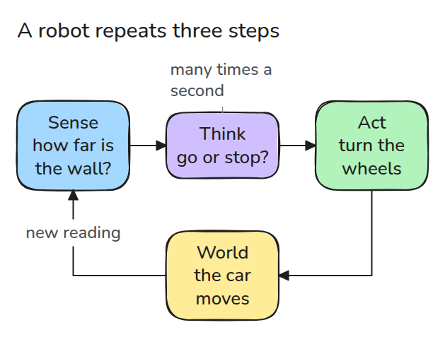
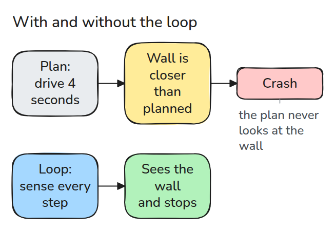
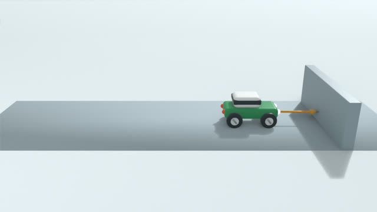
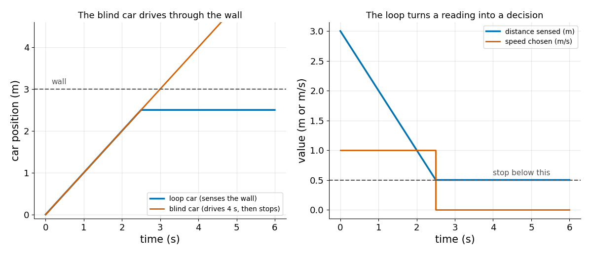

# 로봇이란 무엇인가

> 로봇이 sense, think, act 세 단계를 계속 되풀이하는 기계라는 것을 배웁니다.

**유형:** 배우기   **선수 지식:** 없음   **시간:** 약 15분

## 쉽게 말하면

벽을 향해 자전거를 탄다고 떠올려 보세요. 벽이 얼마나 가까운지 보고 브레이크를 잡기로 정한 다음 손으로 브레이크를 쥐어요. 그러고는 다시 봐요. 벽이 아까보다 가까워졌으니까요.

로봇도 똑같아요. 큰 계획 하나를 세워 놓고 기다리지 않아요. 살피고 정하고 움직이는 일을 매초 여러 번 되풀이해요.

## 핵심 용어

- **Robot**: 주변을 재고 할 일을 정해서 움직이는 일을 되풀이하는 기계입니다.
- **Sensor**: 벽까지의 거리처럼 무언가를 재는 부품입니다.
- **Actuator**: 바퀴를 돌리는 모터처럼 움직임을 만드는 부품입니다.
- **Loop**: 계속 되풀이되는 단계입니다.
- **Time step**: loop를 한 번 시작한 뒤 다음 번을 시작할 때까지 지난 시간입니다. 여기서는 0.1초입니다.

## 문제

장난감 자동차가 벽 앞에서 멈춰야 합니다. "4초 동안 달려"라고 시킬 수도 있습니다. 하지만 벽이 생각보다 가까우면 자동차는 부딪히고 계획은 그 사실을 알아채지 못합니다.

## 개념

청소기부터 로봇 팔까지 모든 로봇이 이 loop를 바탕으로 만들어집니다.



*sense, think, act입니다. 움직일 때마다 세상이 바뀌므로 다음에 읽는 값은 새 값입니다.*

정해진 계획만 따르는 자동차는 반응하지 못합니다. 매번 재는 자동차는 반응할 수 있습니다.



*계획은 벽을 한 번도 보지 않습니다. loop는 매번 봅니다.*

<details><summary>The math (optional)</summary>

한 번 도는 동안 `distance = wall - position`을 구합니다.
`distance`가 0.5 m보다 크면 속도는 1.0 m/s이고 아니면 0입니다.
그다음 `position = position + speed * dt`로 위치를 바꾸고 `dt`는 0.1초입니다.
벽은 3.0 m에 있으므로 loop 자동차는 2.5 m에서 멈추고 벽과의 간격은 0.5 m입니다.
눈 감은 자동차는 1.0 m/s로 4초를 달려 4.0 m에 도착하고 벽을 1.0 m 지나갑니다.

</details>

[](../assets/clip.mp4)

*초록 자동차는 매번 벽까지의 간격을 잽니다. 호박색 막대가 그 값이고 자동차가 멈출 때까지 줄어듭니다.*



*왼쪽은 눈 감은 자동차가 벽을 지나가고 loop 자동차는 멈추는 모습입니다. 오른쪽은 loop가 잰 값을 가기 또는 멈추기로 바꾸는 모습입니다.*

## 만들기

작은 함수 세 개가 세 단계입니다. `drive`가 그것을 되풀이합니다.

```python
def sense(position, wall=WALL):
    return wall - position

def think(distance, stop_at=STOP_AT):
    return SPEED if distance > stop_at else 0.0

def act(position, speed, dt=DT):
    return position + speed * dt

def drive(wall=WALL, seconds=6.0, dt=DT):
    position, run = 0.0, {"position": [], "distance": [], "speed": []}
    for _ in range(round(seconds / dt) + 1):
        distance = sense(position, wall)
        speed = think(distance)
        for key, value in (("position", position), ("distance", distance), ("speed", speed)):
            run[key].append(value)
        position = act(position, speed, dt)
    return run
```

```bash
cd robotics-engineering-from-scratch
python3 -m pytest phases/00-start-here/01-what-is-a-robot -q
python3 phases/00-start-here/01-what-is-a-robot/code/main.py
```

## 실제 도구로 보기

진짜 로봇에는 진짜 센서와 모터가 있고 프로그램은 같은 loop를 돌립니다. ROS 2(뒤에 나오는 레슨) 같은 로봇 소프트웨어는 세 단계를 작은 프로그램으로 나누고 서로 메시지를 주고받게 합니다.

## 결과물

`outputs/skill-sense-think-act-check.md`는 어떤 로봇 작업이든 sense, think, act로 나누어 보는 짧은 체크리스트입니다.

## 연습 문제

1. `STOP_AT`을 1.0으로 바꾸고 자동차가 벽에서 더 멀리 멈추는지 확인하세요.
2. `drive(wall=5.0, seconds=8.0)`을 불러서 같은 코드가 제때 멈추는지 확인하세요.
3. `SPEED`를 2.0으로 바꾸고 자동차가 벽에 얼마나 가까이 가는지 보세요.
