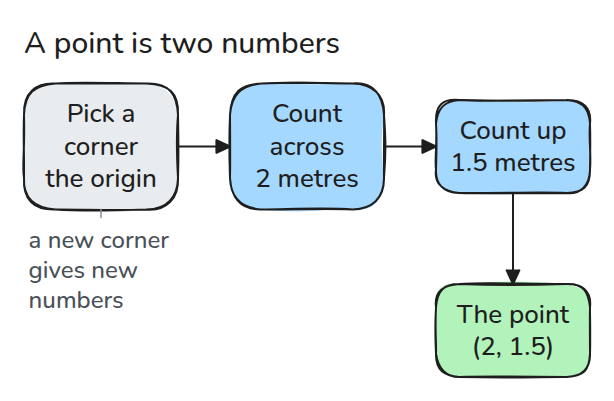
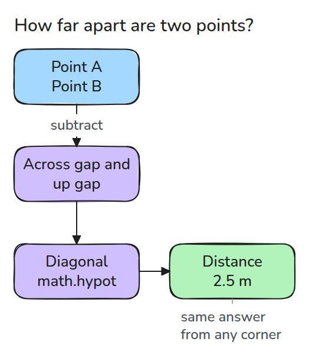
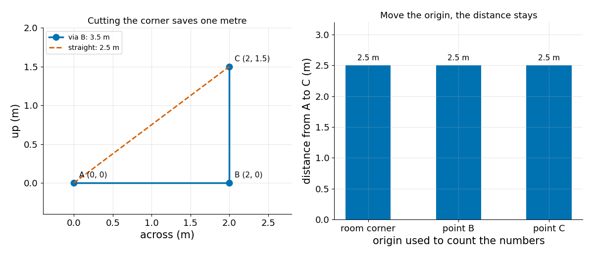

# Points as Numbers

> Learn that a place is just a pair of numbers counted from a corner, and how to measure the distance between two places.

**Type:** Learn   **Prerequisites:** 00/01 What Is a Robot   **Time:** ~15 minutes

## In Plain Words

To tell a friend where treasure is buried, you say: start at the fence corner, walk across this far, then this far up. Two numbers are enough.

A robot does the same, so every place becomes a pair of numbers. Pick a different corner and the numbers change, but the gap between two places stays the same.

## Key Terms

- **Point**: one place, written as a pair of numbers such as (2, 1.5), or three numbers in 3D.
- **Origin**: the corner all counting starts from, written (0, 0).
- **Coordinates**: the numbers that name a point: how far across and how far up.
- **Distance**: the straight-line gap between two points.
- **Hypotenuse**: the slanted long side of a triangle that has one square corner.

## The Problem

A rover must visit three marks on the floor. How far does it drive? Would going straight from the first mark to the last be shorter?

## The Concept

A robot must know where things are before it can move to them, so places need numbers.



*Pick a corner, count across, then count up. Two numbers name the place.*

To find how far apart two points are, find the gap across and the gap up. The straight line between the points is the long side of a triangle with those two gaps.



*Subtract to get the two gaps, then the diagonal gives the distance.*

<details><summary>The math (optional)</summary>

A point is `(x, y)`. `shift` adds a move to each number, and `measured_from(point, origin)` subtracts the origin. The distance is `math.hypot(dx, dy)`, where `dx` and `dy` are the gaps. Across 3 and up 4 gives exactly 5. The route is A (0, 0), B (2, 0), C (2, 1.5). A to B is 2.0 m and B to C is 1.5 m, so driving via B is 3.5 m. Straight from A to C is 2.5 m. `math.hypot` also takes three numbers: (0, 0, 0) to (1, 2, 2) is 3.0.

</details>


*The rover drives from mark to mark. Each leg is one distance.*



*Left: cutting the corner is shorter than going through B. Right: the distance is the same from any origin.*

## Build It

Each function works on a pair or a triple of numbers.

```python
def shift(point, move):
    return tuple(c + d for c, d in zip(point, move))

def measured_from(point, origin):
    return tuple(c - o for c, o in zip(point, origin))

def distance(p, q):
    return math.hypot(*(b - a for a, b in zip(p, q)))

def path_length(points):
    return sum(distance(a, b) for a, b in zip(points, points[1:]))

def lerp(p, q, t):
    return tuple(a + (b - a) * t for a, b in zip(p, q))
```

```bash
cd robotics-engineering-from-scratch
python3 -m pytest phases/00-start-here/02-points-as-numbers -q
python3 phases/00-start-here/02-points-as-numbers/code/main.py
```

## Use It

Python's `math.dist(p, q)` gives the same distance as ours. A test checks that they agree.

## Ship It

`outputs/skill-point-and-distance-check.md` is a short checklist for working with positions and distances.

## Exercises

1. Add a fourth mark D at (0, 1.5) and ask `path_length` for the new route.
2. Count A and B from point C with `measured_from` and check the distance is still 2.0.
3. Use `lerp` to find the point halfway between A and C.
