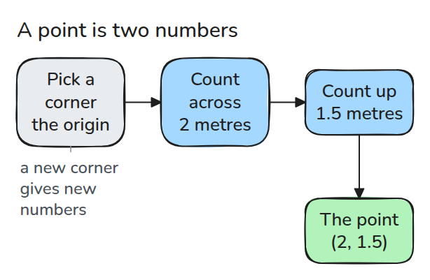
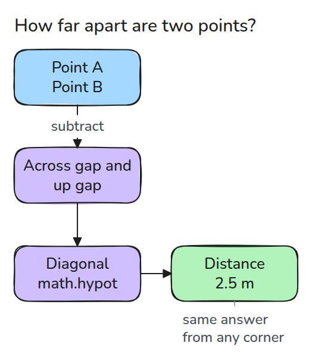
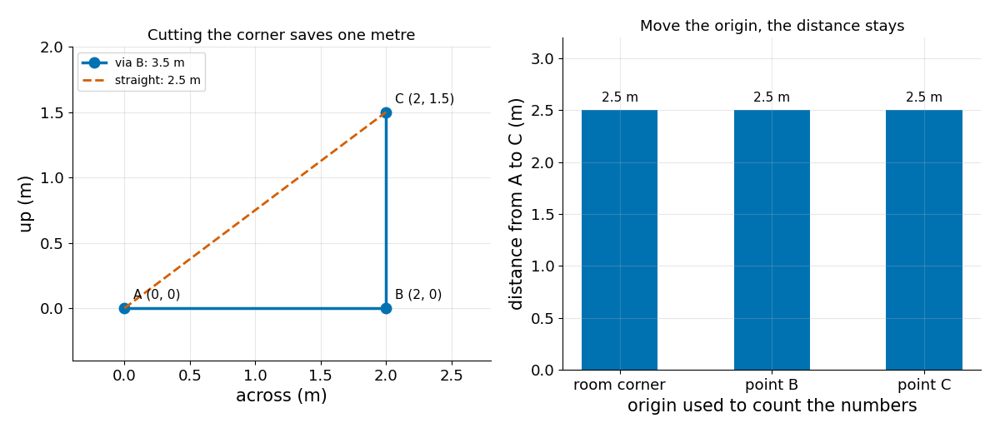

# Points as Numbers

> 자리는 구석에서부터 센 숫자 한 쌍일 뿐이라는 것과 두 자리 사이의 거리를 재는 법을 배웁니다.

**유형:** 배우기   **선수 지식:** 00/01 What Is a Robot   **시간:** 약 15분

## 쉽게 말하면

친구에게 보물이 묻힌 곳을 알려 준다고 해 보세요. 울타리 구석에서 이만큼 옆으로 가고 다시 이만큼 위로 가라고 말하면 돼요. 숫자 두 개면 충분해요.

로봇도 똑같이 하니까 모든 자리가 숫자 한 쌍이 돼요. 다른 구석을 고르면 숫자는 바뀌지만 두 자리 사이의 간격은 그대로예요.

## 핵심 용어

- **Point**: (2, 1.5) 같은 숫자 한 쌍으로 적는 자리 하나입니다. 3D에서는 숫자 세 개입니다.
- **Origin**: 모든 세기가 시작되는 구석이고 (0, 0)으로 적습니다.
- **Coordinates**: 가로로 얼마나 가고 세로로 얼마나 가는지 나타내는 숫자입니다.
- **Distance**: 두 점 사이의 곧은 간격입니다.
- **Hypotenuse**: 직각이 하나 있는 삼각형에서 비스듬한 가장 긴 변입니다.

## 문제

rover가 바닥에 표시된 세 곳을 차례로 가야 합니다. 얼마나 달릴까요? 첫 표시에서 마지막 표시로 곧장 가면 더 짧을까요?

## 개념

로봇은 물건이 어디 있는지 알아야 거기로 움직일 수 있으므로 자리에는 숫자가 필요합니다.



*구석을 고르고 가로로 세고 세로로 셉니다. 숫자 두 개가 자리를 정합니다.*

두 점이 얼마나 먼지 알려면 가로 간격과 세로 간격을 구하면 됩니다. 두 점을 잇는 곧은 선은 그 두 간격을 변으로 하는 삼각형의 가장 긴 변입니다.



*빼서 두 간격을 구하고 대각선으로 거리를 얻습니다.*

<details><summary>The math (optional)</summary>

점은 `(x, y)`입니다.
`shift`는 각 숫자에 이동량을 더하고 `measured_from(point, origin)`은 원점을 뺍니다.
거리는 `math.hypot(dx, dy)`이고 `dx`와 `dy`는 두 간격입니다.
가로 3, 세로 4이면 거리는 정확히 5입니다.
경로는 A (0, 0), B (2, 0), C (2, 1.5)입니다.
A에서 B는 2.0 m이고 B에서 C는 1.5 m이므로 B를 거치면 3.5 m입니다.
A에서 C로 곧장 가면 2.5 m입니다.
`math.hypot`은 숫자 세 개도 받습니다.
(0, 0, 0)에서 (1, 2, 2)까지는 3.0입니다.

</details>


*rover가 표시에서 표시로 달립니다. 한 구간이 거리 하나입니다.*



*왼쪽은 모퉁이를 질러 가면 B를 거치는 길보다 짧다는 것을 보여 줍니다. 오른쪽은 어느 원점에서 세어도 거리가 같다는 것을 보여 줍니다.*

## 만들기

각 함수는 숫자 두 개든 세 개든 받습니다.

```python
def shift(point, move):
    return tuple(c + d for c, d in zip(point, move))

def measured_from(point, origin):
    return tuple(c - o for c, o in zip(point, origin))

def distance(p, q):
    return math.hypot(*(b - a for a, b in zip(p, q)))

def path_length(points):
    return sum(distance(a, b) for a, b in zip(points, points[1:]))

def lerp(p, q, t):
    return tuple(a + (b - a) * t for a, b in zip(p, q))
```

```bash
cd robotics-engineering-from-scratch
python3 -m pytest phases/00-start-here/02-points-as-numbers -q
python3 phases/00-start-here/02-points-as-numbers/code/main.py
```

## 실제 도구로 보기

Python의 `math.dist(p, q)`는 우리가 만든 `distance`와 같은 값을 돌려줍니다. 두 값이 일치하는지 테스트가 확인합니다.

## 결과물

`outputs/skill-point-and-distance-check.md`는 위치와 거리를 다룰 때 보는 짧은 체크리스트입니다.

## 연습 문제

1. (0, 1.5)에 네 번째 표시 D를 더하고 `path_length`로 새 경로의 길이를 구하세요.
2. `measured_from`으로 A와 B를 C 기준으로 세어 보고 거리가 여전히 2.0인지 확인하세요.
3. `lerp`로 A와 C의 한가운데 점을 구하세요.
