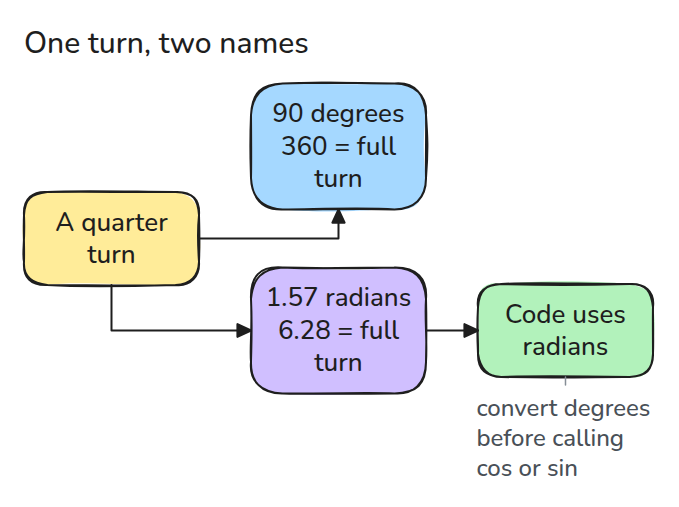
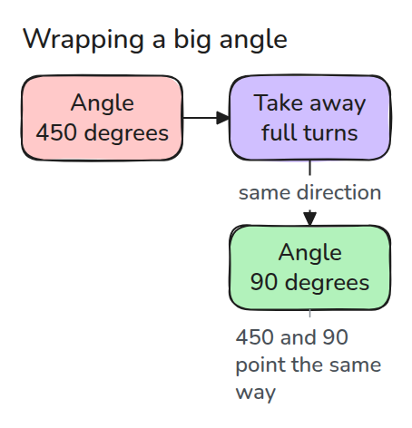
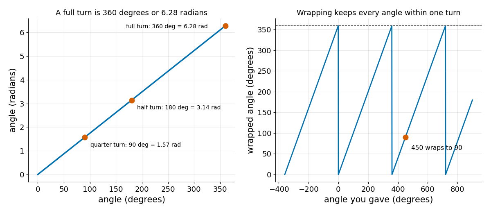

# Angles and Radians

> Learn that an angle can be counted in degrees or radians, and that code always wants radians.

**Type:** Learn   **Prerequisites:** 00/02 Points as Numbers   **Time:** ~15 minutes

## In Plain Words

A turn can be counted in two ways, like a distance in miles or in kilometres. Degrees cut a full turn into many small slices. Radians count how far you walk around the edge of a circle whose radius is one.

Computers expect radians. Give them a number in degrees and they turn the wrong amount, with no warning.

## Key Terms

- **Angle**: how much something has turned from its starting direction.
- **Degree**: one slice when a full turn is cut into 360 equal slices.
- **Radian**: an angle unit where a full turn is about 6.28. Code uses this unit.
- **Full turn**: one complete trip around, back to the direction you started in.
- **Wrap**: bring an angle back into one full turn without changing the direction it points.

## The Problem

A joint sensor says 90. Is that a quarter turn, or more than fourteen full turns? It depends on the unit, and the code will not tell you.

## The Concept

Every joint of a robot arm turns by an angle, so every arm program needs the right unit.



*A quarter turn is one amount with two names. Code uses the radian name.*

An angle can also be bigger than one turn. Going around once more leaves the arm pointing the same way, so we can take whole turns away.



*Taking away full turns changes the number but not the direction.*

<details><summary>The math (optional)</summary>

`pi` is about 3.14159. A full turn is `2 * pi`, about 6.28 radians, or 360 degrees. `deg_to_rad(d) = d * pi / 180` and `rad_to_deg(r) = r * 180 / pi`. So 90 degrees is 1.57 radians and 180 degrees is 3.14. `wrap_turn(a)` is `a % (2 * pi)`, so 450 degrees wraps to 90 and -90 degrees wraps to 270. The result is always from 0 up to, but not including, a full turn.

</details>


*The arm joint turns a quarter turn. The amber bars mark where it starts and where it ends.*



*Left: degrees and radians rise together. Right: wrapping folds every angle back into one turn.*

## Build It

Two conversions and one wrap are enough.

```python
FULL_TURN = 2 * math.pi
QUARTER_TURN = FULL_TURN / 4

def deg_to_rad(degrees):
    return degrees * math.pi / 180

def rad_to_deg(radians):
    return radians * 180 / math.pi

def wrap_turn(angle):
    return angle % FULL_TURN
```

```bash
cd robotics-engineering-from-scratch
python3 -m pytest phases/00-start-here/03-angles-and-radians -q
python3 phases/00-start-here/03-angles-and-radians/code/main.py
```

## Use It

Python has the same conversions as `math.radians` and `math.degrees`, and numpy has `np.deg2rad`. A test checks that ours agree with `math`.

## Ship It

`outputs/skill-angle-unit-check.md` is a short checklist for catching a wrong angle unit before it moves a joint.

## Exercises

1. Convert 45 and 270 degrees and check the answers against the left picture.
2. Predict, then run, `wrap_turn` on 720 degrees and on -450 degrees.
3. Compare `math.cos(90)` with `math.cos(deg_to_rad(90))` and explain the difference.
