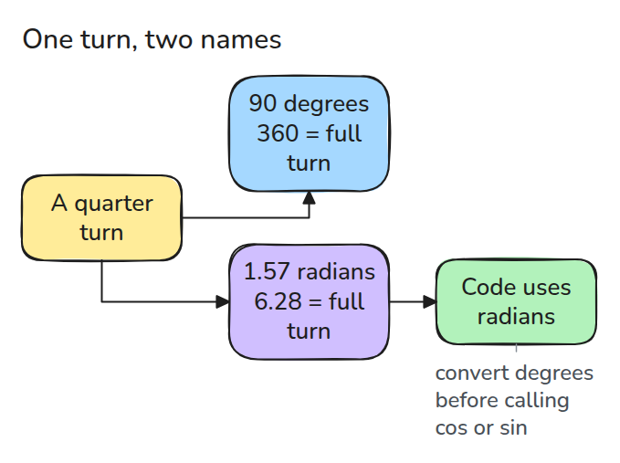
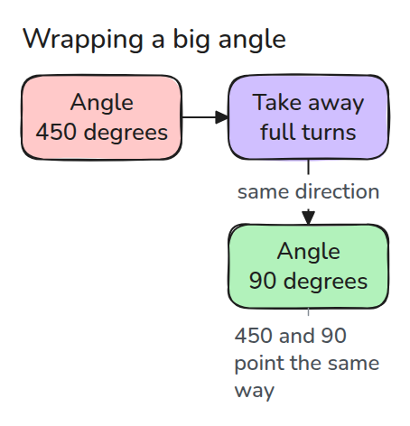
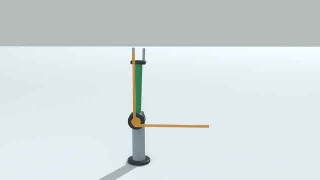
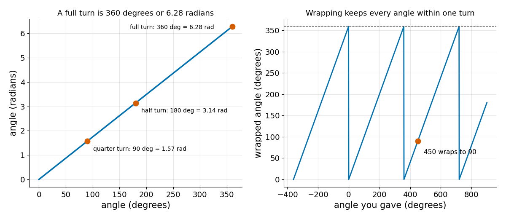

# 각도와 radian

> Python의 sin과 cos에 맞게 degree와 radian을 변환하는 법을 배웁니다.

**유형:** 배우기   **선수 지식:** 00/02 Points as Numbers   **시간:** 약 15분

## 쉽게 말하면

거리를 마일이나 킬로미터로 쓸 수 있듯이 회전도 두 가지 방법으로 셀 수 있어요. degree는 한 바퀴를 아주 많은 작은 조각으로 나눠요. radian은 반지름이 하나인 원의 가장자리를 따라 얼마나 걸었는지를 세요.

Python의 sin과 cos는 radian을 받아요. degree를 변환하지 않고 넣으면 경고 없이 틀린 답이 나와요.

## 핵심 용어

- **Full turn**: 처음 향한 방향으로 돌아오는 한 바퀴입니다.
- **Angle**: 어떤 것이 처음 방향에서 얼마나 돌았는지입니다.
- **Degree**: 한 바퀴를 똑같은 360조각으로 나눈 한 조각입니다.
- **Radian**: 한 바퀴가 약 6.28인 각도 단위입니다. 코드는 이 단위를 씁니다.
- **Wrap**: 가리키는 방향은 그대로 두고 각도를 한 바퀴 안으로 되돌리는 일입니다.

## 문제

팔꿈치에 달린 sensor가 90이라고 말합니다. 사분의 일 바퀴일까요, 열네 바퀴가 넘을까요? 어느 단위냐에 따라 달라지는데 코드는 알려 주지 않습니다.

## 개념

로봇 팔의 모든 경첩은 각도만큼 돌기 때문에 모든 팔 프로그램에는 맞는 단위가 필요합니다.



*사분의 일 바퀴는 하나의 양에 이름이 둘입니다. 코드는 radian 이름을 씁니다.*

각도는 한 바퀴보다 클 수도 있습니다. 한 바퀴를 더 돌아도 팔은 같은 방향을 가리키므로 온전한 바퀴를 뺄 수 있습니다.



*온전한 바퀴를 빼면 숫자는 바뀌지만 방향은 그대로입니다.*

<details><summary>The math (optional)</summary>

`pi`는 약 3.14159입니다. 한 바퀴는 `2 * pi`이고 약 6.28 radian 또는 360도입니다. `deg_to_rad(d) = d * pi / 180`이고 `rad_to_deg(r) = r * 180 / pi`입니다.
그래서 90도는 1.57 radian이고 180도는 3.14입니다. `wrap_turn(a)`는 `a % (2 * pi)`이므로 450도는 90도가 되고 -90도는 270도가 됩니다. 결과는 항상 0부터 한 바퀴 직전까지입니다.

</details>

[](../assets/clip.mp4)

*팔의 경첩이 사분의 일 바퀴를 돕니다. 호박색 막대는 출발점과 도착점입니다.*



*왼쪽은 degree와 radian이 함께 커지는 모습입니다. 오른쪽은 wrap이 모든 각도를 한 바퀴 안으로 접어 넣는 모습입니다.*

## 만들기

변환 두 개와 wrap 하나면 충분합니다.

```python
FULL_TURN = 2 * math.pi
QUARTER_TURN = FULL_TURN / 4

def deg_to_rad(degrees):
    return degrees * math.pi / 180

def rad_to_deg(radians):
    return radians * 180 / math.pi

def wrap_turn(angle):
    return angle % FULL_TURN
```

```bash
cd robotics-engineering-from-scratch
python3 -m pytest phases/00-start-here/03-angles-and-radians -q
python3 phases/00-start-here/03-angles-and-radians/code/main.py
```

## 실제 도구로 보기

Python에는 같은 변환이 `math.radians`와 `math.degrees`로 있고 numpy에는 `np.deg2rad`가 있습니다. 우리 함수가 `math`와 일치하는지 테스트가 확인합니다.

## 결과물

`outputs/skill-angle-unit-check.md`는 틀린 각도 단위를 팔이 움직이기 전에 잡아내는 짧은 체크리스트입니다.

## 연습 문제

1. 45도와 270도를 변환해서 왼쪽 그림과 맞는지 확인하세요.
2. 720도와 -450도에 `wrap_turn`을 쓰면 어떻게 될지 예측한 다음 돌려 보세요.
3. `math.cos(90)`과 `math.cos(deg_to_rad(90))`을 비교하고 차이를 설명하세요.
