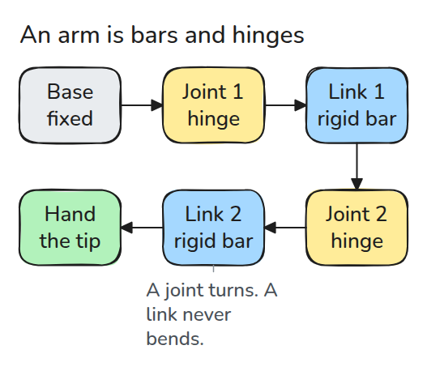
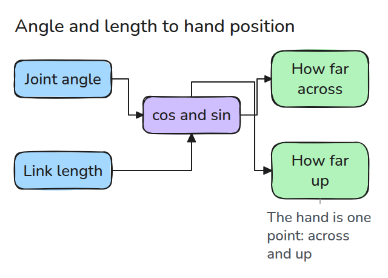
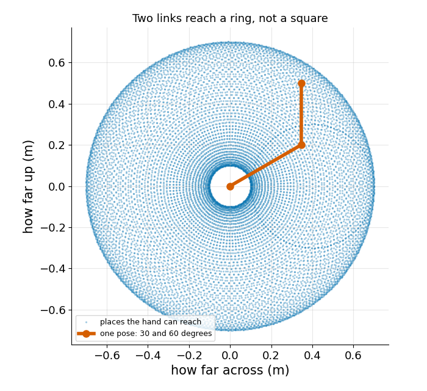

# Joints and Links

> Learn how a joint angle and a link length tell you where an arm's hand is.

**Type:** Learn   **Prerequisites:** 00/03 Angles and Radians   **Time:** ~15 minutes

## In Plain Words

An arm is a few stiff bars joined by hinges, like your shoulder and elbow. Bend only your elbow. The hand swings around the elbow in a circle, because the forearm cannot stretch.

So if you know each bar's length and each hinge's turn, you know exactly where the hand is.

## Key Terms

- **Joint**: a hinge that turns. How far it has turned is an angle.
- **Link**: a stiff bar between two joints. It never bends or stretches.
- **Hand**: the tip of the last link, the point we want to place.
- **cos and sin**: two calculator buttons that turn an angle into "how far across" and "how far up" for a bar of length one.

## The Problem

You want the hand to touch a cup, but you can only tell the joints how far to turn. So you must know where the hand ends up.

## The Concept

Every reach starts with one question: given the angles, where is the hand?



*The base holds still, each joint turns, and each link is a stiff bar.*

Picture one link lying flat, pointing across. Turn its joint, and the tip lifts. How far across the tip still is comes from cos. How far up it has risen comes from sin.



*The angle and the length together give two numbers: across and up.*

A second link starts at the tip of the first. Its angle is counted from the first link, not from the floor. Add the two links' across amounts, and add their up amounts.


*Amber balls show where the code says the hand is. The hand reaches each one.*



*Turning both joints through every angle fills a ring. The hand cannot enter the hole.*

<details><summary>The math (optional)</summary>

One link of length `L` at angle `q` (radians, from straight across): across = `L cos q`, up = `L sin q`. For `L` = 0.4 and `q` = 30 degrees that is (0.346, 0.200).

Two links: across = `L1 cos q1 + L2 cos(q1 + q2)`, up = `L1 sin q1 + L2 sin(q1 + q2)`. With `L1` = 0.4, `L2` = 0.3, `q1` = 30 and `q2` = 60 degrees, the second link points at 90 degrees and the hand is at (0.346, 0.500). Both links straight reach 0.7. The elbow folded fully back reaches 0.1.

</details>

## Build It

`hand_position` is the one-link rule. `two_link_position` adds the second link on top.

```python
import math


def hand_position(length, angle):
    """Hand of one link: (how far across, how far up). The angle is in radians, counted from straight across."""
    return length * math.cos(angle), length * math.sin(angle)


def two_link_position(length1, length2, angle1, angle2):
    """Hand of two links. angle2 is measured from the first link, so the second link points at angle1 + angle2."""
    x1, z1 = hand_position(length1, angle1)
    x2, z2 = hand_position(length2, angle1 + angle2)
    return x1 + x2, z1 + z2
```

```bash
cd robotics-engineering-from-scratch
python3 -m pytest phases/00-start-here/04-joints-and-links -q
python3 phases/00-start-here/04-joints-and-links/code/main.py
```

## Use It

Python's `math` module has `cos` and `sin`, and both expect radians.

Sources: https://docs.python.org/3/library/math.html (cos and sin only).

## Ship It

`outputs/skill-hand-position-check.md` is a checklist for checking a hand position.

## Exercises

1. Set the first angle to a quarter turn. Does the hand point straight up?
2. Give the second angle a negative value. Which way does the hand move?
3. Fold the elbow fully back. How close does the hand get to the shoulder?
