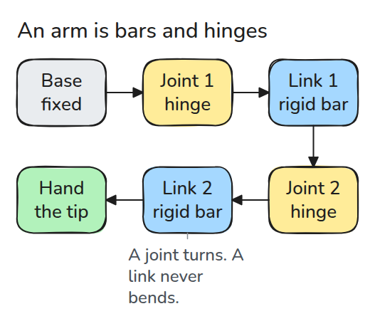
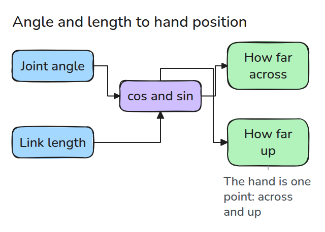
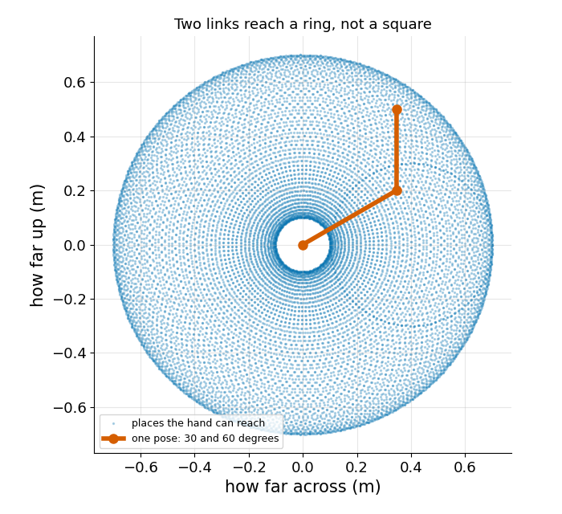

# 관절과 링크

> 경첩마다 돈 정도와 막대의 길이만으로 로봇 팔의 손이 어디에 있는지 알아내는 법을 배웁니다.

**유형:** 배우기   **선수 지식:** 00/03 각도와 radian   **시간:** 약 15분

## 쉽게 말하면

팔은 단단한 막대 몇 개를 경첩으로 이은 것이에요. 어깨와 팔꿈치를 떠올려 보세요. 팔꿈치만 굽히면 손은 팔꿈치를 중심으로 원을 그리며 움직여요. 아래팔이 늘어나지 않기 때문이에요.

그래서 막대의 길이와 경첩이 돈 정도를 알면 손의 위치를 정확히 알 수 있어요.

## 핵심 용어

- **Joint**: 돌아가는 경첩입니다. 얼마나 돌았는지는 각도로 나타냅니다.
- **Link**: 두 joint 사이의 단단한 막대입니다. 휘거나 늘어나지 않습니다.
- **Hand**: 마지막 link의 끝으로 우리가 놓고 싶은 지점입니다.
- **cos and sin**: 각도를 길이 1인 막대의 "옆으로 간 거리"와 "위로 간 거리"로 바꿔 주는 계산기 버튼 두 개입니다.

## 문제

손으로 컵을 건드리고 싶지만 시킬 수 있는 것은 joint를 얼마나 돌릴지뿐입니다. 그래서 손이 어디에 놓이는지 알아야 합니다.

## 개념

팔이 뻗는 동작은 모두 한 질문에서 시작합니다. 각도가 주어졌을 때 손은 어디에 있는가입니다.



*base는 가만히 있고 joint는 돌며 link는 단단한 막대입니다.*

link 하나가 옆을 향해 누워 있다고 해 보세요. joint를 돌리면 끝이 들립니다. 끝이 아직 옆으로 얼마나 가 있는지는 cos로 나옵니다. 위로 얼마나 올라갔는지는 sin으로 나옵니다.



*각도와 길이가 합쳐져 두 숫자가 나옵니다. 옆으로 간 거리와 위로 간 거리입니다.*

두 번째 link는 첫 번째 link의 끝에서 시작합니다. 두 번째 각도는 바닥이 아니라 첫 번째 link를 기준으로 잽니다. 두 link가 옆으로 간 거리를 더하고 위로 간 거리도 더합니다.


*주황색 공은 코드가 계산한 손 위치입니다. 손이 공마다 정확히 닿습니다.*



*두 joint를 모든 각도로 돌리면 고리 모양이 채워집니다. 손은 구멍 안으로 들어갈 수 없습니다.*

<details><summary>The math (optional)</summary>

길이가 `L`인 link 하나가 각도 `q`(radians, 옆으로 곧게 편 방향이 기준)에 있으면 옆으로 간 거리는 `L cos q`이고 위로 간 거리는 `L sin q`입니다. `L` = 0.4와 `q` = 30도이면 (0.346, 0.200)입니다.

link 두 개이면 옆으로 간 거리는 `L1 cos q1 + L2 cos(q1 + q2)`이고 위로 간 거리는 `L1 sin q1 + L2 sin(q1 + q2)`입니다.

`L1` = 0.4, `L2` = 0.3, `q1` = 30도, `q2` = 60도이면 두 번째 link는 90도를 향하고 손은 (0.346, 0.500)에 있습니다. 두 link를 곧게 펴면 0.7까지 닿고 팔꿈치를 끝까지 접으면 0.1까지만 닿습니다.

</details>

## 만들기

`hand_position`은 link 하나의 규칙입니다. `two_link_position`은 그 위에 두 번째 link를 더합니다.

```python
import math


def hand_position(length, angle):
    """Hand of one link: (how far across, how far up). The angle is in radians, counted from straight across."""
    return length * math.cos(angle), length * math.sin(angle)


def two_link_position(length1, length2, angle1, angle2):
    """Hand of two links. angle2 is measured from the first link, so the second link points at angle1 + angle2."""
    x1, z1 = hand_position(length1, angle1)
    x2, z2 = hand_position(length2, angle1 + angle2)
    return x1 + x2, z1 + z2
```

```bash
cd robotics-engineering-from-scratch
python3 -m pytest phases/00-start-here/04-joints-and-links -q
python3 phases/00-start-here/04-joints-and-links/code/main.py
```

## 실제 도구로 보기

Python의 `math` 모듈에 `cos`와 `sin`이 있고 둘 다 radians를 받습니다.

출처: https://docs.python.org/3/library/math.html (cos와 sin만).

## 결과물

`outputs/skill-hand-position-check.md`는 손 위치를 확인하는 체크리스트입니다.

## 연습 문제

1. 첫 번째 각도를 4분의 1 바퀴로 두세요. 손이 똑바로 위를 향합니까?
2. 두 번째 각도에 음수를 넣으세요. 손은 어느 쪽으로 움직입니까?
3. 팔꿈치를 끝까지 접으세요. 손은 어깨에 얼마나 가까워집니까?
