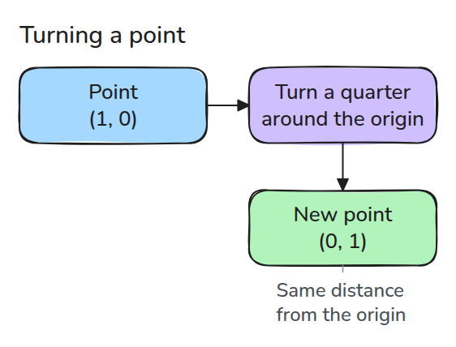
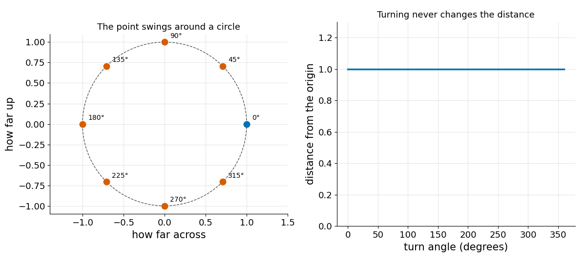
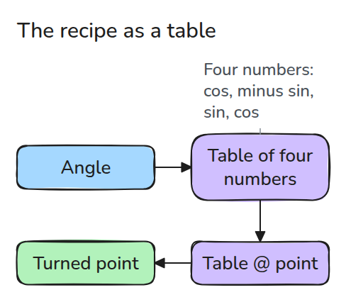

# Turning a Point

> Learn how to turn a point around the origin by an angle, first with plain math, then with a small table of numbers.

**Type:** Learn   **Prerequisites:** 00/04 Joints and Links   **Time:** ~15 minutes

## In Plain Words

Lay a pen flat on a table with one end under your fingertip, then spin it. Every point on the pen travels along a circle around your fingertip. Its distance from the fingertip never changes.

Turning a point works the same way. Your fingertip is the origin, the spot everything turns around. The point swings around it by some angle and stays just as far away.

## Key Terms

- **Origin**: the starting spot, (0, 0), that positions are measured from and things turn around.
- **Rotate**: turn a point around the origin by an angle.
- **Rotation matrix**: a small table of numbers that turns a point when you multiply the two.
- **`@`**: numpy's symbol for multiplying a table by a point.

## The Problem

A drone spins in place to face a new way. A marker in front of its nose must spin with it. Where is the marker after the turn?

## The Concept

Robots turn things all the time: a drone yaws, a joint swings, a camera looks around. All of it is this one move.



*A quarter turn takes the point across the page to the point straight up.*

The turned point keeps its distance from the origin. Only its direction changes.



*Left: the point lands on a circle at every angle. Right: its distance never changes.*

The recipe needs only the cos and sin of the angle. Write four numbers from them in a table, and turning a point becomes "table times point". That table is a rotation matrix.



*The same turn, written as a table that multiplies the point.*


*The drone turns, and the amber ball in front of its nose moves where the code says.*

<details><summary>The math (optional)</summary>

A point (`x`, `y`) turned by angle `a` (radians, counter-clockwise) lands at (`x cos a - y sin a`, `x sin a + y cos a`). The table is [[cos a, -sin a], [sin a, cos a]], and the new point is table `@` point.

A quarter turn takes (1, 0) to (0, 1) and (0, 1) to (-1, 0). Its table is [[0, -1], [1, 0]]. Two turns of 20 and 55 degrees give the same point as one turn of 75 degrees. The tests check that the plain math and the table agree.

</details>

## Build It

`rotate` is the plain recipe. `rotation_table` writes it as a 2x2 table, and `rotate_with_table` multiplies it by the point with `@`.

```python
import math

import numpy as np


def rotate(point, angle):
    """Turn (across, up) around the origin by angle (radians, counter-clockwise)."""
    x, y = point
    c, s = math.cos(angle), math.sin(angle)
    return x * c - y * s, x * s + y * c


def rotation_table(angle):
    """The same recipe as a 2x2 table of numbers (a rotation matrix)."""
    c, s = math.cos(angle), math.sin(angle)
    return np.array([[c, -s], [s, c]])


def rotate_with_table(point, angle):
    return tuple(rotation_table(angle) @ np.asarray(point, dtype=float))
```

```bash
cd robotics-engineering-from-scratch
python3 -m pytest phases/00-start-here/05-turning-a-point -q
python3 phases/00-start-here/05-turning-a-point/code/main.py
```

## Use It

numpy's `@` is its matrix multiply, so `table @ point` is one line.

Sources: https://numpy.org/doc/stable/reference/generated/numpy.matmul.html (the `@` operator only).

## Ship It

`outputs/skill-rotation-check.md` is a checklist for checking a rotation.

## Exercises

1. Turn (1, 0) by half a turn. Where does it land?
2. Turn a point by a quarter turn four times. Where does it end?
3. Turn by a negative angle. Which way does the point swing?
