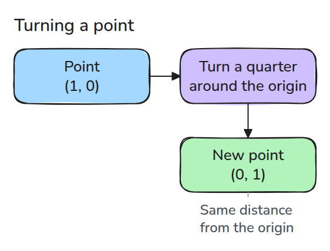
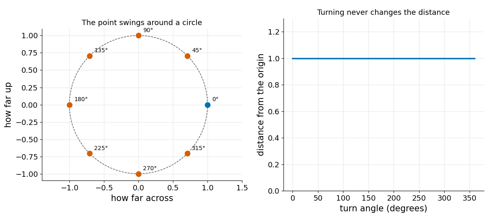
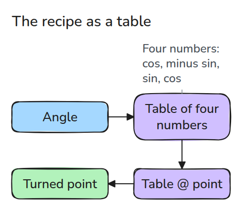

# 점 돌리기

> 점을 원점 둘레로 각도만큼 돌리는 법을 먼저 식으로 그다음 작은 숫자 표로 배웁니다.

**유형:** 배우기   **선수 지식:** 00/04 관절과 링크   **시간:** 약 15분

## 쉽게 말하면

펜 한쪽 끝을 손가락 끝으로 누르고 책상 위에서 돌려 보세요. 펜 위의 모든 점은 손가락 끝을 중심으로 원을 따라 움직여요. 손가락 끝과의 거리는 변하지 않아요.

점을 돌리는 것도 똑같아요. 손가락 끝이 origin이에요. 모든 것이 그 둘레를 도는 기준점이에요. 점은 그 둘레를 각도만큼 돌고 거리는 그대로예요.

## 핵심 용어

- **Origin**: 위치를 재는 기준이자 모든 것이 그 둘레를 도는 출발점 (0, 0)입니다.
- **Rotate**: 점을 원점 둘레로 각도만큼 돌리는 것입니다.
- **Rotation matrix**: 점과 곱하면 점을 돌려 주는 작은 숫자 표입니다.
- **At sign (`@`)**: numpy에서 표와 점을 곱할 때 쓰는 기호입니다.

## 문제

드론이 제자리에서 돌아 다른 쪽을 봅니다. 기체 앞쪽의 표식도 같이 돌아야 합니다. 돈 뒤에 표식은 어디에 있습니까?

## 개념

로봇은 늘 무언가를 돌립니다. 드론은 yaw로 돌고 joint는 휘두르며 카메라는 주위를 둘러봅니다. 모두 이 한 동작입니다.



*4분의 1 바퀴를 돌리면 옆에 있던 점이 똑바로 위의 점이 됩니다.*

돌아간 점은 원점에서의 거리를 그대로 지킵니다. 바뀌는 것은 방향뿐입니다.



*왼쪽은 어떤 각도에서도 점이 원 위에 놓이는 모습입니다. 오른쪽은 거리가 변하지 않는 모습입니다.*

이 방법에는 각도의 cos와 sin만 필요합니다. 그 값으로 숫자 네 개를 표에 적으면 점을 돌리는 일이 "표 곱하기 점"이 됩니다. 그 표가 rotation matrix입니다.



*같은 회전을 점에 곱하는 표로 쓴 모습입니다.*


*드론이 돌면 기체 앞쪽의 주황색 공이 코드가 계산한 자리로 움직입니다.*

<details><summary>The math (optional)</summary>

점 (`x`, `y`)를 각도 `a`(radians, 반시계 방향)만큼 돌리면 (`x cos a - y sin a`, `x sin a + y cos a`)에 놓입니다. 표는 [[cos a, -sin a], [sin a, cos a]]이고 새 점은 표 `@` 점입니다.

4분의 1 바퀴는 (1, 0)을 (0, 1)로 (0, 1)을 (-1, 0)으로 보냅니다. 이때의 표는 [[0, -1], [1, 0]]입니다. 20도 회전 다음 55도 회전은 75도 회전 한 번과 같은 점을 줍니다. 식과 표가 같은 답을 주는지는 테스트가 확인합니다.

</details>

## 만들기

`rotate`는 식 그대로의 방법입니다. `rotation_table`은 같은 방법을 2x2 표로 쓰고 `rotate_with_table`은 `@`로 표를 점에 곱합니다.

```python
import math

import numpy as np


def rotate(point, angle):
    """Turn (across, up) around the origin by angle (radians, counter-clockwise)."""
    x, y = point
    c, s = math.cos(angle), math.sin(angle)
    return x * c - y * s, x * s + y * c


def rotation_table(angle):
    """The same recipe as a 2x2 table of numbers (a rotation matrix)."""
    c, s = math.cos(angle), math.sin(angle)
    return np.array([[c, -s], [s, c]])


def rotate_with_table(point, angle):
    return tuple(rotation_table(angle) @ np.asarray(point, dtype=float))
```

```bash
cd robotics-engineering-from-scratch
python3 -m pytest phases/00-start-here/05-turning-a-point -q
python3 phases/00-start-here/05-turning-a-point/code/main.py
```

## 실제 도구로 보기

numpy의 `@`는 행렬 곱셈이라 `table @ point`가 한 줄로 끝납니다.

출처: https://numpy.org/doc/stable/reference/generated/numpy.matmul.html (`@` 연산자만).

## 결과물

`outputs/skill-rotation-check.md`는 회전을 확인하는 체크리스트입니다.

## 연습 문제

1. (1, 0)을 반 바퀴 돌리세요. 어디에 놓입니까?
2. 점을 4분의 1 바퀴씩 네 번 돌리세요. 어디에서 끝납니까?
3. 음수 각도로 돌리세요. 점은 어느 쪽으로 움직입니까?
