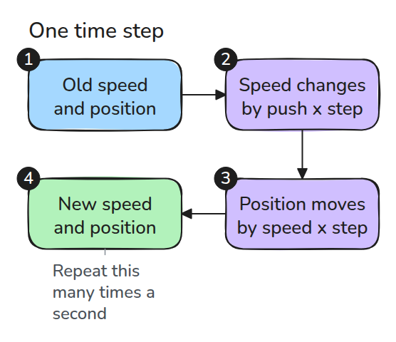
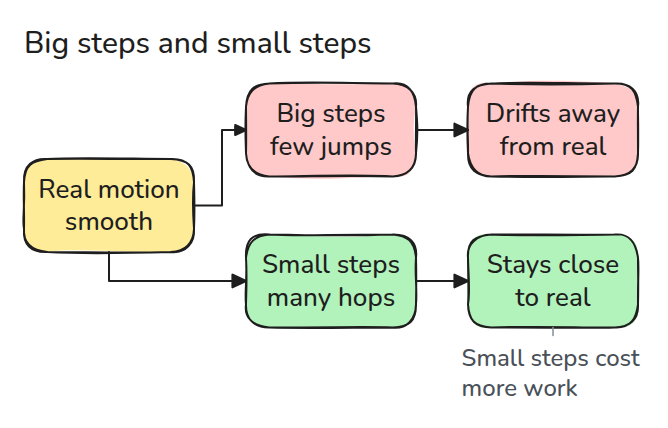
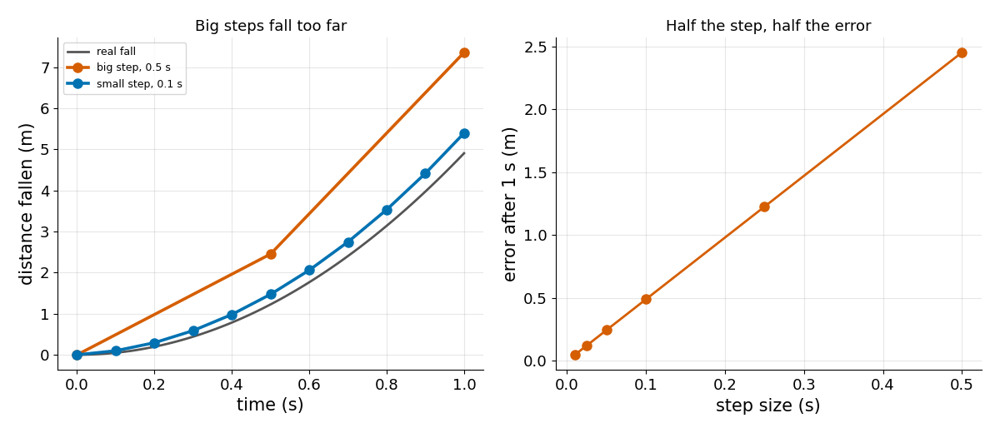
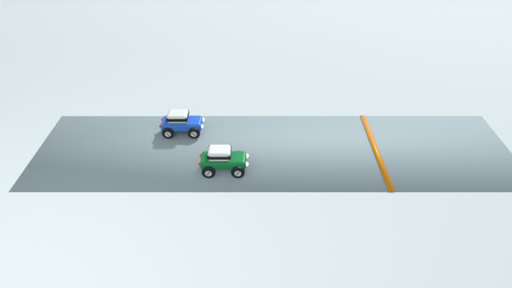

# Time Steps

> Learn how a computer moves things by repeating tiny steps, and why smaller steps follow real motion better.

**Type:** Build   **Prerequisites:** 00/05 Turning a Point   **Time:** ~15 minutes

## In Plain Words

Watch a ball drop in slow motion, one picture at a time. In each picture it has fallen a bit more and is going a bit faster.

A computer moves things the same way. It jumps forward one small slice of time, updates the speed and the position, and repeats. The smaller the slice, the closer the picture stays to what really happens.

## Key Terms

- **Time step (`dt`)**: the small slice of time the computer jumps forward each time.
- **Speed**: how far something moves in one second.
- **Acceleration**: how much the speed changes in one second.
- **Simulation**: a program that predicts motion by repeating small steps.

## The Problem

You drop a ball and want its distance fallen after one second. The computer cannot see a smooth fall. It can only jump from moment to moment.

## The Concept

Robots are tested in simulation first, so how the time is cut up decides whether the test can be trusted.



*In each step the speed changes first, then the position moves by the new speed times the step (`dt`).*

At a steady speed the step size does not matter. When the speed keeps changing, as in a fall, big steps wander away from the real motion and small steps stay close.



*Small steps stay close to real motion, but they cost more work.*



*Left: the big step falls much too far. Right: half the step, half the error.*

[](../assets/clip.mp4)

*Both cars speed up alike. Blue hops in big steps and ends past the amber line. Green ends near it.*

<details><summary>The math (optional)</summary>

Each step: `speed = speed + acceleration * dt`, then `position = position + speed * dt`. The true distance from rest is `0.5 * acceleration * t^2`, which is 4.905 m after 1 s with gravity 9.81.

With `dt` = 0.5 the computer says 7.357 m. With `dt` = 0.1 it says 5.396 m, and with `dt` = 0.01 it says 4.954 m. The error after 1 s is about 4.9 times `dt`.

</details>

## Build It

`move` repeats the step at a steady speed. `positions` adds a changing speed and keeps every step. `exact_distance` is the true answer to compare with.

```python
G = 9.81


def move(position, speed, dt, steps):
    """Move at a steady speed: repeat 'new position = old position + speed * dt'."""
    for _ in range(steps):
        position = position + speed * dt
    return position


def positions(accel, seconds, dt):
    """Distance covered from rest at every step while speeding up by accel. The speed is updated first, then the position."""
    d, v, out = 0.0, 0.0, [0.0]
    for _ in range(round(seconds / dt)):
        v += accel * dt
        d += v * dt
        out.append(d)
    return out


def exact_distance(accel, seconds):
    """The true distance from rest, from the school formula half * accel * t squared."""
    return 0.5 * accel * seconds**2
```

```bash
cd robotics-engineering-from-scratch
python3 -m pytest phases/00-start-here/06-time-steps -q
python3 phases/00-start-here/06-time-steps/code/main.py
```

## Use It

MuJoCo, a free physics simulator, has the same knob. Its `timestep` option sets how long each step is.

Sources: https://mujoco.readthedocs.io/en/stable/XMLreference.html (the `timestep` option only).

## Ship It

`outputs/skill-time-step-check.md` is a checklist for choosing a step size.

## Exercises

1. Change the step in `positions` from 0.1 to 0.05. Does the error halve?
2. Use `move` to find where a car at 3 m/s is after 2 s.
3. Find a step that keeps the one-second fall within 0.1 m.
