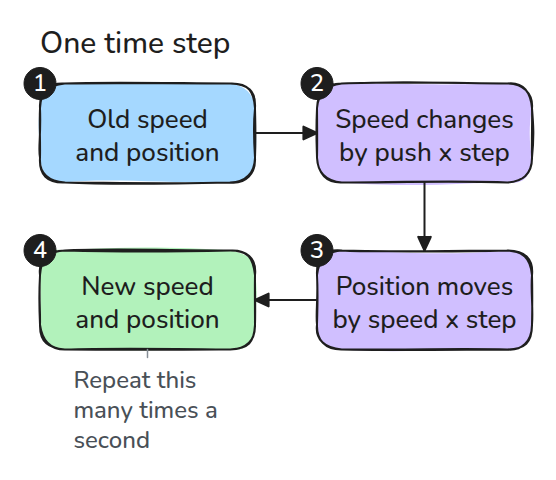
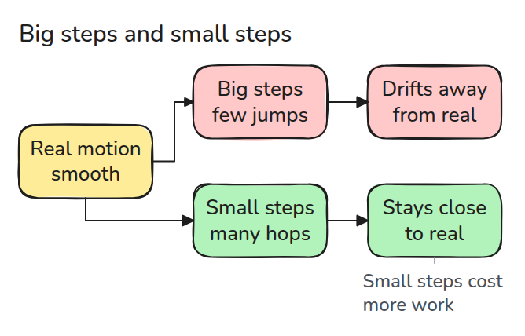
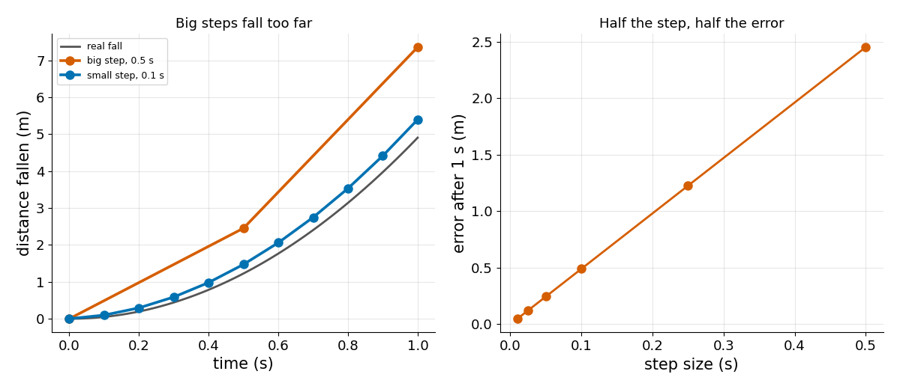

# 시간 스텝

> 컴퓨터가 아주 작은 스텝을 되풀이해 물체를 움직이는 법과 스텝이 작을수록 실제 운동을 더 잘 따라가는 이유를 배웁니다.

**유형:** 만들기   **선수 지식:** 00/05 점 돌리기   **시간:** 약 15분

## 쉽게 말하면

공이 떨어지는 모습을 슬로모션으로 한 장면씩 보세요. 장면마다 공은 조금 더 떨어졌고 조금 더 빨라졌어요.

컴퓨터도 똑같이 움직여요. 시간을 작은 조각만큼 앞으로 넘기고 속도와 위치를 고친 뒤 되풀이해요. 조각이 작을수록 그림이 실제와 더 가깝게 남아요.

## 핵심 용어

- **Time step (`dt`)**: 컴퓨터가 한 번에 앞으로 넘기는 작은 시간 조각입니다.
- **Speed**: 1초 동안 얼마나 움직이는지입니다.
- **Acceleration**: 1초 동안 속도가 얼마나 바뀌는지입니다.
- **Simulation**: 작은 스텝을 되풀이해서 움직임을 예측하는 프로그램입니다.

## 문제

공을 떨어뜨리고 1초 뒤 낙하 거리를 알고 싶습니다. 컴퓨터는 매끄러운 낙하를 볼 수 없습니다. 순간에서 순간으로 건너뛸 수만 있습니다.

## 개념

로봇은 먼저 simulation으로 시험하므로 시간을 어떻게 나누느냐에 따라 그 시험을 믿을 수 있는지가 정해집니다.



*한 스텝에서 속도가 먼저 바뀌고 위치는 새 속도 곱하기 스텝(`dt`)만큼 움직입니다.*

속도가 일정하면 스텝 크기는 상관없습니다. 낙하처럼 속도가 계속 바뀌면 큰 스텝은 실제 운동에서 멀어지고 작은 스텝은 가깝게 따라갑니다.



*작은 스텝은 실제 운동에 가깝게 머물지만 계산이 더 듭니다.*



*왼쪽은 큰 스텝이 너무 멀리 떨어지는 모습입니다. 오른쪽은 스텝을 절반으로 줄이면 오차도 절반이 되는 모습입니다.*


*두 자동차는 똑같이 속도를 올립니다. 파랑은 큰 스텝으로 뛰어 주황색 선을 넘고 초록은 그 근처에서 멈춥니다.*

<details><summary>The math (optional)</summary>

스텝마다 `speed = speed + acceleration * dt`를 한 다음 `position = position + speed * dt`를 합니다. 정지 상태에서의 실제 거리는 `0.5 * acceleration * t^2`이고 중력 9.81이면 1초 뒤 4.905 m입니다.

`dt` = 0.5이면 컴퓨터는 7.357 m라고 답합니다. `dt` = 0.1이면 5.396 m이고 `dt` = 0.01이면 4.954 m입니다. 1초 뒤 오차는 `dt`의 약 4.9배입니다.

</details>

## 만들기

`move`는 일정한 속도로 스텝을 되풀이합니다. `positions`는 변하는 속도를 더하고 모든 스텝을 남깁니다. `exact_distance`는 비교할 실제 답입니다.

```python
G = 9.81


def move(position, speed, dt, steps):
    """Move at a steady speed: repeat 'new position = old position + speed * dt'."""
    for _ in range(steps):
        position = position + speed * dt
    return position


def positions(accel, seconds, dt):
    """Distance covered from rest at every step while speeding up by accel. The speed is updated first, then the position."""
    d, v, out = 0.0, 0.0, [0.0]
    for _ in range(round(seconds / dt)):
        v += accel * dt
        d += v * dt
        out.append(d)
    return out


def exact_distance(accel, seconds):
    """The true distance from rest, from the school formula half * accel * t squared."""
    return 0.5 * accel * seconds**2
```

```bash
cd robotics-engineering-from-scratch
python3 -m pytest phases/00-start-here/06-time-steps -q
python3 phases/00-start-here/06-time-steps/code/main.py
```

## 실제 도구로 보기

무료 물리 simulator인 MuJoCo에도 같은 손잡이가 있습니다. `timestep` 옵션이 스텝 하나의 길이를 정합니다.

출처: https://mujoco.readthedocs.io/en/stable/XMLreference.html (`timestep` 옵션만).

## 결과물

`outputs/skill-time-step-check.md`는 스텝 크기를 고를 때 보는 체크리스트입니다.

## 연습 문제

1. `positions`의 스텝을 0.1에서 0.05로 바꾸세요. 오차가 절반이 됩니까?
2. `move`로 초속 3미터 자동차가 2초 뒤 어디에 있는지 구하세요.
3. 1초 낙하의 오차를 0.1 m 안에 두는 스텝을 찾으세요.
