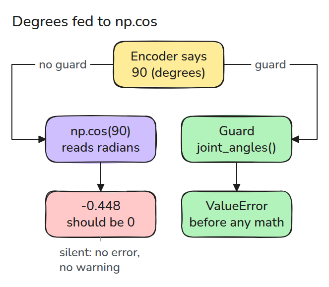
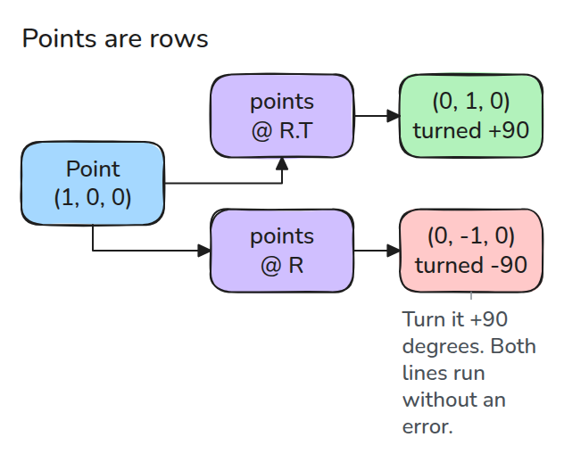
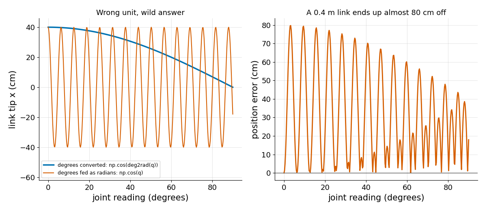

# Python Env and numpy

> See how a wrong unit or array shape quietly gives a wrong answer, and how to catch it.

**Type:** Build   **Prerequisites:** 00/06 Time Steps   **Time:** ~15 minutes

## In Plain Words

An arm's sensor reports the elbow angle as ninety. In degrees that is a quarter turn; in radians it is over fourteen turns. numpy always assumes radians and never asks, so a wrong unit or array shape still runs. Only a check where data enters your code catches it.

## Key Terms

- **Radian**: a unit of angle where one full turn is about 6.28. Degrees use 360 for a full turn.
- **Array shape**: how many rows and columns an array has, such as 5 rows by 3 columns.
- **Rotation matrix**: a small grid of numbers that turns a point around an axis.
- **Transpose (`.T`)**: swaps the rows and columns of a matrix.
- **Guard**: a check where data enters your code that stops bad data with a clear error.
- **venv**: a private folder of packages for one project.

## The Problem

A robot arm's sensor says the elbow is at 90 degrees, and your code treats that number as radians. The hand ends up in the wrong place, and the program shows no error.

## The Concept

A robot does whatever its numbers say, so a wrong unit sends a real arm to the wrong place. numpy never checks units, so your code must.



*The sensor says 90 degrees, but the code reads 90 radians.*

Arrays have the same trap. We store points as rows, and turning them needs one extra step (transposing). Forget it and the points turn the other way, with no error.



*Forgetting that step turns the points the wrong way, silently.*


*Green reaches the post. Blue forgot the step.*



*The wrong unit throws the hand far from where it should be.*

<details><summary>The math (optional)</summary>

`np.cos(90)` reads radians: 90 minus fourteen full turns is 2.04 radians (about 117 degrees), and its cosine is -0.448 instead of 0, so the tip lands 0.45 of a link length off. Turning a point `p` is `R @ p`; points stored as rows need `points @ R.T`. Turning `(1, 0, 0)` by +90 degrees about z should give `(0, 1, 0)`, and `points @ R` gives `(0, -1, 0)`. On a 0.4 m link the unit error moves the tip by almost 0.8 m.

</details>

## Build It

One function checks an array's shape and names the argument in its error. Another flags values that look like degrees, meaning above one full turn in radians.

```python
def check_shape(x, shape, name="array"):
    a = np.asarray(x, dtype=float)
    if a.ndim != len(shape) or any(s is not None and s != n for s, n in zip(shape, a.shape)):
        raise ValueError(f"{name}: expected shape {shape}, got {a.shape}")
    return a

def looks_like_degrees(q, limit=2 * np.pi):
    return bool(np.max(np.abs(q)) > limit)
```

`joint_angles` and `rotate_z` use both. A joint that can spin past a full turn needs a larger limit.

```bash
cd robotics-engineering-from-scratch
python3 -m pytest phases/00-start-here/07-python-env-and-numpy -q
python3 phases/00-start-here/07-python-env-and-numpy/code/main.py
```

## Use It

`python3 -m venv .venv` makes a private folder of packages for one project. Good habits: one venv per project, tests with `np.testing.assert_allclose`, and units in names like `q_rad`.

Sources: https://docs.python.org/3/library/venv.html (venv only), https://numpy.org/doc/stable/user/basics.broadcasting.html (broadcasting only).

## Ship It

`outputs/skill-numpy-robot-guards.md` reviews a robot script for missing shape and unit guards.

## Exercises

1. Pass angles in degrees to `joint_angles` and read the error message.
2. Add a check that rejects NaN.
3. Rotate a point with `points @ R` and see which way it turns.
