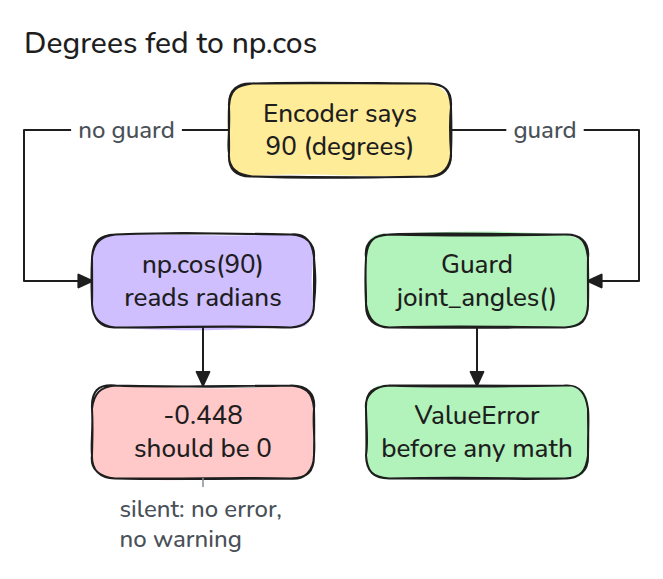
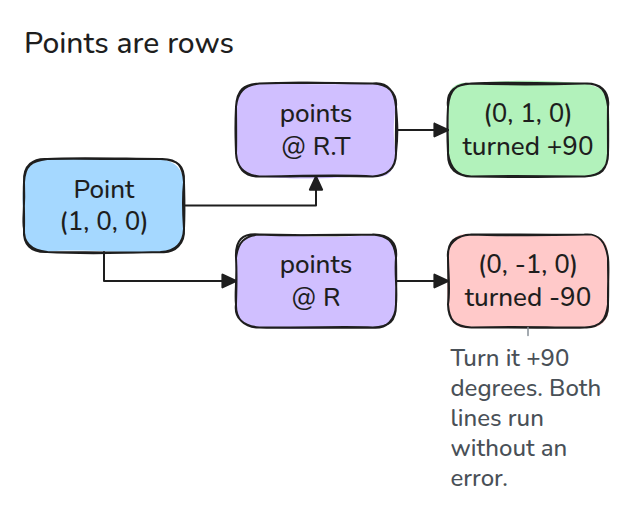
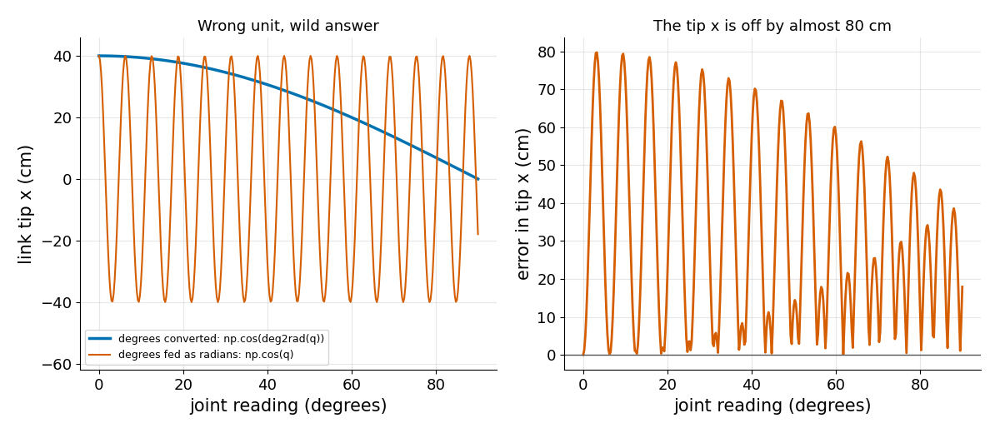

# Python 환경과 numpy

> 단위나 배열 모양이 틀리면 왜 조용히 틀린 답이 나오는지, 그리고 어떻게 잡는지 알게 됩니다.

**유형:** 만들기   **선수 지식:** 00/06 시간 스텝   **시간:** 약 15분

## 쉽게 말하면

로봇 팔의 sensor가 팔꿈치 각도를 구십이라고 알려 줘요. degree로 읽으면 사분의 일 바퀴예요. radian으로 읽으면 열네 바퀴가 넘어요.

numpy는 숫자 격자를 다루는 Python 도구예요. 언제나 radian이라고 가정하고 단위를 묻지 않아요. 그래서 단위나 배열 shape이 틀려도 계산은 그대로 돌아가요. 들어오는 숫자를 그 자리에서 검사해야만 잡을 수 있어요.

## 핵심 용어

- **Radian**: 각도의 단위로 한 바퀴가 약 6.28입니다. degree는 한 바퀴를 360으로 셉니다.
- **Array shape**: 배열의 행과 열이 몇 개인지입니다. 예를 들어 5행 3열입니다.
- **Rotation matrix**: 점을 어떤 축 둘레로 돌리는 작은 숫자 표입니다.
- **Transpose (`.T`)**: 행렬의 행과 열을 맞바꿉니다.
- **Guard**: 들어오는 숫자를 검사해서 나쁜 값을 분명한 오류로 멈추게 하는 검사입니다.
- **venv**: 프로젝트 하나에 쓰는 Python 도구를 담는 전용 폴더입니다.

## 문제

로봇 팔의 센서가 팔꿈치가 90도에 있다고 알려 줍니다. 그런데 코드는 그 숫자를 radian으로 읽습니다. 손은 엉뚱한 곳에 가고 프로그램은 아무 오류도 내지 않습니다.

## 개념

로봇은 받은 숫자를 그대로 따라 움직이므로 단위가 틀리면 실제 팔이 엉뚱한 곳으로 갑니다. numpy는 단위를 검사하지 않으므로 코드가 직접 검사해야 합니다.



*센서는 90도라고 하는데 코드는 90 radian으로 읽습니다.*

숫자 격자(배열)에도 같은 함정이 있습니다. 점을 하나씩 행으로 저장하므로 모두 돌리려면 먼저 rotation matrix의 행과 열을 맞바꾸는 transpose를 해야 합니다. 그것을 빼먹으면 점이 반대로 돌고 오류는 없습니다.



*transpose를 빼먹으면 점이 조용히 반대로 돕니다.*


*초록은 기둥에 닿습니다. 파랑은 transpose를 빼먹어서 기둥에서 멀어집니다.*



*단위가 틀리면 손이 있어야 할 곳에서 멀리 벗어납니다.*

<details><summary>The math (optional)</summary>

`np.cos(90)`은 90을 radian으로 읽습니다. 90에서 온전한 열네 바퀴를 빼면 2.04 radian(약 117도)이고 cosine은 0이 아니라 -0.448이라서 링크 끝이 링크 길이의 0.45배만큼 어긋납니다.
점 `p`를 돌리는 식은 `R @ p`이고 행으로 저장한 점에는 `points @ R.T`를 씁니다. `(1, 0, 0)`을 z축 둘레로 +90도 돌리면 `(0, 1, 0)`이 나와야 하는데 `points @ R`은 `(0, -1, 0)`을 내놓습니다.
0.4 m 링크에서는 단위 오류가 끝을 0.8 m 가까이 움직입니다.

</details>

## 만들기

함수 하나는 배열의 shape을 검사합니다. 다른 하나는 radian으로 한 바퀴를 넘어서 degree처럼 보이는 값을 표시합니다.

```python
def check_shape(x, shape, name="array"):
    a = np.asarray(x, dtype=float)
    if a.ndim != len(shape) or any(s is not None and s != n for s, n in zip(shape, a.shape)):
        raise ValueError(f"{name}: expected shape {shape}, got {a.shape}")
    return a

def looks_like_degrees(q, limit=2 * np.pi):
    return bool(np.max(np.abs(q)) > limit)
```

`joint_angles`와 `rotate_z`가 둘 다 씁니다.

```bash
cd robotics-engineering-from-scratch
python3 -m pytest phases/00-start-here/07-python-env-and-numpy -q
python3 phases/00-start-here/07-python-env-and-numpy/code/main.py
```

## 실제 도구로 보기

`python3 -m venv .venv`는 프로젝트 하나에 쓰는 Python 도구를 담는 전용 폴더를 만듭니다. 좋은 습관은 프로젝트마다 venv를 하나씩 두고 변수 이름에 `angle_rad`처럼 단위를 붙이는 것입니다.

출처: https://docs.python.org/3/library/venv.html (venv만), https://numpy.org/doc/stable/user/basics.broadcasting.html (broadcasting만).

## 결과물

`outputs/skill-numpy-robot-guards.md`는 로봇 스크립트에서 빠진 shape guard와 단위 guard를 찾아 줍니다.

## 연습 문제

1. degree 값을 `joint_angles`에 넣고 오류 메시지를 읽어 보세요.
2. NaN을 거부하는 검사를 추가하세요.
3. `points`를 3행 배열로, `R`을 이 레슨의 rotation matrix로 만들고 `points @ R`을 돌려서 어느 쪽으로 도는지 보세요.
