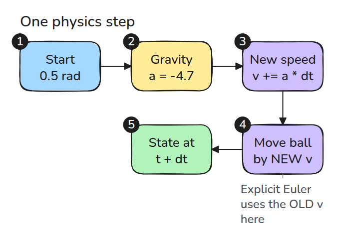
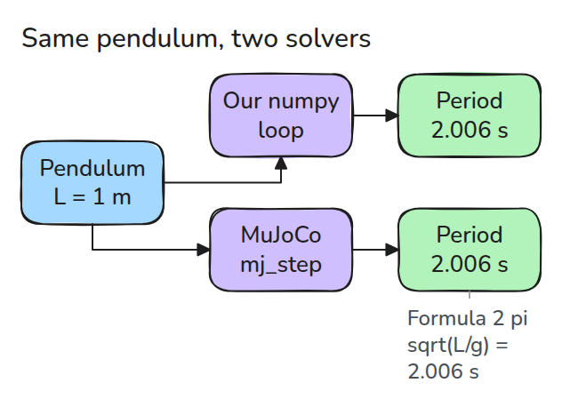
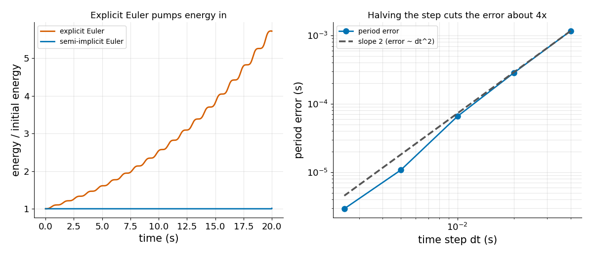

# MuJoCo Hello World

> Learn how a simulator moves things in tiny time steps, why a wrong step adds energy out of nowhere, and the one-line fix.

**Type:** Build   **Prerequisites:** 00/07 Python Env and numpy   **Time:** ~15 minutes

## In Plain Words

Hang a ball on a rod like a swing and let go. If nothing slows it down, it never rises above where you let go.

A computer moves the ball in tiny time steps. Each step first changes the speed, then moves the ball. If it moves the ball with the old speed, every step adds a little energy and the swing grows. Using the new speed fixes it.

## Key Terms

- **Time step (`dt`)**: how far the computer jumps forward in time on each step, here a few hundredths of a second.
- **Simulation**: a program that predicts how something moves by repeating one small time step many times.
- **Pendulum**: a weight on a rod that swings under gravity.
- **Period**: the time for one full swing out and back.
- **Explicit / semi-implicit Euler**: two ways to take a step. Explicit uses the old speed; semi-implicit uses the new speed. Euler is a name.
- **MuJoCo**: a free ready-made simulator we compare our loop against.

## The Problem

You copy a physics loop and run a pendulum. It swings higher each time until it spins over the top. Only two lines are in the wrong order (you will see them in Build It).

## The Concept

Robots are tested in simulation first, so a simulator that invents energy misleads you. The engine repeats these boxes every step.



*Acceleration changes the speed, and the new speed moves the position. Moving with the old speed is the explicit way.*

Let go and run the swing for ten seconds. The right order keeps the same height. The wrong order climbs about five times higher.

<details><summary>The math (optional)</summary>

`theta` is the swing angle in radians, `omega` the angular speed, `L` the rod length and `g` gravity (9.81). Gravity changes the speed by `-(g/L) sin(theta)` per second. Each explicit step multiplies the energy by about `1 + (g/L) dt^2`, just above one. Released at 0.5 rad for 10 s, semi-implicit stays at 0.50 rad and explicit climbs to 2.46 rad.

</details>


*Amber line: where it was let go. Wrong order: blue (big steps) and dark blue (small steps) climb above it. Right order: green stays on it.*



*Both swing out and back in the same time.*



*Left: with the wrong order the energy keeps climbing. Right: smaller steps make the error much smaller.*

## Build It

The two ways differ only in which speed (`omega`, how fast the angle changes) moves the angle.

```python
def step(theta, omega, dt, L=1.0, scheme="semi"):
    omega_new = omega - dt * (G / L) * np.sin(theta)
    return theta + dt * (omega_new if scheme == "semi" else omega), omega_new

def simulate(theta0, dt, seconds, L=1.0, scheme="semi"):
    theta, omega, out = theta0, 0.0, [theta0]
    for _ in range(int(round(seconds / dt))):
        theta, omega = step(theta, omega, dt, L, scheme)
        out.append(theta)
    return np.array(out)
```

```bash
cd robotics-engineering-from-scratch
python3 -m pytest phases/00-start-here/08-mujoco-hello-world -q
python3 phases/00-start-here/08-mujoco-hello-world/code/main.py
```

## Use It

`mujoco_period()` swings the same pendulum in MuJoCo. Its timing matches ours within 0.5% (tested): MuJoCo also moves with the new speed.

Sources: https://mujoco.readthedocs.io/en/stable/XMLreference.html

## Ship It

`outputs/skill-sim-sanity-check.md` checks a new simulation.

## Exercises

1. Add a slowing force to `step` and check that the swing shrinks.
2. Find the biggest step keeping the timing within 1%.
3. Make the rod longer and check that each swing takes longer.
