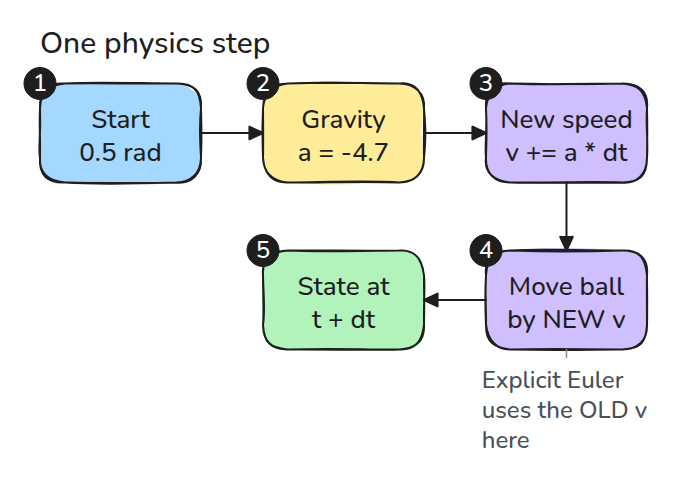
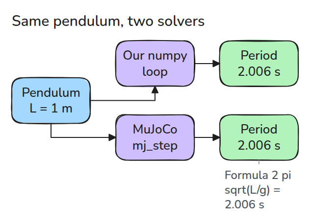
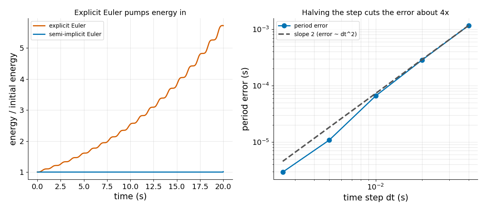

# MuJoCo Hello World

> simulator가 물체를 아주 작은 시간 스텝으로 움직이는 법, 잘못된 스텝이 없던 에너지를 만드는 이유, 그리고 한 줄짜리 해결책을 배웁니다.

**유형:** 만들기   **선수 지식:** 00/07 Python 환경과 numpy   **시간:** 약 15분

## 쉽게 말하면

공을 막대에 매달아 그네처럼 놓아 보세요. 아무것도 늦추지 않으면 놓은 곳보다 높이 올라가지 않아요.

컴퓨터는 공을 아주 작은 시간 단위로 나눠 움직여요. 한 단계마다 속도를 먼저 바꾸고 공을 옮겨요. 바뀌기 전 속도로 옮기면 단계마다 에너지가 조금씩 더해져서 흔들림이 커져요. 새 속도로 옮기면 해결돼요.

## 핵심 용어

- **Time step (`dt`)**: 컴퓨터가 한 번에 시간을 얼마나 앞으로 넘기는지입니다. 여기서는 100분의 몇 초입니다.
- **Simulation**: 작은 시간 스텝 하나를 여러 번 되풀이해서 물체가 어떻게 움직일지 예측하는 프로그램입니다.
- **Pendulum**: 막대 끝에 달려 중력으로 흔들리는 추입니다.
- **Period**: 한 번 갔다가 돌아오는 데 걸리는 시간입니다.
- **Explicit / semi-implicit Euler**: 스텝을 밟는 두 방법입니다. explicit는 공을 옛 속도로, semi-implicit는 새 속도로 움직입니다. Euler는 방법의 이름일 뿐입니다.
- **MuJoCo**: 우리 반복문과 비교할 완성된 무료 simulator입니다.

## 문제

forum에서 물리 반복문을 가져와 진자를 돌렸습니다. 흔들릴 때마다 조금씩 높이 올라가다가 결국 한 바퀴를 돕니다. 식은 맞아 보이고 틀린 것은 두 줄의 순서뿐입니다(만들기에서 볼 수 있습니다).

## 개념

로봇은 실물을 움직이기 전에 simulation으로 시험합니다. 에너지를 지어내는 simulator로 시험하면 이유 없이 실패하는 로봇이 나옵니다. 엔진은 이 상자들을 시간 스텝마다 되풀이합니다.



*가속도가 속도를 바꾸고 새 속도가 위치를 움직입니다. 옛 속도로 움직이는 쪽이 explicit입니다.*

그네를 놓고 10초 동안 돌려 보세요. 순서가 맞으면 같은 높이로 계속 흔들리고 순서가 틀리면 약 다섯 배 높이까지 올라갑니다.

<details><summary>The math (optional)</summary>

`theta`는 흔들린 각도(radians), `omega`는 각속도, `L`은 막대 길이, `g`는 중력(9.81)입니다. 중력은 속도를 초마다 `-(g/L) sin(theta)`만큼 바꿉니다.
explicit 스텝 하나는 에너지에 약 `1 + (g/L) dt^2`를 곱하고 이 값은 1보다 조금 큽니다. 0.5 rad에서 놓고 10초를 돌리면 semi-implicit는 0.50 rad에 머물고 explicit는 2.46 rad까지 올라갑니다.

</details>


*주황색 선은 놓은 높이입니다. 틀린 순서에서는 파랑(큰 스텝)과 진한 파랑(작은 스텝)이 선 위로 올라가고 맞는 순서에서는 초록이 선에 머뭅니다.*



*둘 다 한 번 갔다가 돌아오는 데 같은 시간이 걸립니다.*



*왼쪽은 틀린 순서에서 에너지가 계속 오르는 모습입니다. 오른쪽은 스텝을 작게 하면 오차가 크게 줄어드는 모습입니다.*

## 만들기

두 방식의 차이는 어느 속도(`omega`, 각도가 얼마나 빨리 변하는지)가 각도를 움직이느냐뿐입니다.

```python
def step(theta, omega, dt, L=1.0, scheme="semi"):
    omega_new = omega - dt * (G / L) * np.sin(theta)
    return theta + dt * (omega_new if scheme == "semi" else omega), omega_new

def simulate(theta0, dt, seconds, L=1.0, scheme="semi"):
    theta, omega, out = theta0, 0.0, [theta0]
    for _ in range(int(round(seconds / dt))):
        theta, omega = step(theta, omega, dt, L, scheme)
        out.append(theta)
    return np.array(out)
```

```bash
cd robotics-engineering-from-scratch
python3 -m pytest phases/00-start-here/08-mujoco-hello-world -q
python3 phases/00-start-here/08-mujoco-hello-world/code/main.py
```

## 실제 도구로 보기

`mujoco_period()`는 같은 진자를 MuJoCo로 흔듭니다. MuJoCo도 기본으로 새 속도로 움직이기 때문에 주기가 우리 값과 0.5% 안에서 일치합니다(테스트로 확인).

출처: https://mujoco.readthedocs.io/en/stable/XMLreference.html

## 결과물

`outputs/skill-sim-sanity-check.md`는 새 simulation을 믿기 전에 보는 짧은 체크리스트입니다.

## 연습 문제

1. `step`에 속도를 줄이는 힘을 넣고 흔들림이 줄어드는지 확인하세요.
2. 주기 오차가 1% 안에 머무는 가장 큰 스텝을 찾으세요.
3. 막대를 길게 만들고 한 번 흔들리는 시간이 길어지는지 확인하세요.
