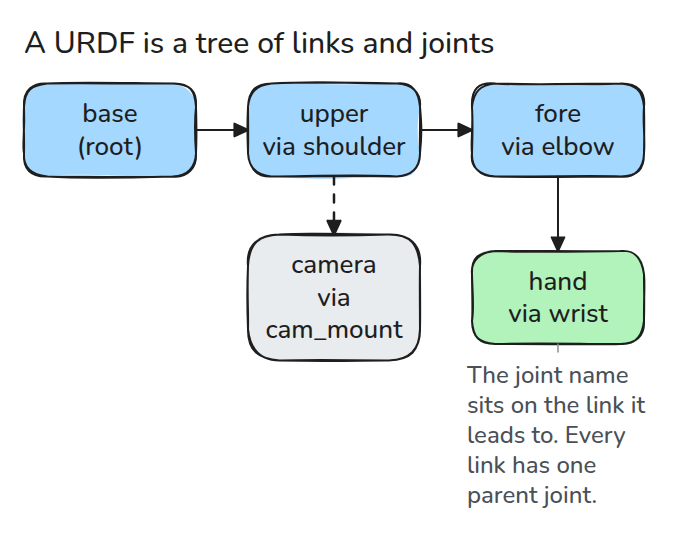
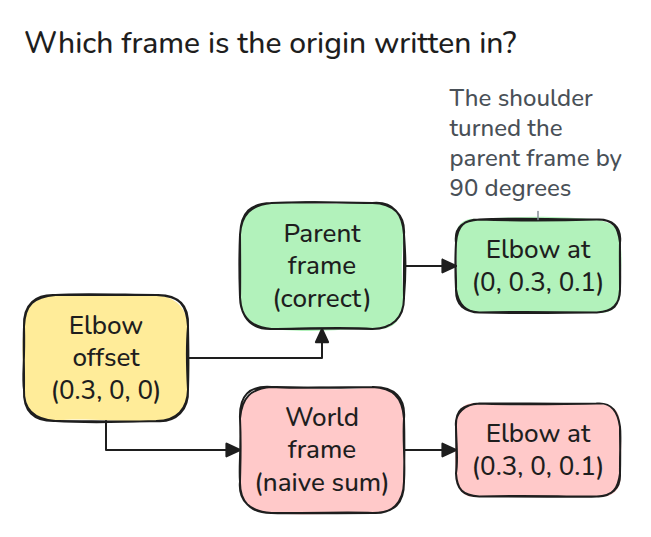
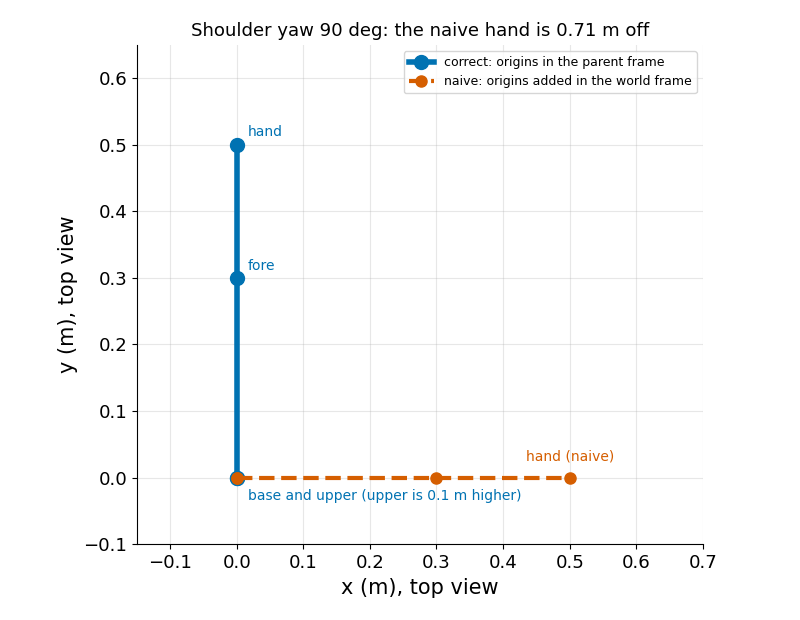

# Reading a URDF

> Learn to read a robot's description file, and why each joint's offset is measured from the part before it.

**Type:** Build   **Prerequisites:** 00/07 Python Env and numpy   **Time:** ~15 minutes

## In Plain Words

A small arm's file says the elbow sits a fixed distance ahead of the shoulder. Ahead means along the link, not along the room, so a turned shoulder makes ahead point sideways.

A URDF, the robot's description file, lists links (rigid parts) joined by joints. Each joint offset follows the previous link's axes, so turn each offset by every turn before it, then add.

## Key Terms

- **URDF**: a text file that describes a robot as links joined by joints.
- **Link**: one rigid part of the robot, such as an upper arm.
- **Joint**: the connection that lets a child link move relative to its parent link.
- **Frame**: a set of x, y, z axes attached to something, such as a link or the room.
- **`<origin>`**: a joint's position (`xyz`) and rotation (`rpy`) relative to its parent link.
- **Transform**: a 4x4 table of numbers holding one turn and one shift.

## The Problem

A robot's description file says each part sits a set distance ahead of the part before it. You add the distances to find the hand, and the answer is far from where the viewer shows it.

## The Concept

Every simulator and robot program starts from this file, so misreading it breaks everything built on it.



*Each box is a part, each arrow a joint.*

The file measures each offset in the previous part's own directions, so after a turned shoulder, "ahead" points sideways. Read it in the room's fixed directions and you get the wrong spot.



*Measured the file's way, the offset turns with the arm.*


*Blue added the offsets in room directions and misses the ball. Green turns them first.*



*From above, the elbow offset points sideways.*

<details><summary>The math (optional)</summary>

A joint's `<origin>` is its parent-to-child transform: a position `xyz` and a rotation `rpy` (roll about x, pitch about y, yaw about z). In the example every joint angle is 0, the shoulder origin lifts 0.1 m along z and turns 90 degrees about z, and the elbow and wrist offsets are `0.3 0 0` and `0.2 0 0`. Added as room directions they give (0.5, 0, 0.1). Turned correctly, the hand is at (0, 0.5, 0.1), 0.71 m from the wrong answer.

</details>

## Build It

Read the file with the standard library, then walk from the base to the tip, multiplying one transform per joint.

```python
root = ET.fromstring(xml)
for e in root.findall("joint"):
    o = e.find("origin")
    joints[e.get("name")] = dict(parent=e.find("parent").get("link"),
                                 child=e.find("child").get("link"),
                                 xyz=_vec(o, "xyz"), rpy=_vec(o, "rpy"))
# T = T @ T_origin @ R_axis(q), for each joint on the chain
```

`chain()` walks from tip to root. `link_positions()` applies the origin first, then the joint's own turn, and rejects values outside the limits.

```bash
cd robotics-engineering-from-scratch
python3 -m pytest phases/00-start-here/09-reading-a-urdf -q
```

## Use It

ROS 2's `robot_state_publisher` turns the file and the joint values into poses. Compare them with `link_positions()`.

Sources: https://wiki.ros.org/urdf/XML/joint, https://github.com/ros/robot_state_publisher

## Ship It

`outputs/skill-urdf-reading-check.md` lists what to check when a URDF position looks wrong.

## Exercises

1. Add a sliding joint to the example and move a link along it.
2. Print every part that has more than one child.
3. Make the parser reject a file with two roots.
