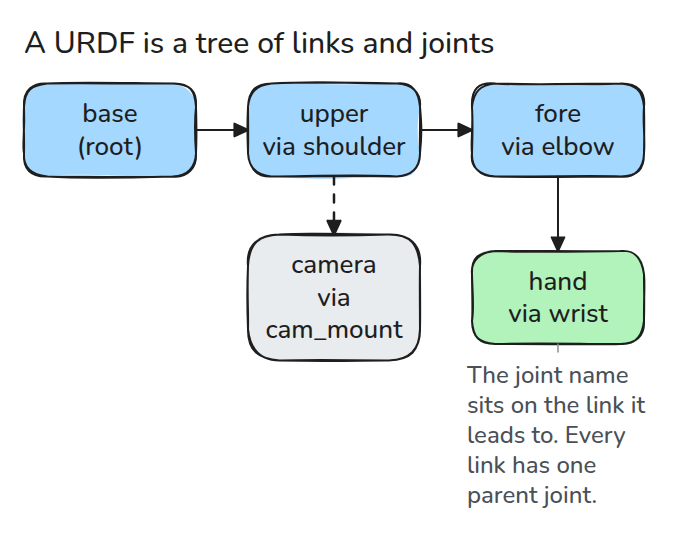
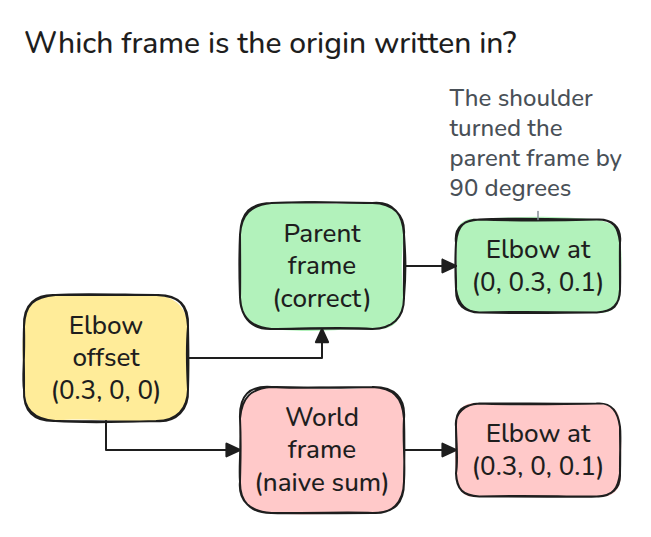
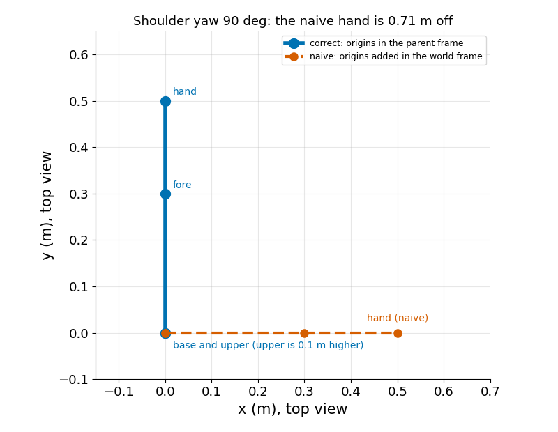

# URDF 읽기

> 로봇의 설명 파일을 읽는 법과, 각 joint의 offset을 왜 바로 앞 부품에서 재는지 알게 됩니다.

**유형:** 만들기   **선수 지식:** 00/07 Python 환경과 numpy   **시간:** 약 15분

## 쉽게 말하면

작은 로봇 팔의 설명 파일(URDF)에는 팔꿈치가 어깨에서 일정한 거리만큼 앞에 있다고 적혀 있어요. 여기서 앞은 방이 아니라 link를 따라가는 방향이라서 어깨를 돌리면 앞이 옆을 가리켜요.

파일은 joint로 이어진 link(단단한 부품)를 나열해요. 각 joint의 offset은 바로 앞 부품의 방향을 기준으로 재요. 그래서 offset마다 앞에서 일어난 회전을 모두 반영한 다음 더해야 해요.

## 핵심 용어

- **Link**: 로봇의 단단한 부품 하나입니다. 예를 들어 윗팔입니다.
- **Joint**: 두 link 사이의 경첩으로 한쪽이 다른 쪽을 기준으로 돌 수 있게 해 줍니다.
- **URDF**: 로봇을 joint로 이어진 link로 설명하는 텍스트 파일입니다.
- **Frame**: link나 방 같은 어떤 대상에 붙은 x, y, z축의 묶음입니다.
- **Joint offset (`<origin>`)**: joint가 앞 부품에서 얼마나 떨어져 있고 얼마나 돌아가 있는지를 그 부품 자신의 방향으로 적은 값입니다.
- **Transform**: 회전 하나와 이동 하나를 담은 4x4 숫자 표입니다.

## 문제

로봇의 설명 파일에는 부품마다 바로 앞 부품에서 얼마나 떨어져 있는지 적혀 있습니다. 그 거리를 모두 더해 손의 위치를 구했더니 팔이 실제로 있는 위치와 많이 다릅니다.

## 개념

simulator와 로봇 프로그램은 모두 이 파일에서 출발하므로 잘못 읽으면 그 위에 쌓은 것이 전부 틀어집니다.



*상자는 부품이고 화살표는 joint입니다.*

offset은 바로 앞 부품 자신의 방향으로 잽니다. 방에 고정된 방향으로 읽으면 엉뚱한 곳이 나옵니다.



*파일이 재는 방식으로 보면 offset이 팔과 함께 돕니다.*


*파랑은 offset을 방의 방향으로 더해서 공을 빗나갑니다. 초록은 먼저 돌립니다.*



*위에서 보면 elbow offset이 옆을 향합니다.*

<details><summary>The math (optional)</summary>

joint의 `<origin>`은 부모에서 자식으로 가는 transform이고 위치 `xyz`와 회전 `rpy`(x축 roll, y축 pitch, z축 yaw)로 이루어집니다.
예에서는 모든 joint 각도가 0입니다. 어깨 origin은 z축 방향으로 0.1 m 올라가고 z축 둘레로 90도 돌아가 있으며 elbow와 wrist offset은 `0.3 0 0`과 `0.2 0 0`입니다.
방의 방향으로 더하면 (0.5, 0, 0.1)이 나옵니다. 제대로 돌리면 손은 (0, 0.5, 0.1)에 있고 틀린 답과 0.71 m 떨어져 있습니다.

</details>

## 만들기

표준 라이브러리로 파일을 읽은 다음 base에서 tip까지 걸어가며 joint마다 transform 하나씩 곱합니다.

```python
root = ET.fromstring(xml)
for e in root.findall("joint"):
    o = e.find("origin")
    joints[e.get("name")] = dict(parent=e.find("parent").get("link"),
                                 child=e.find("child").get("link"),
                                 xyz=_vec(o, "xyz"), rpy=_vec(o, "rpy"))
# T = T @ T_origin @ R_axis(q), for each joint on the chain
```

`chain()`은 tip에서 base까지 거꾸로 걸어갑니다. `link_positions()`는 origin을 먼저 적용하고 joint 자신의 회전을 그다음에 적용하며 limit 밖의 값은 거부합니다.

```bash
cd robotics-engineering-from-scratch
python3 -m pytest phases/00-start-here/09-reading-a-urdf -q
```

## 실제 도구로 보기

작은 프로그램이 모여 이루어진 로봇 소프트웨어인 ROS 2에는 `robot_state_publisher`가 있습니다. 이것은 파일과 joint 값을 모든 부품의 자리로 바꿔 줍니다. 그 결과를 `link_positions()`와 비교해 보세요.

출처: https://wiki.ros.org/urdf/XML/joint, https://github.com/ros/robot_state_publisher

## 결과물

`outputs/skill-urdf-reading-check.md`는 URDF 위치가 이상할 때 확인할 항목을 정리한 것입니다.

## 연습 문제

1. 돌지 않고 직선으로 미끄러지는 joint를 더하고 link를 그 방향으로 움직여 보세요.
2. 자식이 둘 이상인 부품을 모두 출력하세요.
3. base 부품이 둘인 파일을 파서가 거부하게 만드세요.
