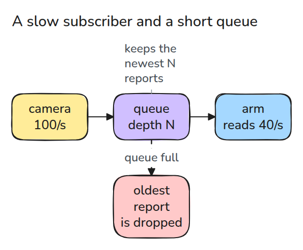

# ROS 2 in One Page

> Learn how robot programs pass data to each other, and why a longer waiting line can make a robot react late.

**Type:** Learn   **Prerequisites:** 00/07 Python Env and numpy   **Time:** ~15 minutes

## In Plain Words

A sensor reports a sliding cup's position faster than the arm's controller can read. Unread reports wait in a queue, and the controller takes the oldest first.

When the queue is full, each new report pushes the oldest out. A long queue means the oldest report can be half a second old. A queue of one means the arm reads the newest.

## Key Terms

- **Node**: one running program in a ROS 2 system.
- **Topic**: a named stream that publishers send to and subscribers read from.
- **Service**: a request with one reply, unlike a topic's endless stream.
- **Queue depth**: how many messages a subscriber keeps while it waits to read them.
- **Hz**: times per second.
- **QoS**: quality of service, the settings that decide how messages are kept and delivered.

## The Problem

A robot's controller reads joint angles only 40 times a second, but the motor program sends them 100 times a second. To avoid losing messages you make the waiting line 50 long, and now the arm reacts late.

## The Concept

A robot is many small programs, and how they pass data decides how fresh it is on arrival.


*Programs send a stream (topic) or ask one question and get one answer (service).*

Each reader keeps a waiting line of messages. When the line is full, a new message pushes the oldest out. A longer line only means older data.



*The sender is faster, so the line stays full.*


*Three arms with short, medium and long lines. The longer the line, the more the arm chases old positions.*


*A longer line does not save messages. It only makes the ones you read older.*

<details><summary>The math (optional)</summary>

Run 10 s with a 100 Hz sender and a 40 Hz reader: 1000 messages are sent and 400 are read at every depth. The message read is 5 ms old at depth 1, and each extra queued message adds 10 ms: 95 ms at depth 10, 495 ms at depth 50. Messages arrive every 10 ms, so 50 queued ones reach back 0.5 s.

</details>

## Build It

The `Bus` keeps one waiting line per reader. `run()` measures drops and message age, and `burst_drops()` shows the one case where a longer line helps: a short burst of messages.

```python
def publish(self, topic, msg):
    for s in self.subs.get(topic, []):
        if len(s.q) == s.depth:
            s.q.popleft()
            s.dropped += 1
        s.q.append(msg)
```

```bash
cd robotics-engineering-from-scratch
python3 -m pytest phases/00-start-here/10-ros2-in-one-page -q
python3 phases/00-start-here/10-ros2-in-one-page/code/main.py
```

## Use It

In ROS 2 this setting is the QoS history policy `keep last`. For control signals keep the line short.

Sources: https://docs.ros.org/en/jazzy/Concepts/Intermediate/About-Quality-of-Service-Settings.html

## Ship It

`outputs/skill-qos-depth-check.md` checks a topic's rates and depth for drops and stale data.

## Exercises

1. Run `run()` with depth 1 and depth 50 and compare the message age.
2. Make the reader faster than the sender and watch the age.
3. Add a second reader with a different depth.
