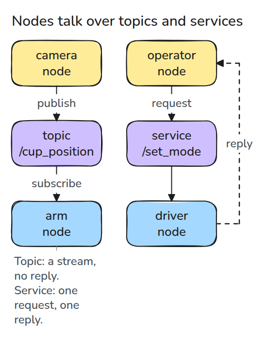
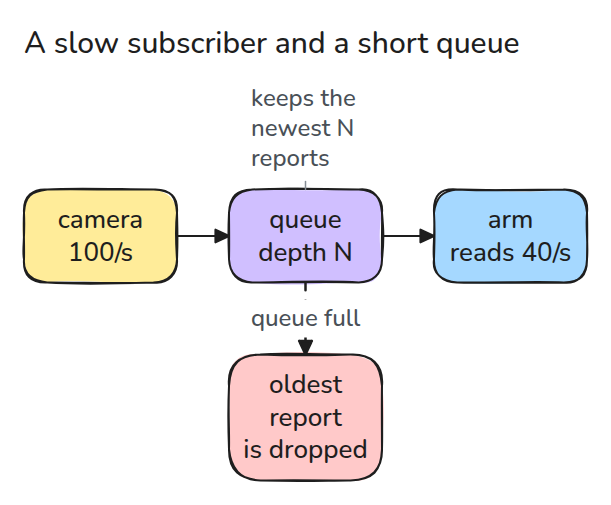
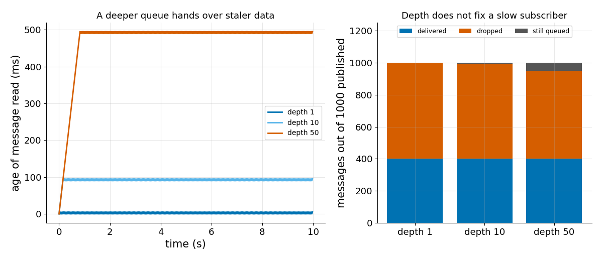

# ROS 2 한 장 요약

> 로봇 프로그램들이 서로 데이터를 주고받는 방법과, 대기열을 길게 하면 왜 로봇이 늦게 반응하는지 알게 됩니다.

**유형:** 배우기   **선수 지식:** 00/07 Python 환경과 numpy   **시간:** 약 15분

## 쉽게 말하면

센서는 미끄러지는 컵의 위치를 팔의 controller가 읽는 것보다 빠르게 알려 줘요. 읽지 못한 보고는 queue에서 기다리고 controller는 가장 오래된 보고부터 가져가요.

queue가 가득 차면 새 보고가 올 때마다 가장 오래된 보고가 밀려나요. queue가 길면 가장 오래된 보고가 반 초 전 것일 수도 있어서 팔은 컵이 있던 자리를 향해요. 보고를 하나만 담는 queue라면 팔은 가장 새 보고를 읽어요.

## 핵심 용어

- **Node**: ROS 2 시스템에서 돌아가는 프로그램 하나입니다.
- **Topic**: publisher가 보내고 subscriber가 읽는 이름 붙은 스트림입니다.
- **Service**: 요청 하나에 응답 하나를 돌려주는 방식입니다. 끝없이 흐르는 topic과 다릅니다.
- **Queue depth**: subscriber가 읽기 전까지 보관하는 메시지의 개수입니다.
- **Hz**: 1초에 몇 번인지를 나타내는 단위입니다.
- **QoS**: quality of service의 약자로 메시지를 어떻게 보관하고 전달할지 정하는 설정입니다.

## 문제

로봇의 controller는 joint 각도를 1초에 40번만 읽는데 모터 프로그램은 1초에 100번 보냅니다. 메시지를 잃지 않으려고 대기열을 50개로 늘렸더니 팔이 늦게 반응합니다.

## 개념

로봇은 작은 프로그램 여러 개로 이루어져 있고 이들이 데이터를 건네는 방식이 데이터가 도착할 때 얼마나 신선한지를 정합니다.



*프로그램은 스트림(topic)을 보내거나 질문 하나를 하고 답 하나를 받습니다(service).*

읽는 쪽은 메시지의 대기열을 하나씩 가집니다. 대기열이 가득 차면 새 메시지가 가장 오래된 것을 밀어냅니다. 보내는 쪽보다 느린 reader는 영영 따라잡지 못하므로 대기열을 길게 하면 더 오래된 데이터를 읽을 뿐입니다.



*보내는 쪽이 더 빠르므로 대기열은 가득 찬 채로 있습니다.*


*대기열이 짧은 팔, 중간인 팔, 긴 팔 세 대입니다. 대기열이 길수록 팔이 옛 위치를 쫓아갑니다.*



*대기열을 길게 해도 메시지가 살아남지 않습니다. 읽는 메시지가 더 오래될 뿐입니다.*

<details><summary>The math (optional)</summary>

100 Hz 보내는 쪽과 40 Hz reader로 10초를 돌리면 메시지 1000개가 나가고 depth와 상관없이 400개를 읽습니다.
읽은 메시지는 depth 1에서 5 ms 전 것이고 queue에 하나 더 쌓일 때마다 10 ms가 더해져서 depth 10은 95 ms, depth 50은 495 ms입니다. 메시지는 10 ms마다 오므로 50개가 쌓이면 0.5초 전까지 거슬러 올라갑니다.

</details>

## 만들기

`Bus`는 reader마다 대기열을 하나씩 가집니다. `run()`은 폐기 개수와 메시지의 나이를 재고 `burst_drops()`는 대기열을 길게 하는 것이 도움이 되는 유일한 경우, 곧 메시지가 잠깐 몰려오는 경우를 보여 줍니다.

```python
def publish(self, topic, msg):
    for s in self.subs.get(topic, []):
        if len(s.q) == s.depth:
            s.q.popleft()
            s.dropped += 1
        s.q.append(msg)
```

```bash
cd robotics-engineering-from-scratch
python3 -m pytest phases/00-start-here/10-ros2-in-one-page -q
python3 phases/00-start-here/10-ros2-in-one-page/code/main.py
```

## 실제 도구로 보기

ROS 2에서는 이 설정이 QoS history 정책 `keep last`입니다. 제어 신호에는 대기열을 짧게 두세요.

출처: https://docs.ros.org/en/jazzy/Concepts/Intermediate/About-Quality-of-Service-Settings.html

## 결과물

`outputs/skill-qos-depth-check.md`는 topic의 속도와 depth를 보고 데이터가 버려지는지 낡는지 알려 줍니다.

## 연습 문제

1. `run()`을 depth 1과 depth 50으로 돌려 메시지의 나이를 비교하세요.
2. reader를 보내는 쪽보다 빠르게 만들고 나이를 보세요.
3. depth가 다른 두 번째 reader를 추가하세요.
