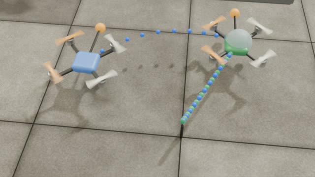
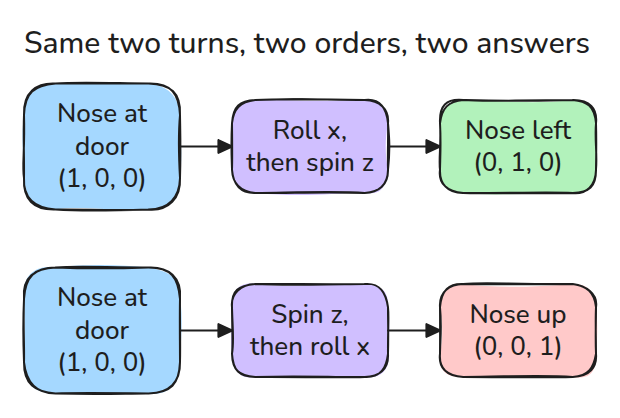
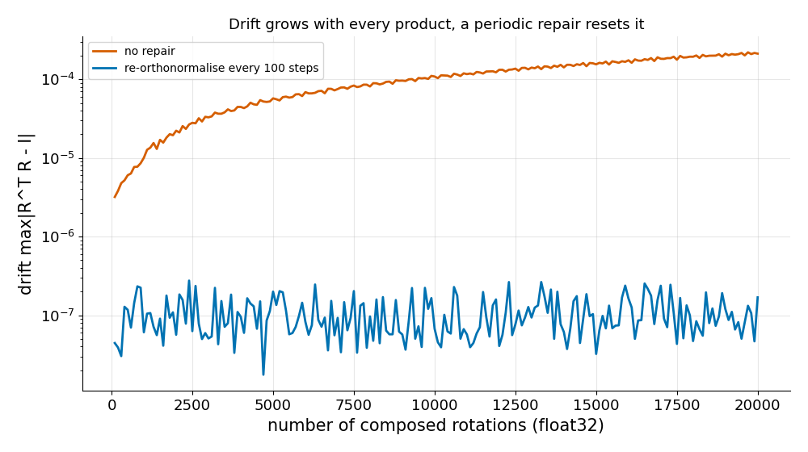

# Rotations and SE(3)

> Learn how to describe where something is and which way it faces, and why the order of two turns matters.

**Type:** Build   **Prerequisites:** none   **Time:** ~15 minutes

## In Plain Words

Hold a drone, nose to the door. Roll it a quarter turn about the line to the door, then spin it a quarter turn about the vertical: the nose points left. Spin first, then roll about that same line: the nose swings up to the ceiling.

A pose is which way something faces plus where it is. Combining poses in order tracks both, and the order matters.

## Key Terms

- **Rotation matrix**: a 3x3 grid of numbers that turns a point without stretching it.
- **Pose**: which way an object faces plus where it is.
- **Transform (`T`)**: a 4x4 matrix that stores a rotation and a shift in one table.
- **Frame**: x, y, z axes attached to something, such as the camera or the arm's base.
- **Inverse**: the transform that undoes another one.
- **Drift**: a slow error that builds up as rounded numbers are multiplied many times.

## The Problem

A camera on a mast sees a cup, and the arm needs the cup's position from its own base. You combine the camera's pose and the cup's pose in the wrong order, and the arm reaches for a point that is not there.

## The Concept

A robot must know where each part is and which way it faces.


*One pose tells you how to go from the camera's view to the base's view.*

Turning then shifting lands somewhere different from shifting then turning.

[](../assets/clip-example.mp4)

*Green turns first, then moves. Blue moves first, so its turn swings it around the origin.*



*The same two turns in a different order point the nose in different directions.*

Rounding errors slowly stop a rotation matrix from being a true rotation, so long programs repair it from time to time.



*Without the repair the error keeps growing. With it the error stays tiny.*

<details><summary>The math (optional)</summary>

A rotation matrix `R` has perpendicular unit-length columns and determinant +1. A pose `T` stacks `R` and a position `p` into one 4x4 matrix: it turns a point by `R`, then shifts it by `p`, and in `A @ B` the right matrix acts first. The inverse is `[R^T, -R^T p]`. Such 4x4 poses together are called SE(3), the name in the title. A quarter turn about z plus `p = (1, 2, 0)`: turn then shift sends (1, 0, 0) to (1, 3, 0); shift then turn sends it to (-2, 2, 0). 20,000 small float32 rotations drift; `reorthonormalize` every 100 steps keeps the error at rounding level.

</details>

## Build It

Three small helpers check that a matrix is a true rotation, undo a pose, and repair a drifting rotation.

```python
def is_rotation(R, tol=1e-9):
    return np.allclose(R.T @ R, np.eye(3), atol=tol, rtol=0.0) and np.isclose(np.linalg.det(R), 1.0, atol=tol, rtol=0.0)

def invert_T(T):
    R, p = T[:3, :3], T[:3, 3]
    return make_T(R.T, -R.T @ p)

def reorthonormalize(R):
    U, _, Vt = np.linalg.svd(R)
    return U @ np.diag([1, 1, np.linalg.det(U @ Vt)]) @ Vt
```

```bash
cd robotics-engineering-from-scratch
python3 -m pytest phases/01-math-foundations/01-rotations-and-se3 -q
```

## Use It

SciPy, a Python add-on, has `Rotation`, which does all this; a test compares it with the lesson's 0.8 radian z turn.

Sources: Craig, *Introduction to Robotics*, 3rd ed., ch. 2.

## Ship It

`outputs/skill-transform-sanity.md` catches pose bugs before hardware.

## Exercises

1. Turn then shift a point, swap the order, and compare.
2. Multiply a tiny turn by itself many thousand times, then run the rotation check.
3. Write `compose` that multiplies a list of poses.
