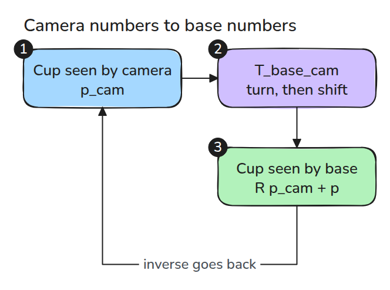

# Rotations and SE(3)

> Learn how to describe where something is and which way it faces, and why the order of two turns matters.

**Type:** Build   **Prerequisites:** none   **Time:** ~15 minutes

## In Plain Words

Hold a drone, nose to the door. Roll it a quarter turn about its nose, then spin it a quarter turn about the vertical: the nose points left. Spin first, then roll: the nose swings up to the ceiling.

The first turn changes what the second turn acts on. A pose is orientation plus position, and multiplying poses in order tracks both.

## Key Terms

- **Rotation matrix**: a 3x3 grid of numbers that turns a point without stretching it.
- **Pose**: an object's orientation plus its position.
- **Transform (`T`)**: a 4x4 matrix that stores a rotation and a shift in one table.
- **Frame**: x, y, z axes attached to something, such as the camera or the arm's base.
- **Inverse**: the transform that undoes another one.
- **Drift**: a slow error that builds up as rounded numbers are multiplied many times.

## The Problem

A camera sees a cup at (0.2, 0, 0.5) in its own frame, and the arm needs the spot in its base frame. Multiply the transforms in the wrong order and the arm reaches for a point that does not exist.

## The Concept

A robot must know where each part is and which way it faces.

A rotation matrix `R` turns without stretching or mirroring: its columns are perpendicular, one unit long, with determinant (a mirror check) +1. A transform `T` stacks `R` and a position `p` into one 4x4 matrix, a pose in SE(3). It turns a point by `R`, then shifts it by `p`; in `A @ B` the right matrix acts first.



*`T_base_cam` maps camera coordinates to base coordinates.*

A drone's pose is a quarter turn about z plus a shift `p = (1, 2, 0)`. Turn then shift: the nose mark (1, 0, 0) lands at (1, 3, 0). Shift then turn: the mark lands at (-2, 2, 0).


*Green turns, then moves. Blue moves first, so the turn swings it around the origin.*


*Roll about x then spin about z, or the reverse: the nose (1, 0, 0) ends at (0, 1, 0) or (0, 0, 1).*

The inverse is `[R^T, -R^T p]`, where `R^T` swaps `R`'s rows and columns. It lets drift show up as `T^-1 T` missing the identity.


*20,000 small float32 rotations let drift grow. `reorthonormalize` every 100 steps keeps it at rounding level.*

## Build It

```python
def is_rotation(R, tol=1e-9):
    return np.allclose(R.T @ R, np.eye(3), atol=tol) and np.isclose(np.linalg.det(R), 1.0, atol=tol)

def invert_T(T):
    R, p = T[:3, :3], T[:3, 3]
    return make_T(R.T, -R.T @ p)

def reorthonormalize(R):
    U, _, Vt = np.linalg.svd(R)
    return U @ np.diag([1, 1, np.linalg.det(U @ Vt)]) @ Vt
```

Helpers: see `code/main.py`.

```bash
cd robotics-engineering-from-scratch
python3 -m pytest phases/01-math-foundations/01-rotations-and-se3 -q
```

## Use It

`scipy.spatial.transform.Rotation` does all of this; the last test compares it with `rot_z(0.8)`.

Sources: Craig, *Introduction to Robotics*, 3rd ed., ch. 2.

## Ship It

`outputs/skill-transform-sanity.md` catches pose bugs before hardware.

## Exercises

1. Compose `rot_x(a)` and `rot_z(b)` both ways and print the tip difference.
2. Find how many float64 steps pass before `is_rotation` fails.
3. Write `compose(Ts)` to multiply a list of transforms.
