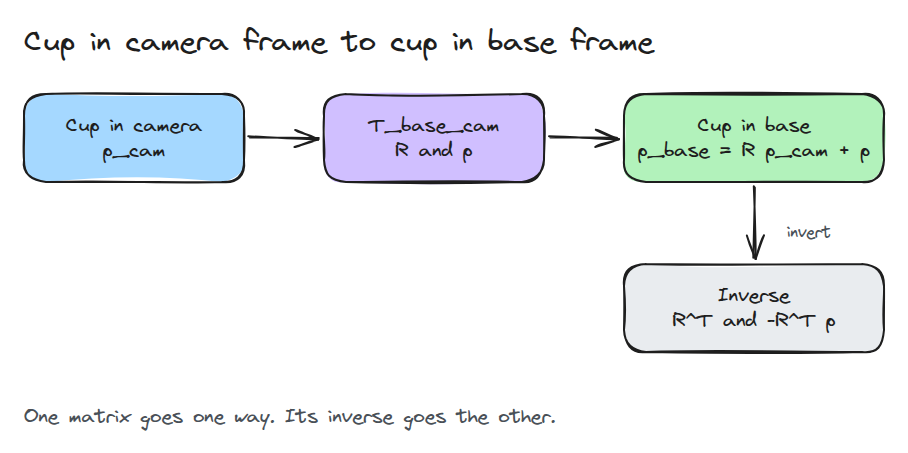
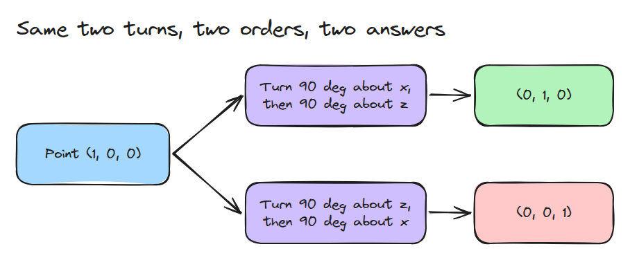
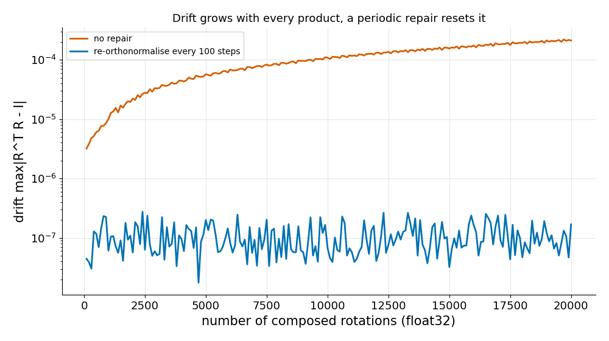

# Rotations and SE(3)

> A pose is a rotation and a position, and the order you multiply them in decides the result.

**Type:** Build   **Prerequisites:** none   **Time:** ~15 minutes

## The Problem

A camera sees a cup at (0.2, 0, 0.5) in its own frame, and the arm needs the cup in the base frame. If you multiply two transforms in the wrong order, the result is still a valid-looking pose, just a wrong one. The arm reaches for a point that does not exist and nothing in the code complains.

## The Concept



*A rigid transform `T_base_cam` carries a point from camera coordinates into base coordinates.*

A rotation matrix has orthonormal columns and determinant +1. A rigid transform stacks `R` and a position `p` into a 4x4 matrix. Chaining frames is matrix multiplication, which is not commutative.



*Rotating about x then z sends (1, 0, 0) to (0, 1, 0). The opposite order sends it to (0, 0, 1).*

The inverse has a closed form, `[R^T, -R^T p]`. A general matrix inverse also works, but it hides drift: if `R` stops being orthonormal, it quietly returns a non-rigid result.



*Composing 20,000 small rotations in float32 lets drift grow. Re-orthonormalising every 100 steps keeps it at rounding level.*

## Build It

```python
def is_rotation(R, tol=1e-9):
    return np.allclose(R.T @ R, np.eye(3), atol=tol) and np.isclose(np.linalg.det(R), 1.0, atol=tol)

def invert_T(T):
    R, p = T[:3, :3], T[:3, 3]
    return make_T(R.T, -R.T @ p)

def reorthonormalize(R):
    U, _, Vt = np.linalg.svd(R)
    return U @ np.diag([1, 1, np.linalg.det(U @ Vt)]) @ Vt
```

`rot_x`, `rot_y`, `rot_z` and `make_T` are in `code/main.py`.

```bash
cd robotics-engineering-from-scratch
python3 -m pytest phases/01-math-foundations/01-rotations-and-se3 -q
```

## Use It

`scipy.spatial.transform.Rotation` does all of this. The last test compares `rot_z(0.8)` with `Rotation.from_euler("z", 0.8).as_matrix()`. Use the library in production, and use your version to know what its output means when a pose looks wrong.

Sources: Craig, *Introduction to Robotics*, 3rd ed., ch. 2 (descriptions and transformations).

## Ship It

`outputs/skill-transform-sanity.md` is a checklist that catches these pose bugs before they reach hardware.

## Exercises

1. Compose `rot_x(a)` and `rot_z(b)` both ways and print the tip difference.
2. Reproduce the drift curve in float64. How many steps until `is_rotation` fails?
3. Write `compose(Ts)` that multiplies a list of transforms and checks the result.
