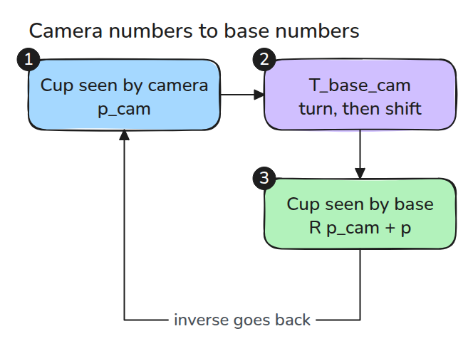
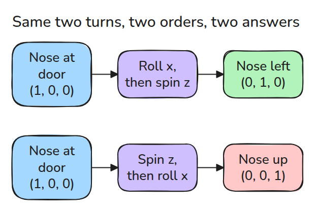
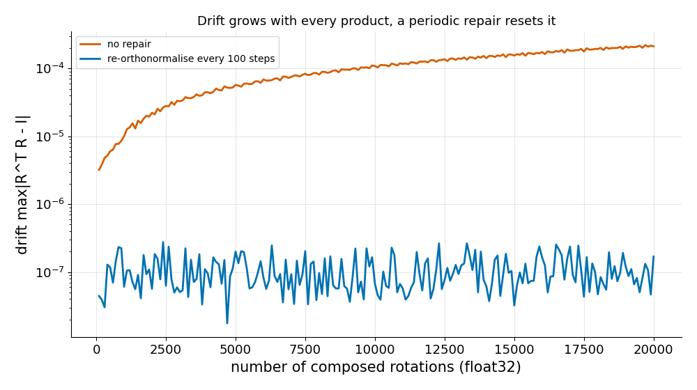

# 회전과 SE(3)

> pose는 회전과 위치이고 곱하는 순서가 결과를 정합니다.

**유형:** 만들기   **선수 지식:** 없음   **시간:** 약 15분

## 쉽게 말하면

책을 평평하게 들고 책상 모서리와 나란한 고정축으로 기울인 뒤 방의 수직축으로 돌려 보세요. 순서를 바꾸면 표지가 다른 방향을 향할 수 있어요. 첫 회전이 다음 회전에 들어가는 자세를 바꾸기
때문이에요.

pose는 방향과 위치를 함께 나타내요. transform을 곱하면 이 둘을 순서대로 반영해요. 회전과 거리가 각각 맞아도 곱하는 순서를 바꾸면 다른 위치가 나올 수 있어요.

## 문제

카메라는 컵이 자기 frame의 (0.2, 0, 0.5)에 있다고 봅니다. 팔에는 컵의 위치가 base frame 좌표로 필요합니다. transform 두 개를 잘못된 순서로 곱해도 결과는 그럴듯한 pose입니다. 다만 틀렸을 뿐입니다.
팔은 존재하지 않는 점으로 손을 뻗지만 코드는 아무 경고도 내지 않습니다.

## 개념



*rigid transform `T_base_cam`은 점을 카메라 좌표에서 base 좌표로 옮깁니다.*

회전 행렬은 열이 orthonormal이고 determinant가 +1입니다. rigid transform은 `R`과 위치 `p`를 4x4 행렬 하나에 쌓은 것입니다. frame을 잇는 일은 행렬 곱이고 행렬 곱은 교환법칙이 성립하지 않습니다.



*x축 회전 뒤에 z축 회전을 하면 (1, 0, 0)이 (0, 1, 0)으로 갑니다. 순서를 바꾸면 (0, 0, 1)로 갑니다.*

inverse에는 closed form `[R^T, -R^T p]`가 있습니다. 일반 행렬 inverse도 계산은 되지만 drift를 숨깁니다. `R`이 orthonormal이 아니게 되어도 조용히 rigid가 아닌 결과를 돌려주기 때문입니다.



*float32로 작은 회전을 20,000번 곱하면 drift가 계속 커집니다. 100번마다 re-orthonormalise하면 반올림 수준에 머뭅니다.*

## 만들기

```python
def is_rotation(R, tol=1e-9):
    return np.allclose(R.T @ R, np.eye(3), atol=tol) and np.isclose(np.linalg.det(R), 1.0, atol=tol)

def invert_T(T):
    R, p = T[:3, :3], T[:3, 3]
    return make_T(R.T, -R.T @ p)

def reorthonormalize(R):
    U, _, Vt = np.linalg.svd(R)
    return U @ np.diag([1, 1, np.linalg.det(U @ Vt)]) @ Vt
```

`rot_x`, `rot_y`, `rot_z`, `make_T`는 `code/main.py`에 있습니다.

```bash
cd robotics-engineering-from-scratch
python3 -m pytest phases/01-math-foundations/01-rotations-and-se3 -q
```

## 실제 도구로 보기

`scipy.spatial.transform.Rotation`이 전부 해 줍니다. 마지막 테스트는 `rot_z(0.8)`과 `Rotation.from_euler("z", 0.8).as_matrix()`를 비교합니다.

실무에서는 라이브러리를 쓰고 pose가 이상해 보일 때 출력의 뜻을 알기 위해 직접 만든 버전을 씁니다.

출처: Craig, *Introduction to Robotics*, 3판, 2장(공간 기술과 변환).

## 결과물

`outputs/skill-transform-sanity.md`는 이런 pose 버그가 하드웨어에 닿기 전에 잡는 체크리스트입니다.

## 연습 문제

1. `rot_x(a)`와 `rot_z(b)`를 두 순서로 합성하고 팁 위치의 차이를 출력하세요.
2. float64로 drift 곡선을 다시 그리세요. 몇 번째에서 `is_rotation`이 실패합니까?
3. transform 리스트를 곱하고 결과를 검사하는 `compose(Ts)`를 쓰세요.
