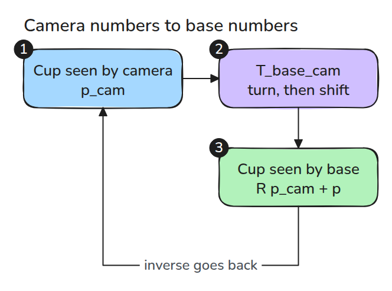
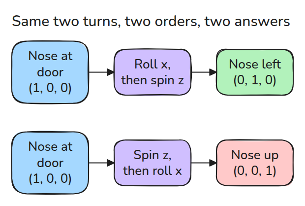
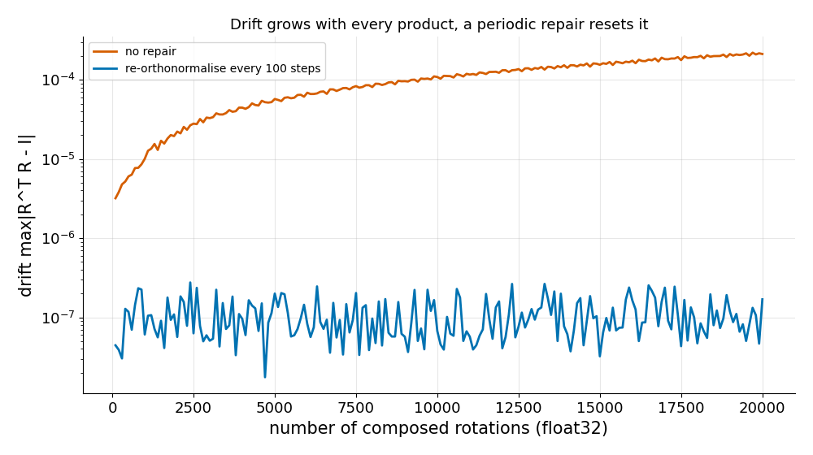

# 회전과 SE(3)

> 물체가 어디에 있고 어느 쪽을 보는지 나타내는 법과, 회전 두 개의 순서가 왜 중요한지 알게 됩니다.

**유형:** 만들기   **선수 지식:** 없음   **시간:** 약 15분

## 쉽게 말하면

드론의 코가 문을 향하게 들어 보세요. 코를 축으로 직각만큼 굴린 다음 수직선을 축으로 직각만큼 돌리면 코가 왼쪽을 향해요. 먼저 돌리고 굴리면 코가 천장으로 올라가요.

첫 번째 회전이 두 번째 회전이 걸리는 대상을 바꿔 놓아요. pose는 방향과 위치를 합친 것이고 pose를 순서대로 곱하면 둘을 함께 따라갈 수 있어요.

## 핵심 용어

- **Rotation matrix**: 점을 늘이지 않고 돌리는 3x3 숫자 표입니다.
- **Pose**: 물체의 방향과 위치를 합친 것입니다.
- **Transform (`T`)**: 회전과 이동을 한 표에 담은 4x4 행렬입니다.
- **Frame**: 카메라나 팔의 base 같은 대상에 붙은 x, y, z축입니다.
- **Inverse**: 다른 transform을 되돌리는 transform입니다.
- **Drift**: 반올림된 숫자를 여러 번 곱하면서 쌓이는 느린 오차입니다.

## 문제

마스트에 달린 카메라가 컵이 자기 frame의 (0.2, 0, 0.5)에 있다고 봅니다. 옆에 있는 팔에는 같은 컵이 base frame 좌표로 필요합니다.

transform을 잘못된 순서로 곱하면 팔은 존재하지 않는 점으로 손을 뻗고 결과는 그럴듯한 pose여서 아무 경고도 없습니다.

## 개념

로봇은 각 부품이 어디에 있고 어느 쪽을 보는지 알아야 하고 곱셈 하나가 틀리면 그것이 틀어집니다.

회전 행렬 `R`은 물체를 늘이거나 뒤집지 않고 돌립니다. 세 열이 서로 수직이고 길이가 1이며 determinant(거울상인지 확인하는 값)가 +1이기 때문입니다.

rigid transform `T`는 `R`과 위치 `p`를 4x4 행렬 하나에 쌓은 것이고 SE(3)의 pose입니다. `T`는 점을 `R`로 돌린 다음 `p`만큼 이동합니다. `A @ B`에서는 오른쪽 행렬이 먼저 작용합니다.



*`T_base_cam`은 카메라 좌표를 base 좌표로 옮기고 inverse는 되돌립니다.*

드론의 pose가 z축으로 직각 회전하고 `p = (1, 2, 0)`만큼 이동하는 것이라고 해 보겠습니다. 먼저 돌리고 이동하면 코에 찍은 점 (1, 0, 0)은 (1, 3, 0)에 놓입니다.

이동하고 돌리면 회전이 중심을 원점 둘레로 휘돌려 (-2, 1, 0)으로, 코의 점을 (-2, 2, 0)으로 보냅니다.


*초록 드론은 돌고 나서 회색 목표로 이동합니다. 파란 드론은 먼저 이동해서 회전이 원점 둘레로 휘돌립니다.*



*x축으로 굴린 뒤 z축으로 돌리거나 그 반대로 하면 코 (1, 0, 0)이 (0, 1, 0) 또는 (0, 0, 1)로 갑니다.*

inverse는 `[R^T, -R^T p]`입니다. `R^T`는 `R`의 행과 열을 맞바꾼 것이고 회전을 되돌립니다. 일반 inverse와 달리 drift가 있으면 `T^-1 T`가 항등 행렬에서 벗어나서 눈에 보입니다.



*float32로 작은 회전을 20,000번 곱하면 drift가 계속 커집니다. 100번마다 `R`을 되돌려 놓으면(`reorthonormalize`) 반올림 수준에 머뭅니다.*

## 만들기

```python
def is_rotation(R, tol=1e-9):
    return np.allclose(R.T @ R, np.eye(3), atol=tol) and np.isclose(np.linalg.det(R), 1.0, atol=tol)

def invert_T(T):
    R, p = T[:3, :3], T[:3, 3]
    return make_T(R.T, -R.T @ p)

def reorthonormalize(R):
    U, _, Vt = np.linalg.svd(R)
    return U @ np.diag([1, 1, np.linalg.det(U @ Vt)]) @ Vt
```

도우미 `rot_x`, `rot_y`, `rot_z`, `make_T`는 `code/main.py`에 있습니다.

```bash
cd robotics-engineering-from-scratch
python3 -m pytest phases/01-math-foundations/01-rotations-and-se3 -q
```

## 실제 도구로 보기

`scipy.spatial.transform.Rotation`이 전부 해 줍니다. 마지막 테스트가 이것을 `rot_z(0.8)`과 비교합니다.

출처: Craig, *Introduction to Robotics*, 3판, 2장(공간 기술과 변환).

## 결과물

`outputs/skill-transform-sanity.md`는 이런 pose 버그가 하드웨어에 닿기 전에 잡는 체크리스트입니다.

## 연습 문제

1. `rot_x(a)`와 `rot_z(b)`를 두 순서로 합성하고 팁 위치의 차이를 출력하세요.
2. float64에서 몇 단계 뒤에 `is_rotation`이 실패하는지 찾으세요.
3. transform 리스트를 곱하는 `compose(Ts)`를 쓰세요.
