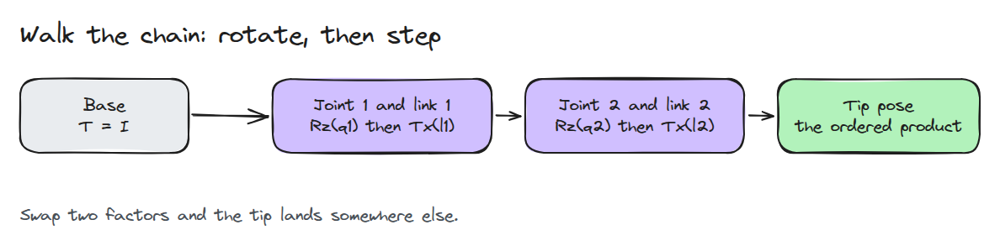
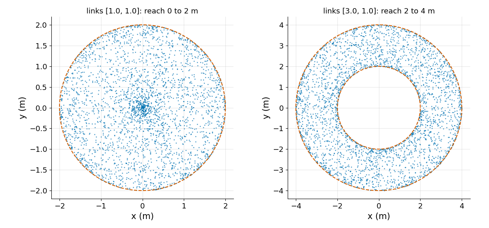

# Forward Kinematics

> Learn how to turn a robot arm's joint angles into the position of its hand.

**Type:** Build   **Prerequisites:** 01/01 Rotations and SE(3)   **Time:** ~15 minutes

## In Plain Words

A desk arm has motors at the shoulder and the elbow. Forward kinematics follows the turns from base to hand. Each link points in a direction set by all the joint angles before it. Step along each link that way, add the steps, and you know where the tip lands.

## Key Terms

- **Link**: the rigid bar between two joints.
- **Joint angle (`q`)**: how far a joint is turned from the position where its angle is 0.
- **Forward kinematics (FK)**: finding where the tip is from the joint angles.
- **Tip pose**: where the end of the arm is and which way it points.
- **Workspace**: every place the tip can reach.
- **Cartesian space**: ordinary x, y, z positions, as opposed to joint angles.

## The Problem

You tell a robot arm to put its hand at one spot, but its motors only know joint angles. Your code must work out where the hand ends up for a given set of angles.

## The Concept

To reach anything, a robot first has to know where its own hand is. Start at the base, turn by each joint's angle and step along each link.



*Turn, step, turn, step.*


*Shoulder up, then elbow forward. The red ball is where the tip lands if the shoulder's turn is left out.*

The hand is farthest from the base when the arm is straight, and closest when it folds back on itself.


*If one link is longer than all the others together, the hand can never come back to the base.*



*Dots are places the hand can reach. The left arm covers a full disc, the right arm leaves a hole in the middle.*

<details><summary>The math (optional)</summary>

The example target is the gripper at (0.5, 0.3). Each joint adds a turn `Rz(q)` and each link a slide `Tx(l)`; the tip pose is their ordered product. Links 1 and 0.5 long, shoulder a right angle up, elbow a right angle back: the tip is at (0.5, 1), and forgetting the shoulder's turn gives (0, 0.5). The closest reach is exactly `max(0, 2*longest - sum)`. The plot uses 3,000 random poses per arm: links [1, 1] cover a disc, links [3, 1] never come closer than 2 m. A test checks both routines agree to 1e-12.

</details>

## Build It

One function adds up the angles of all links; the other multiplies a turn and a shift for each link. A test checks that both agree on random poses.

```python
def fk_planar(lengths, angles):
    heading = np.cumsum(angles)
    return np.sum(lengths*np.cos(heading)), np.sum(lengths*np.sin(heading)), heading[-1]

def fk_chain(angles, lengths):
    T = np.eye(4)
    for q, l in zip(angles, lengths):
        T = T @ _rz(q) @ _tx(l)
    return T
```

```bash
cd robotics-engineering-from-scratch
python3 -m pytest phases/01-math-foundations/02-forward-kinematics -q
```

## Use It

Real arms describe their links in URDF files, or in tables covered in Phase 02.

Sources: Craig, *Introduction to Robotics*, 3rd ed., ch. 3.

## Ship It

`outputs/skill-fk-check.md` cross-checks any FK code against a second implementation.

## Exercises

1. Change a link length and see where the hand goes.
2. Fold the elbow all the way back and find the closest the hand gets.
3. Try links [1, 1] and find a pose where the hand returns to the base.
