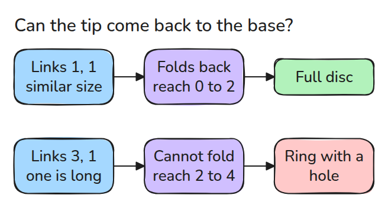

# Forward Kinematics

> Learn how to turn a robot arm's joint angles into the position of its hand.

**Type:** Build   **Prerequisites:** 01/01 Rotations and SE(3)   **Time:** ~15 minutes

## In Plain Words

A desk arm has a motor at the shoulder and another at the elbow. The shoulder swings the whole arm; the elbow swings only the forearm and hand.

Forward kinematics follows the turns from base to hand. Each link points in a direction that adds up every joint angle before it. Step along each link by its length, add the steps, and you know where the tip lands.

## Key Terms

- **Forward kinematics (FK)**: finding where the tip is from the joint angles.
- **Link**: the rigid bar between two joints.
- **Joint angle (`q`)**: how far a joint is turned from its zero position.
- **Tip pose**: the position and orientation of the end of the arm.
- **Workspace**: every place the tip can reach.
- **Cartesian space**: ordinary x, y, z positions, as opposed to joint angles.

## The Problem

You want the gripper at (0.5, 0.3), but the motors only know joint angles. Inverse kinematics (angles for a wanted tip) and Jacobians (tip speed from joint speed) build on it, so an FK bug looks like a controller bug.

## The Concept

To reach anything, a robot first has to know where its own hand is.

Each joint contributes `Rz(q)`, a turn about the joint, and each link contributes `Tx(l)`, a slide along itself. The tip pose is their ordered product.


*Turn, step, turn, step, from base to tip.*

Take links 1 and 0.5 long: turn the shoulder a right angle up, then the elbow a right angle back. Link 1 ends at (0, 1), link 2 adds (0.5, 0), so the tip lands at (0.5, 1). Forgetting the shoulder's turn gives (0, 0.5).


*Shoulder up, then elbow forward. The red ball forgets the shoulder's turn.*

The tip is farthest from the base when the arm is straight and closest when it folds back, exactly `max(0, 2*longest - sum)`.



*A link longer than all the others together leaves a hole in the workspace.*


*3,000 random poses per arm. Left: links [1, 1] cover a full disc. Right: links [3, 1] never come closer than 2 m.*

## Build It

```python
def fk_planar(lengths, angles):
    heading = np.cumsum(angles)
    return np.sum(lengths*np.cos(heading)), np.sum(lengths*np.sin(heading)), heading[-1]

def fk_chain(angles, lengths):
    T = np.eye(4)
    for q, l in zip(angles, lengths):
        T = T @ _rz(q) @ _tx(l)
    return T
```

A test requires both to agree to 1e-12 on random poses.

```bash
cd robotics-engineering-from-scratch
python3 -m pytest phases/01-math-foundations/02-forward-kinematics -q
```

## Use It

Real arms use Denavit-Hartenberg parameters (a standard link table) or URDF joint origins. Check which frame each `<origin>` is in.

Sources: Craig, *Introduction to Robotics*, 3rd ed., ch. 3 (manipulator kinematics).

## Ship It

`outputs/skill-fk-check.md` cross-checks any FK code against a second implementation.

## Exercises

1. Make joint 2 rotate about `y` and see why the planar test fails.
2. Plot minimum reach against link-length ratio.
3. Find a pose of links [1, 1] where the tip returns to the base.
