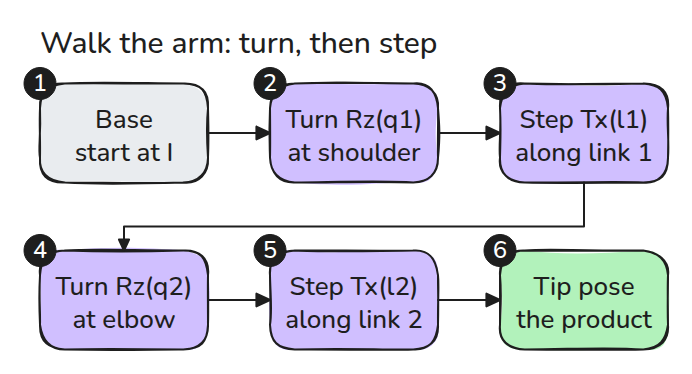
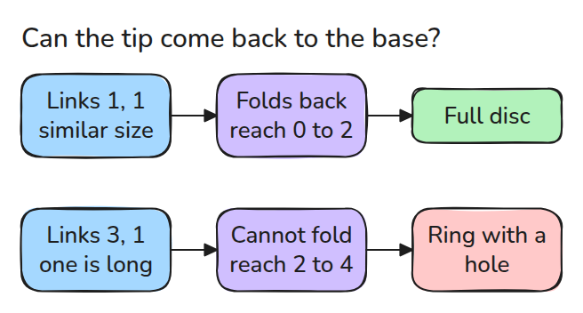
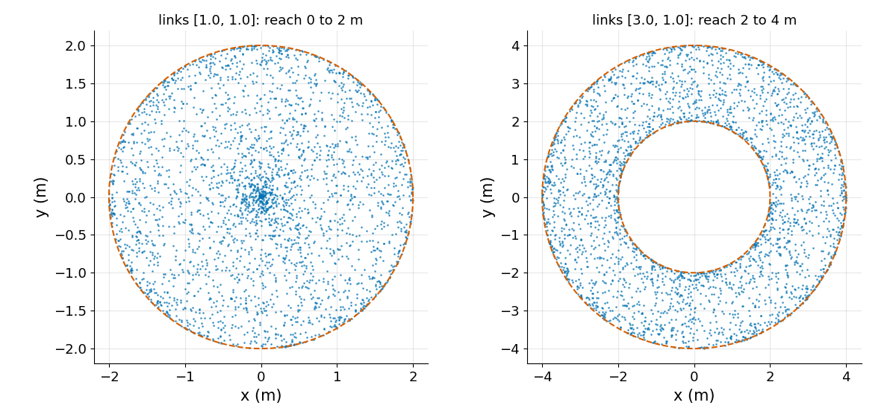

# Forward Kinematics

> Walk the chain: rotate about the joint, step along the link, repeat.

**Type:** Build   **Prerequisites:** 01/01 Rotations and SE(3)   **Time:** ~15 minutes

## In Plain Words

A small desk arm has a motor at the shoulder and another at the elbow. Turn the shoulder and the whole arm swings. Turn the elbow and only the forearm and hand swing around it.

Forward kinematics follows the turns from base to hand. The bar between two joints is a link, and it points in a direction that adds up every joint angle before it. Step along that direction by the link's length, add up all the steps, and you know where the tip lands.

## The Problem

The controller knows joint angles, but the task lives in Cartesian space (x, y positions): put the gripper (the hand) at (0.5, 0.3). Forward kinematics (FK) maps joint angles to the tip pose. Inverse kinematics (finding angles for a wanted tip), Jacobians (how tip speed follows joint speed) and collision checks all sit on top of it, so an FK bug looks like a controller bug.

## The Concept

Each joint contributes `Rz(q)`, a turn about the joint by its angle, and each link contributes `Tx(l)`, a slide along itself by its length. The tip pose is their ordered product.



*Follow the numbers from the base to the tip: turn, step, turn, step.*

Take links 1 and 0.5 long: turn the shoulder a right angle up, then the elbow a right angle the other way. Link 1 ends at (0, 1), link 2 points forward again and adds (0.5, 0), so the tip lands at (0.5, 1). Forget that the shoulder also turned the forearm and you would put the tip at (0, 0.5).


*Watch the amber ball: the shoulder swings the whole arm up, then the elbow folds the forearm forward. The red ball forgets the shoulder's turn.*

A cross-check for a flat chain: running totals of the joint angles give each link's direction, and the link steps add up to the same tip. The tip is farthest from the base when the arm is straight (the sum of the lengths). It is closest when the arm folds back on itself: only the other links can cancel the longest one, so the closest is exactly `max(0, 2*longest - sum)`.



*Compare the rows. If the longest link is longer than all the others together, the workspace (every place the tip can reach) has a hole in the middle.*



*Check the prediction: 3,000 random poses per arm. Left: links [1, 1] cover a full disc. Right: links [3, 1] never come closer than 2 m.*

## Build It

```python
def fk_planar(lengths, angles):
    heading = np.cumsum(angles)
    return np.sum(lengths*np.cos(heading)), np.sum(lengths*np.sin(heading)), heading[-1]

def fk_chain(angles, lengths):
    T = np.eye(4)
    for q, l in zip(angles, lengths):
        T = T @ _rz(q) @ _tx(l)
    return T
```

A test runs both on random poses and requires agreement to 1e-12.

```bash
cd robotics-engineering-from-scratch
python3 -m pytest phases/01-math-foundations/02-forward-kinematics -q
```

## Use It

Real arms use Denavit-Hartenberg parameters (a standard link table) or URDF joint origins (offsets in the robot file), and not every axis is `z`. The structure is the same: one fixed transform and one joint transform per link. Before trusting any FK, check which frame each URDF `<origin>` is expressed in.

Sources: Craig, *Introduction to Robotics*, 3rd ed., ch. 3 (manipulator kinematics).

## Ship It

`outputs/skill-fk-check.md` is a two-implementation cross-check for any FK code.

## Exercises

1. Make joint 2 rotate about `y` and see why the planar test now fails.
2. Plot minimum reach against the length ratio of a two-link arm.
3. Find a pose of links [1, 1] where the tip returns to the base.
