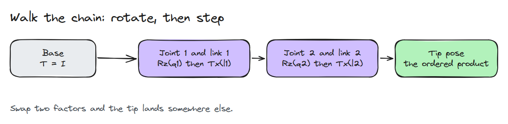
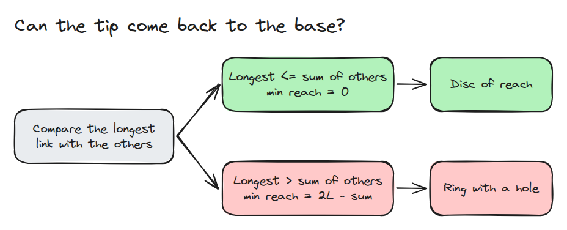
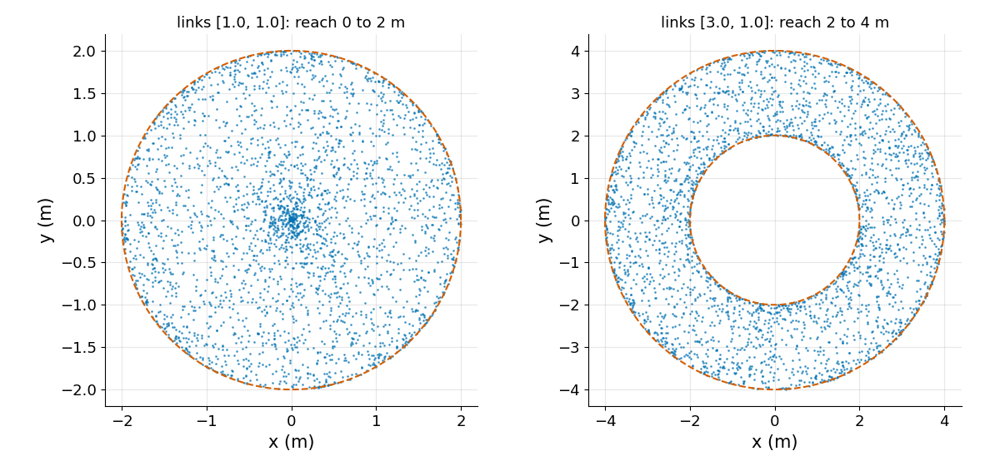

# 순기구학 (Forward Kinematics)

> 사슬을 따라 걷습니다. 관절에서 회전하고 link를 따라 한 걸음 나아가고 이를 반복합니다.

**유형:** 만들기   **선수 지식:** 01/01 회전과 SE(3)   **시간:** 약 15분

## 문제

제어기는 관절각을 알지만 과제는 Cartesian 공간에 있습니다. gripper를 (0.5, 0.3)에 놓아야 합니다. 순기구학(FK)은 관절각을 팁 pose로 옮깁니다. 역기구학과 Jacobian과 충돌 검사가 모두 FK 위에 서 있어서 FK 버그가 제어기 버그처럼 보입니다.

## 개념



*관절마다 `Rz(q)` 하나가, link마다 `Tx(l)` 하나가 곱에 들어갑니다. 팁 pose는 이들의 순서 있는 곱입니다.*

평면 사슬은 누적 각도만으로 같은 답이 나오므로 독립적인 교차 검증이 됩니다. base에서 팁까지의 거리는 길이의 합 이하이고 `max(0, 2*longest - sum)` 이상입니다.



*가장 긴 link가 나머지를 모두 합친 것보다 길면 작업 공간 가운데에 구멍이 생깁니다.*



*팔마다 무작위 자세 3,000개입니다. 왼쪽 link [1, 1]은 원판 전체를 덮습니다. 오른쪽 link [3, 1]은 2 m보다 가까이 오지 못합니다.*

## 만들기

```python
def fk_planar(lengths, angles):
    heading = np.cumsum(angles)
    return np.sum(lengths*np.cos(heading)), np.sum(lengths*np.sin(heading)), heading[-1]

def fk_chain(angles, lengths):
    T = np.eye(4)
    for q, l in zip(angles, lengths):
        T = T @ _rz(q) @ _tx(l)
    return T
```

테스트 하나가 두 구현을 무작위 자세에서 돌려 1e-12 이내로 일치하는지 확인합니다.

```bash
cd robotics-engineering-from-scratch
python3 -m pytest phases/01-math-foundations/02-forward-kinematics -q
```

## 실제 도구로 보기

실제 팔은 Denavit-Hartenberg 매개변수나 URDF joint origin을 쓰고 축이 모두 `z`는 아닙니다.
구조는 같습니다. link마다 고정 transform 하나와 관절 transform 하나가 붙습니다. FK를 믿기 전에 URDF `<origin>`을 읽고 각각이 어느 frame 기준인지 물어보세요.

출처: Craig, *Introduction to Robotics*, 3판, 3장(매니퓰레이터 기구학).

## 결과물

`outputs/skill-fk-check.md`는 모든 FK 코드에 쓸 수 있는 두 구현 교차 검증입니다.

## 연습 문제

1. 관절 2를 `y`축 회전으로 바꾸고 평면 테스트가 왜 실패하는지 확인하세요.
2. 두 link 팔의 길이 비에 대해 최소 reach를 그려 보세요.
3. link [1, 1]에서 팁이 base로 돌아오는 자세를 찾으세요.
