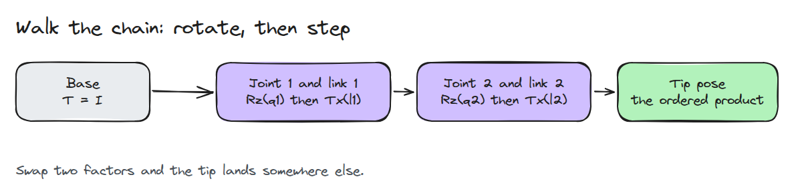
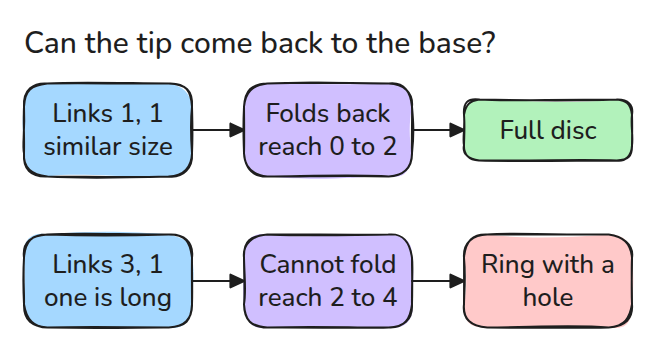
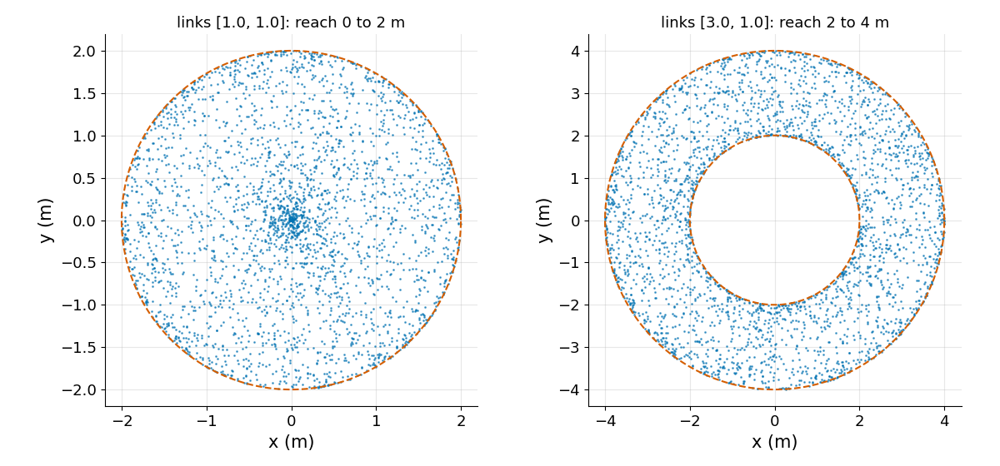

# 순기구학 (Forward Kinematics)

> 로봇 팔의 joint 각도를 손의 위치로 바꾸는 법을 알게 됩니다.

**유형:** 만들기   **선수 지식:** 01/01 회전과 SE(3)   **시간:** 약 15분

## 쉽게 말하면

작은 책상용 로봇 팔에는 어깨에 모터가 하나, 팔꿈치에 모터가 하나 있어요.

forward kinematics는 이 회전을 base에서 손까지 따라가요. 각 link는 앞쪽 관절 각도를 모두 합친 방향을 향해요. link마다 그 방향으로 한 걸음씩 나아가 걸음을 모두 더하면 손끝이 어디에 닿는지 알 수 있어요.

## 핵심 용어

- **Link**: 두 관절 사이의 단단한 막대입니다.
- **Joint angle (`q`)**: 관절이 각도가 0인 위치에서 얼마나 돌았는지입니다.
- **Forward kinematics (FK)**: 관절 각도로부터 손끝이 어디에 있는지 구하는 계산입니다.
- **Tip pose**: 팔 끝이 어디에 있고 어느 쪽을 향하는지입니다.
- **Workspace**: 손끝이 닿을 수 있는 모든 곳입니다.
- **Cartesian space**: 관절 각도가 아니라 보통의 x, y, z 위치로 나타내는 공간입니다.

## 문제

로봇 팔에게 손을 한 곳에 놓으라고 말해도 모터는 관절 각도만 압니다. 그래서 코드가 주어진 각도에서 손이 어디에 놓이는지 계산해야 합니다.

## 개념

무엇이든 잡으려면 로봇은 먼저 자기 손이 어디에 있는지 알아야 합니다. base에서 시작해 관절마다 그 각도만큼 돌고 link를 따라 한 걸음씩 나아갑니다.



*돌고 한 걸음, 돌고 한 걸음입니다.*


*어깨를 위로 올리고 이어서 팔꿈치를 앞으로 굽힙니다. 빨간 공은 어깨의 회전을 빠뜨렸을 때 팁이 닿는 곳입니다.*

손은 팔을 곧게 폈을 때 base에서 가장 멀고 접었을 때 가장 가깝습니다.



*한 link가 나머지를 모두 합친 것보다 길면 손은 base로 돌아올 수 없습니다.*



*점은 손이 닿을 수 있는 곳입니다. 왼쪽 팔은 원판 전체를 덮고 오른쪽 팔은 가운데에 구멍이 생깁니다.*

<details><summary>The math (optional)</summary>

예제 목표는 (0.5, 0.3)에 놓은 gripper입니다. 관절은 회전 `Rz(q)`를, link는 이동 `Tx(l)`을 하나씩 보태고 팁 pose는 이것들을 순서대로 곱한 것입니다.
길이가 1과 0.5인 link에서 어깨를 직각만큼 위로, 팔꿈치를 직각만큼 뒤로 돌리면 팁은 (0.5, 1)에 놓입니다. 어깨의 회전을 잊으면 (0, 0.5)가 나옵니다. 가장 가까운 거리는 정확히 `max(0, 2*longest - sum)`입니다.
그림은 팔마다 무작위 자세 3,000개를 썼습니다. link [1, 1]은 원판을 덮고 link [3, 1]은 2 m보다 가까이 오지 못합니다. 테스트는 두 계산이 1e-12 이내로 일치하는지 확인합니다.

</details>

## 만들기

함수 하나는 모든 link의 각도를 더하고 다른 하나는 link마다 회전과 이동을 곱합니다. 테스트가 무작위 자세에서 둘이 일치하는지 확인합니다.

```python
def fk_planar(lengths, angles):
    heading = np.cumsum(angles)
    return np.sum(lengths*np.cos(heading)), np.sum(lengths*np.sin(heading)), heading[-1]

def fk_chain(angles, lengths):
    T = np.eye(4)
    for q, l in zip(angles, lengths):
        T = T @ _rz(q) @ _tx(l)
    return T
```

```bash
cd robotics-engineering-from-scratch
python3 -m pytest phases/01-math-foundations/02-forward-kinematics -q
```

## 실제 도구로 보기

실제 팔은 URDF 파일이나 Phase 02에서 다루는 표로 link를 설명합니다.

출처: Craig, *Introduction to Robotics*, 3판, 3장.

## 결과물

`outputs/skill-fk-check.md`는 어떤 FK 코드든 두 번째 구현과 대조해 검증합니다.

## 연습 문제

1. link 길이를 바꾸고 손이 어디로 가는지 보세요.
2. 팔꿈치를 끝까지 접어서 손이 가장 가까워지는 거리를 찾으세요.
3. link [1, 1]에서 손이 base로 돌아오는 자세를 찾으세요.
