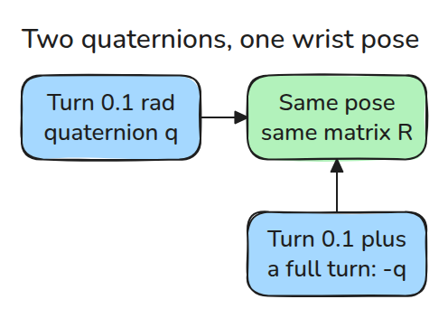
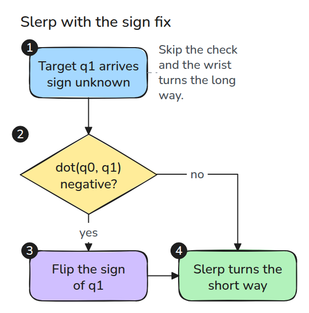
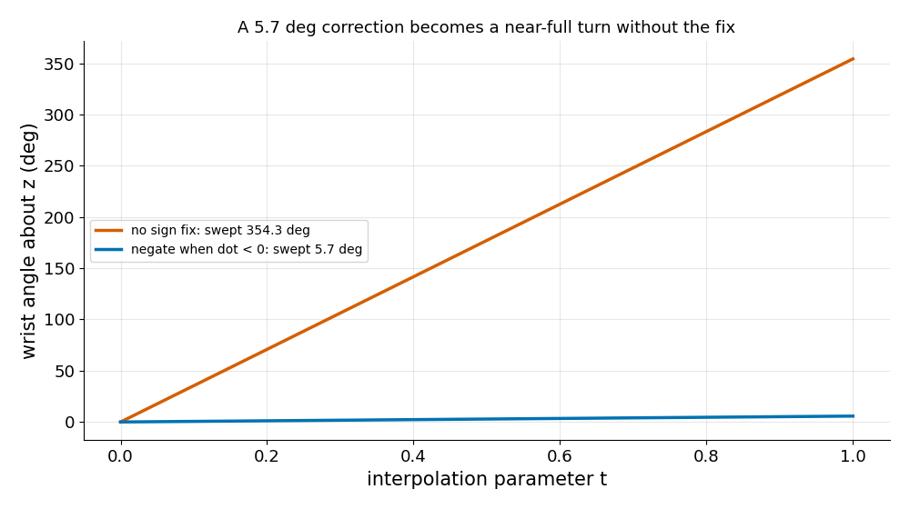

# Axis-Angle and Quaternions

> Every rotation has two quaternions, and an interpolator that ignores this can spin a wrist a full turn.

**Type:** Build   **Prerequisites:** 01/01 Rotations and SE(3)   **Time:** ~15 minutes

## In Plain Words

A robot wrist is told to turn a tiny bit left. The same direction is also reachable by turning almost a full circle right, so the destination alone does not choose the route.

A quaternion names an orientation, but q and its opposite, -q, name the same one. They sit on opposite sides of a sphere of orientations, so the short way to one is the long way to the other. Slerp, a smooth turn between two orientations, flips the sign when needed to keep the turn short.

## The Problem

A wrist was told to correct a 0.1 rad error and instead spun almost a full turn the long way round. The target quaternion had arrived with the opposite sign, which names the same orientation. The interpolator, the code that moves smoothly between two orientations, trusted the sign and took the far side.

## The Concept

A unit axis `k` (the line to turn about) and an angle `t` give a rotation matrix by Rodrigues' formula, `R = I + sin(t) K + (1 - cos(t)) K^2`, where `I` is the do-nothing matrix and `K` turns a vector `v` into `k x v`. A unit quaternion packs the same turn into four numbers, `(cos(t/2), sin(t/2) k)`.

A turn of 0.1 about z gives `q = (0.9988, 0, 0, 0.0500)`. Add one full turn, `t = 0.1 + 2pi`, and the wrist ends where it was. The half angle `t/2` grows by `pi`, which flips the sign of both `cos` and `sin`, so the quaternion is `-q = (-0.9988, 0, 0, -0.0500)`. So every rotation has two quaternions (it is covered twice).


*Watch the dials. Blue turns 0.1, green turns 0.1 + 2pi, and both grippers end in the same pose. A needle shows the quaternion's half angle: 0.05 for blue, pi + 0.05 for green, the opposite side.*



*A unit quaternion is a point on a sphere in four dimensions. Two opposite points map to one 3x3 rotation matrix.*

The dot product (multiply matching entries and add up) scores how alike two quaternions are. From `q0 = (1, 0, 0, 0)` to `-q` it is -0.9988: negative, so the target is on the far side and slerp must flip it.



*Follow the numbers. If `dot(q0, q1)` is negative, negate `q1` before interpolating. The rotation is unchanged and the short arc is taken.*



*Compare the lines. Same start, same target. Without the fix the wrist sweeps 354.3 degrees (360 minus 5.7), with it 5.7 (0.1 rad).*

## Build It

```python
def rodrigues(axis, angle):
    k = _unit(axis)
    K = np.array([[0, -k[2], k[1]], [k[2], 0, -k[0]], [-k[1], k[0], 0]])
    return np.eye(3) + np.sin(angle) * K + (1 - np.cos(angle)) * K @ K

def slerp(q0, q1, t, fix=True):
    d = float(q0 @ q1)
    if fix and d < 0:
        q1, d = -q1, -d
    om = np.arccos(min(d, 1.0))
    return (np.sin((1 - t) * om) * q0 + np.sin(t * om) * q1) / np.sin(om)
```

The full file adds `quat_mul`, `quat_to_R` and `R_to_quat`.

```bash
cd robotics-engineering-from-scratch
python3 -m pytest phases/01-math-foundations/03-axis-angle-and-quaternions -q
```

## Use It

SciPy's `Rotation.from_quat` and `Slerp` do this. SciPy stores quaternions scalar-last, `(x, y, z, w)` with the plain number `w` at the end, and the last test checks that against this lesson's scalar-first `(w, x, y, z)`. Always confirm the order when you cross a library boundary.

Sources: Craig, *Introduction to Robotics*, 3rd ed., ch. 2 (Euler parameters; section number not verified).

## Ship It

`outputs/skill-quaternion-sign-check.md` reviews any code that interpolates or compares orientations.

## Exercises

1. Show that `quat_mul(q, q_inv)` is the identity, with `q_inv = (w, -x, -y, -z)`.
2. For a start of 0 rad about z, find the target angle where `dot` crosses zero.
3. Compare the angle `2*arccos(|dot|)` with the path angle, with and without the fix.
