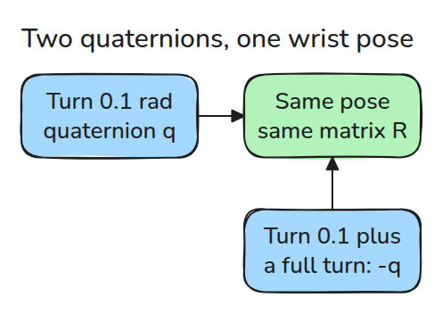
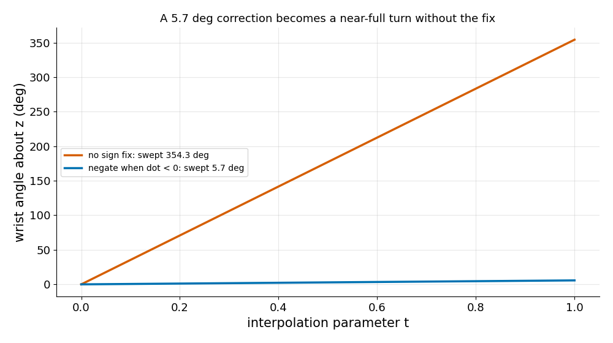

# Axis-Angle and Quaternions

> Learn why a robot wrist can spin a whole turn the long way round, and the one-line check that stops it.

**Type:** Build   **Prerequisites:** 01/01 Rotations and SE(3)   **Time:** ~15 minutes

## In Plain Words

A robot wrist is told to turn a tiny bit left. Turning almost a full circle right reaches the same direction, so the destination does not choose the route.

A quaternion names an orientation, but q and its opposite, -q, name the same one. Slerp, a smooth turn between two orientations, flips the sign when needed to keep the turn short.

## Key Terms

- **Quaternion**: four numbers that name an orientation; a unit quaternion has length one.
- **Axis-angle**: a rotation given as a line to turn about plus an angle.
- **Slerp**: a smooth, even-speed turn between two orientations.
- **Interpolator**: code that moves smoothly between a start value and a target value.
- **Dot product**: multiply matching entries of two lists and add them up; it scores how alike two quaternions are.
- **Radian (rad)**: an angle unit where one full turn is about 6.28.

## The Problem

A robot wrist told to correct a 0.1 rad error spun almost a full turn the long way round. The target quaternion arrived with the opposite sign, naming the same orientation, and the interpolator trusted it.

## The Concept

A sign slip in a smooth turn makes the wrist take the long way.

A unit axis `k` and an angle `t` give a rotation matrix by Rodrigues' formula, `R = I + sin(t) K + (1 - cos(t)) K^2`, where `K` turns a vector `v` into `k x v`. A unit quaternion packs the same turn into four numbers, `(cos(t/2), sin(t/2) k)`.

A turn of 0.1 about z gives `q = (0.9988, 0, 0, 0.0500)`. Adding a full turn, `t = 0.1 + 2pi`, leaves the wrist where it was but flips both signs: `-q = (-0.9988, 0, 0, -0.0500)`.


*Blue turns 0.1, green 0.1 + 2pi; both end in the same pose. Needles show half angles 0.05 and pi + 0.05.*



*Opposite points on a four-dimensional sphere give one rotation matrix.*

The dot product of `q0 = (1, 0, 0, 0)` and `-q` is -0.9988: negative, the far side, so slerp flips it.


*If `dot(q0, q1)` is negative, negate `q1` first: same rotation, short arc.*



*Same start and target. Without the fix the wrist sweeps 354.3 degrees, with it 5.7 (0.1 rad).*

## Build It

```python
def rodrigues(axis, angle):
    k = _unit(axis)
    K = np.array([[0, -k[2], k[1]], [k[2], 0, -k[0]], [-k[1], k[0], 0]])
    return np.eye(3) + np.sin(angle) * K + (1 - np.cos(angle)) * K @ K

def slerp(q0, q1, t, fix=True):
    d = float(q0 @ q1)
    if fix and d < 0:
        q1, d = -q1, -d
    om = np.arccos(min(d, 1.0))
    return (np.sin((1 - t) * om) * q0 + np.sin(t * om) * q1) / np.sin(om)
```

More helpers are in `code/main.py`.

```bash
cd robotics-engineering-from-scratch
python3 -m pytest phases/01-math-foundations/03-axis-angle-and-quaternions -q
```

## Use It

SciPy's `Rotation.from_quat` and `Slerp` do this. SciPy stores quaternions scalar-last, `(x, y, z, w)`; the last test checks that against this lesson's `(w, x, y, z)`.

Sources: Craig, *Introduction to Robotics*, 3rd ed., ch. 2 (Euler parameters; section number not verified).

## Ship It

`outputs/skill-quaternion-sign-check.md` reviews code that interpolates orientations.

## Exercises

1. Show `quat_mul(q, q_inv)` is the identity, with `q_inv = (w, -x, -y, -z)`.
2. Find where `dot` crosses zero from a start of 0 rad.
3. Compare `2*arccos(|dot|)` with the path angle.
